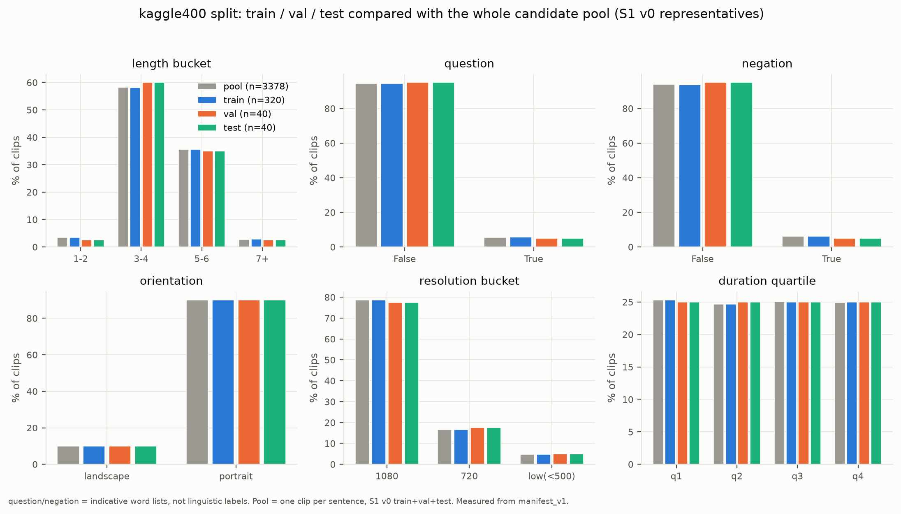

# SPLIT_REPORT — kaggle400 (400 videos for the Kaggle experiment)

Generated by `python kaggle/src/k400_run.py select` (`kaggle/src/k400/select.py`) on
2026-10-23. Everything below is **measured** from `manifest_v1` and `S1_v0`
unless marked otherwise. Results on this subset are **small-scale and signer-dependent**.

## 1. Inputs
| Input | SHA-256 |
|---|---|
| `work/manifests/manifest_v1.csv` | `2ff133cf6bb2ec33f544133cd424594465b531a83ab8554cd498d099a0588d82` |
| `work/splits/S1_v0.csv` | `40481a5faedc962a0ad92d5f7ec515c36aa34a46bf6d6127db77d81009c76cc0` |
| selection seed | `20261023` |

Both input hashes were checked before selecting: they equal the values pinned in
`configs/data/kaggle400.yaml`, which are the values recorded in the files' `.meta.json` (2026-10-22).

## 2. Which split is used for what
| Split | Used for | Never used for |
|---|---|---|
| **TRAIN** | the model learns from it: fitting weights, building vocabularies, feature standardisation (mean/sd), the sources of baselines B0 and B1 | — |
| **VAL** | development: early stopping, choosing epochs / learning rate / ablations, error analysis | fitting weights |
| **TEST** | locked. Used **once**, at the very end, after the final configuration is frozen (`evaluate --final`) | any decision: no tuning, no model choice, no threshold choice |

Enforced in code: training commands read only train and val rows (`bdsl.data.kaggle400`: reading test
raises `TestSplitLocked`); `python -m bdsl.cli evaluate --final` reads test, needs a frozen configuration,
writes `outputs/FINAL_TEST_LOCK.json` and refuses a second run unless the owner gives a written reason.

## 3. Real counts
| | train | val | test | total |
|---|---:|---:|---:|---:|
| clips | 320 | 40 | 40 | 400 |
| leakage groups (S1 v0) | 318 | 40 | 40 | 398 |
| minimal-pair held-out clips | — | 10 | 10 | |
| train siblings / vocabulary-support clips | 20 / 14 | — | — | |
| clips also in pilot50_v1 | 4 | 0 | 0 | |

Candidate pool: 3378 clips (one representative clip per normalised sentence; S1 v0
train 2702 / val 357 / test 319).
Longest selected clip: 1147 (22.1 s ≈ 332 frames at 15 fps).
Total size of the 400 source videos: 5.94 GB (from `manifest_v1`).

## 4. How the clips were chosen
1. **Pool**: representative clips only (no exact copies), decodable, no label conflict, assigned to
   train/val/test in S1 v0; one clip per normalised sentence. **Every clip keeps its S1 v0 partition**
   (a train clip of S1 can only be train here, etc.), so group-disjointness is inherited from S1 v0.
2. **Colour cluster** 3456/3457/3458 (one recording edited onto three endings): one unit, all three in
   train (their S1 partition). Val/test sentences of the same minimal-pair family are excluded
   (they may share that footage): 0 such sentence(s) exist in the pool.
3. **Minimal pairs** (10 val + 10 test): a held-out
   sentence that differs by exactly one word from a train sentence; the train sibling is added to
   train, plus a "vocabulary support" train clip when a held-out word was still unseen. One held-out
   clip per family. These items measure an **unseen combination of seen words**.
4. **Stratified fill**: val and test, then train, are filled greedily so that each split's shares of
   length_bucket, question, negation, orientation, resolution_bucket, duration_quartile stay as close as possible to the pool's shares (ties broken by a seeded hash).
5. Every chosen clip has a written `reason` in the manifests. Re-running the selection gives the same
   400 clips (the PowerShell script checks this on the desktop).

## 5. Distribution per split (count and share; last column = share in the pool)
| length_bucket | train | val | test | pool share |
|---|---:|---:|---:|---:|
| 1-2 | 11 (3.4%) | 1 (2.5%) | 1 (2.5%) | 3.5% |
| 3-4 | 186 (58.1%) | 24 (60.0%) | 24 (60.0%) | 58.2% |
| 5-6 | 114 (35.6%) | 14 (35.0%) | 14 (35.0%) | 35.6% |
| 7+ | 9 (2.8%) | 1 (2.5%) | 1 (2.5%) | 2.8% |

| question | train | val | test | pool share |
|---|---:|---:|---:|---:|
| False | 302 (94.4%) | 38 (95.0%) | 38 (95.0%) | 94.5% |
| True | 18 (5.6%) | 2 (5.0%) | 2 (5.0%) | 5.5% |

| negation | train | val | test | pool share |
|---|---:|---:|---:|---:|
| False | 300 (93.8%) | 38 (95.0%) | 38 (95.0%) | 93.9% |
| True | 20 (6.2%) | 2 (5.0%) | 2 (5.0%) | 6.1% |

| orientation | train | val | test | pool share |
|---|---:|---:|---:|---:|
| landscape | 32 (10.0%) | 4 (10.0%) | 4 (10.0%) | 9.9% |
| portrait | 288 (90.0%) | 36 (90.0%) | 36 (90.0%) | 90.1% |

| resolution_bucket | train | val | test | pool share |
|---|---:|---:|---:|---:|
| 1080 | 252 (78.8%) | 31 (77.5%) | 31 (77.5%) | 78.6% |
| 720 | 53 (16.6%) | 7 (17.5%) | 7 (17.5%) | 16.5% |
| low(<500) | 15 (4.7%) | 2 (5.0%) | 2 (5.0%) | 4.8% |

| duration_quartile | train | val | test | pool share |
|---|---:|---:|---:|---:|
| q1 | 81 (25.3%) | 10 (25.0%) | 10 (25.0%) | 25.3% |
| q2 | 79 (24.7%) | 10 (25.0%) | 10 (25.0%) | 24.7% |
| q3 | 80 (25.0%) | 10 (25.0%) | 10 (25.0%) | 25.1% |
| q4 | 80 (25.0%) | 10 (25.0%) | 10 (25.0%) | 24.9% |



## 6. Out-of-vocabulary rate of val and test against the TRAIN vocabulary
Train vocabulary: **416** word types (normalised Bangla words of the 320 train sentences).

| split | word tokens | OOV tokens | OOV token rate | word types | OOV types | sentences with ≥ 1 OOV word | sentences with all words seen |
|---|---:|---:|---:|---:|---:|---:|---:|
| val | 169 | 35 | **20.7%** | 111 | 35 | 22 / 40 | 18 / 40 |
| test | 173 | 21 | **12.1%** | 99 | 21 | 16 / 40 | 24 / 40 |

Minimal pairs on the final selection:

| split | designated minimal-pair clips | clips with a one-word-different sibling in train | designated clips with all words seen in train |
|---|---:|---:|---:|
| val | 10 | 21 | 10 |
| test | 10 | 21 | 10 |

## 7. Leakage tests (at selection time, without videos)
```
PASS  1 manifests agree                              400 rows in subset_manifest; 400 in the 3 split manifests
PASS  2 counts                                       train 320, val 40, test 40 (total 400)
PASS  3 no group crosses splits                      398 groups; crossing: []
PASS  4 no SHA-256 crosses splits                    crossing: []; duplicated in subset: 0
PASS  5 no normalised sentence crosses splits        crossing: []; duplicated in subset: 0
PASS  6 no known shared-segment link crosses splits  3456/3457/3458 → ['train']
PASS  7 S1 partition kept (no clip moved)            checked against S1_v0.csv; moved: []
SKIP  8 files match their manifest rows              videos not present here
SKIP  9 no file in two folders                       videos not present here
SKIP  10 SPLIT_LOCK.json matches the manifests       lock not written yet (written by the copy step)
RESULT: PASS (7 passed, 0 failed, 3 skipped)
```
Checks 8–10 need the copied videos and the lock; they run on the desktop after copying (section 9).

## 8. Known limits (read before using any number)
1. **Small-scale, signer-dependent.** 40 val and 40 test clips; the number of signers is unknown
   (owner estimate 4–6, unverified, ADR-0018) and which signer recorded which clip is unknown, so the
   same signers appear in train, val and test. Results do not show generalisation to new signers.
2. **Split S1 v0 is provisional.** Groups join clips with the same normalised sentence, the same
   SHA-256, or a *known* shared-segment link. Only one link is known (colour cluster 3456/3457/3458).
   The full shared-segment scan (open question G2) has not been run, so different sentences that reuse
   the same recorded footage could still sit in different splits. These leakage tests cannot detect that.
3. **Minimal-pair siblings are the most likely place for shared footage.** A val/test minimal-pair clip
   and its train sibling were often recorded as a template; if footage was edited and reused (as in the
   colour cluster), motion error on those items may be optimistic. Report the minimal-pair subset
   separately (error analysis stratum `minimal_pair_sibling_in_train`).
4. **Indicative tags.** "question" and "negation" come from small word lists (`src/bdsl/text/tags.py`),
   not from linguistic annotation; the sheet contains no `?`.
5. **Vocabulary.** The train vocabulary is small (see the OOV table); words never seen in train become
   `<unk>` for every model, so OOV items are expected to be harder.
6. **Glosses are G0 pseudo-glosses** (auto_draft, rule-based, no human review): not BdSL annotation.
7. **Hand-side labels** are MediaPipe's as given; whether some recordings are mirrored is unknown (G8).

## 9. Copy verification and full leakage test
(Appended by the copy step on the desktop.)

### Desktop run, 2026-10-23T06:35:16+00:00 (DESKTOP-4NDR99B)
- Copies: 400/400 byte-identical (SHA-256 of source = copy = manifest_v1); copied in this run: 0; already present from an earlier run (re-hashed now): 400; source files unchanged (size + modification time): 400/400.
- Total size of the copies: 5.94 GB.
- SPLIT_LOCK.json written; videos digest `ec1f61a231048286d07aad42eeff83827cdc88513633dddf5642de00db0d385c`.

```
PASS  1 manifests agree                              400 rows in subset_manifest; 400 in the 3 split manifests
PASS  2 counts                                       train 320, val 40, test 40 (total 400)
PASS  3 no group crosses splits                      398 groups; crossing: []
PASS  4 no SHA-256 crosses splits                    crossing: []; duplicated in subset: 0
PASS  5 no normalised sentence crosses splits        crossing: []; duplicated in subset: 0
PASS  6 no known shared-segment link crosses splits  3456/3457/3458 → ['train']
PASS  7 S1 partition kept (no clip moved)            checked against S1_v0.csv; moved: []
PASS  8 files match their manifest rows              400 files, names and SHA-256 equal
PASS  9 no file in two folders                       in two folders: []
PASS  10 SPLIT_LOCK.json matches the manifests       4 manifests match their locked hashes
RESULT: PASS (10 passed, 0 failed, 0 skipped)
```
