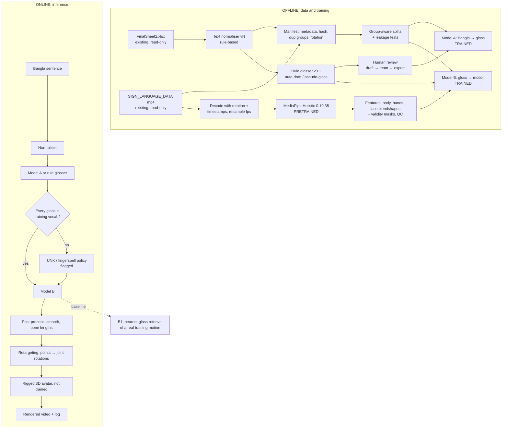

# Stage 1 — Audit and Research Design Plan (2026-10-21)

> **Status: PROPOSAL — not a confirmed project decision.** Written by the AI in Session 2 after a
> read-only audit. Nothing here is an ADR until the owner confirms it (`agent_docs/decisions.md`).
> Measured numbers are logged in `agent_docs/test_log.md` (2026-10-21). Labels used: **verified**
> (measured this session), **reported** (old logs, not re-measured), **proposed**, **future**.
> The blocking questions are F1–F6 in `agent_docs/open_questions.md`.

---

## A. Executive summary

- **Objective (owner requirement, ADR-0007):** Bangla sentence → BdSL sentence-level output on a 3D
  avatar, via Bangla → gloss → motion → avatar. Not recognition, not sign→text, not retrieval as the
  final system.
- **State:** this repo holds docs, the literature review, the label sheets and the full 5,010-video set
  (gitignored). No code, features, glosses or models. A separate earlier project
  (`D:\CSE498R\Sign_Language\CSE498R_v2\`, sign→voice recognition, remote
  `RRM006/sign-language-to-voice`) has reusable analysis scripts, MediaPipe model files, a `src/` package
  and the duplicate CSVs. Its derived-features folder (`D:\CSE498R\derived`) does not exist, so **no
  landmark features exist anywhere.**
- **Blockers:** (1) no gloss labels and no BdSL-competent validator on record; (2) 98.4% of unique
  sentences have exactly one video; (3) signer identity unknown; (4) hands missing in many frames
  (reported: both hands visible in 24–29% of frames); (5) uploading videos or face landmarks needs owner
  permission (CLAUDE.md rule 7 / E4).
- **Proposed direction:** two trainable models. **Model A** (Bangla → gloss) is trained on a small
  human-reviewed gloss set. **Model B** (gloss → MediaPipe-derived motion) is trained on complete
  sentence videos, using **rule-generated pseudo-glosses** on the full set, clearly labelled. Both are
  compared with retrieval and mean baselines on leakage-safe splits. The avatar is a deterministic
  display layer (retargeting); nothing in it is trained. The 50-video pilot proves the pipeline runs; it
  cannot prove generalisation.

## B. Audit summary

The full audit table (29 items: claim, evidence, status, impact, next action) was presented in the
Session 2 chat. Its measured facts are in `agent_docs/test_log.md` (2026-10-21). Key contradictions:

| Claim in docs/logs | Evidence | Status |
|---|---|---|
| "Only the 50-clip sample is in this repo" (CLAUDE.md, ADR-0009, `dataset/README.md`) | 5,010 MP4 in `dataset/initial_dataset/SIGN_LANGUAGE_DATA/`, gitignored | Contradicted |
| Reorganisation "staged but not committed"; leftover branch/worktree | Clean `main` = `origin/main` (`c2d541d`); only `main`; no `.claude/` | Contradicted (stale) |
| "All videos VFR" (SESSION_LOG) / "0 badly VFR" (old ADR-0108) | 80 clips: 55 constant, 20 near-constant, 5 irregular (gaps ≤ 333 ms) | Both contradicted |
| Old scripts at `D:\CSE498R\Sign_Language\Sign_Language` | Path absent; found under `D:\CSE498R\Sign_Language\CSE498R_v2\` | Located elsewhere |
| ~5–7 signers | Visual estimate only; no signer field anywhere | Unverified |
| 2 exact-duplicate label mismatches | 3 groups (3850/3851/5019/5020; 3882/3883/5017/5018; 1515/1569), all punctuation-only | Corrected |

## C. Proposed architecture



- **Pretrained (used, not trained):** MediaPipe Holistic; optionally BanglaT5.
- **Trained by us:** Model A, Model B (and an optional text–motion matcher, for evaluation only).
- **Rule-based / deterministic:** normaliser, glosser, splits, decoding, feature normalisation,
  smoothing, retargeting.
- **External tool:** the avatar renderer.

## D. C1–C5 recommendations (proposed)

- **C1 representation / avatar.**
  - Representation: MediaPipe-derived skeletal features (upper body + both hands + a face-blendshape
    subset, with validity masks) as Model B's target.
  - Prototype: a skeleton viewer first, then a VRM avatar in the browser (three-vrm + a
    MediaPipe-to-rig solver such as Kalidokit; 2022-era library, test before relying on it).
  - Fallback: Blender + MPFB2 rig with a Python retargeting script.
  - HamNoSys/SiGML/JASigning only as an optional outside comparison: our videos cannot produce notation.
  - Landmarks on an avatar are not automatically natural or correct BdSL.
- **C2 text → gloss.**
  - Baseline: the rule glosser v0.1.
  - Trainable: word-level BiGRU encoder + attention GRU decoder.
  - Pretrained comparison: BanglaT5, once about 300+ reviewed pairs exist.
  - Bangla-SGP (1,000 pairs, release unconfirmed): auxiliary data or convention reference only.
  - No model learns BdSL grammar from sentence–video pairs alone.
- **C3 lexicon.**
  - A gloss lexicon table built from our data: ID, Bangla lemma(s), English label, POS, counts, example
    Index list, status.
  - It is the vocabulary of Models A and B, not per-sign motion clips. Per-sign motion assets do not exist
    and are not claimed.
  - Future options: minimal-pair segment mining; public word-level sets (licence unverified); SiGML as an
    outside comparison.
- **C4 words with no sign.**
  - Prototype: a marked `UNK(word)` (neutral pose + caption + log).
  - Final: `FS(...)` or `NUM(...)` for names and numbers only if assets exist and a reviewer agrees, plus
    a lexicon-expansion queue.
  - Fingerspelling is not assumed appropriate for every word.
- **C5 evaluation.**
  - Model A: gloss error rate (Levenshtein), sacreBLEU, chrF, exact match, targeted negation/question checks.
  - Model B: masked DTW-MJE per part, MPJPE after time normalisation, duration error, velocity/jerk, hand
    motion energy ratio, bone-length variance. A retrieval proxy needs the full dataset.
  - Avatar: round-trip error, FPS, latency.
  - Human: forced choice among minimal pairs, 1–4 rating, acceptability, Krippendorff's α (needs
    BdSL-competent raters).
  - Low coordinate error is not linguistic correctness. With 5–10 pilot test items: per-item results, no
    significance claims.

## E. Training strategy (proposed)

| | Model A: Bangla → gloss | Model B: gloss → motion |
|---|---|---|
| Input → target | Normalised word tokens → gloss tokens + `[neg]`/`[q-wh]`/`[q-yn]` tags | Full-sentence gloss sequence → full-video features at 15 fps (configurable), ~185 dims/frame + masks + length |
| Architecture | BiGRU encoder + Bahdanau attention + GRU decoder; BanglaT5 comparison | BiGRU encoder + length regressor + autoregressive attention GRU decoder with progress counter and input noise; non-autoregressive fallback |
| Loss | Cross-entropy, label smoothing 0.1 | Masked L1 positions + λ·masked velocity + log-length (+ bone length) |
| Baselines | Rule glosser; copy-input | B0 mean motion; B1 nearest gloss sequence → real motion; B-text (raw Bangla conditioning) |
| Tune | hidden 128/256, dropout, lr, beam | hidden, layers, noise σ, λ, lr, fps, max length |
| With 50 videos | Pipeline / overfit test only | Overfit test only |
| Claim needs | Beat rule baseline on held-out reviewed pairs, 3 seeds + CIs | Beat B0/B1 on unseen-combination split, 3 seeds, hand-energy ratio ≈ 1; still "closer to real motion", not "correct BdSL" |

- Pseudo-glosses for the full set are a deterministic function of the text, and are labelled as such.
- No word-level alignment is fabricated; every video is treated as one complete sentence.

**Proposed research question:** "On a templated, phone-recorded BdSL sentence dataset, does a
gloss-conditioned sequence model generate held-out sentence motion closer to real signing than retrieval
and mean baselines, and does an explicit gloss step outperform raw-text conditioning, under duplicate-
and sentence-disjoint splits?"

## F. 50-video pilot (proposed)

**Selection pool:** the 3,456 deduplicated videos, excluding the 3 punctuation-mismatch groups and the
colour cluster (3456/3457/3458/5096/5100/5102).

- **30 composition core:** about 6 template families × 5 minimal-pair sentences.
- **20 diversity set:** questions 4, negation 4, numbers/time 3, long ≥ 7 words 3, 1–2 words 2, other 4.
- **Quotas:** ≥ 7 landscape; ≥ 3 low-res; duration quartiles; index blocks (a session proxy, not
  signers); hand-coverage tertiles from a MediaPipe pre-pass on about 150 candidates.
- **About 20% deliberately hard clips.** The bias of picking only clean clips is stated in the report.

**Folder:** `dataset/pilot50_v1/`.

- `videos/` — copies, gitignored.
- `pilot50_manifest.csv` — source and copy SHA-256, metadata, stratum, split, selection reason.
- `pilot50_annotations.csv` — raw and normalised sentence, `gloss_auto_v01`, `gloss_reviewed`,
  `nms_tags`, `tense_note`, status, annotator, reviewer, date, confidence, notes.
- `README.md`, `SELECTION_PROTOCOL.md`, `GLOSS_CONVENTION_v0.1.md`.

The originals stay untouched.

**Gloss convention v0.1 (provisional):**

- **Three different things:** Bangla word order (the text), gloss notation (labels for signs, not a
  language), and BdSL grammar (space, non-manuals, simultaneity — mostly lost in glosses).
- **Evidence:** a 2026 FASAL proceedings paper (Reed) reports default SOV order, three negation particles
  (NOT, NOT.BE, NOT.HAVE) and an optional headshake (seen only as a search summary; the team should read
  it). Bangla-SGP reports future tense as root + "will be" and fingerspelled names.
- **Tokens:** Bangla citation-form lemma (NFC), each mapped to a lexicon ID with an English caps label.
- **Particles:** drop case suffixes; keep possessive pronouns as tokens pending review.
- **Verbs and tense:** verb lemma; tense recorded in `tense_note`, not as an invented token.
- **Word order:** keep Bangla SOV. Candidate reorderings (time-initial, wh-final) are recorded but not
  applied until a reviewer confirms them.
- **Negation:** না/নয়/নেই → `NOT`/`NOT.BE`/`NOT.HAVE` candidates + `[neg]`.
- **Questions:** keep the wh-word + `[q-wh]`/`[q-yn]`.
- **Names, numbers, unknown words:** `FS(name)`, `NUM(n)`, `UNK(word)`.
- **No timestamps.** Statuses: auto-draft → team-reviewed (checked against the video) →
  expert-validated (BdSL-competent person only).

**Pilot split:** 40 train / 5 validation / 5 test, disjoint by sentence and duplicate group. Five test
items support no statistical claim.

## G. Code architecture (proposed)

A reusable package `src/bdsl/` (config, env, data, text, features, models, train, eval, avatar), with
thin notebooks:

`00_env_check` · `01_manifest` · `02_extract` · `03_gloss` · `04_train_text2gloss` ·
`05_train_gloss2motion` · `06_evaluate_export` · `07_avatar_demo`.

- **Config layering:** `configs/base.yaml` + `configs/env/{local,kaggle,colab}.yaml` +
  `configs/data/{pilot50,full}.yaml` + `configs/model/*.yaml`.
- **Paths:** relative to `DATA_ROOT`/`WORK_DIR`; no absolute paths in code; no reliance on notebook
  execution order.
- **Reuse from CSE498R_v2:** presence-mask idea, MediaPipe API gotchas (fresh landmarker per video,
  `min_hand_landmarks_confidence`). **Don't reuse** its fixed-frame-count sampling: it suits recognition,
  not motion generation.

## H. Compute (proposed; amends ADR-0004/0009 if accepted)

- **Local desktop CPU** (verified: Ryzen 5 3500X, 24 GB RAM): manifest, all MediaPipe extraction, pilot
  training, avatar rendering.
- **RX 570:** off the critical path. torch-directml is a 2024 pre-release with Python ≤ 3.12 wheels only;
  optional benchmark.
- **Kaggle:** full-set training on uploaded **features only**, if the owner approves. Verify quota and
  session limits in the account.
- **Colab:** fallback.
- **Environment:** a pinned `uv` venv on Python 3.12; mediapipe pinned at 0.10.35 (1.1.1 released
  2026-10-14; do not upgrade mid-project).

## I. Five-day plan (proposed)

| Day | Objective | Acceptance |
|---|---|---|
| 1 | Env + config + manifest (headers only) + pilot selection + copies | env check 0 fail; manifest 5,010; 50/50 copies hash-identical; sources unchanged; quota report |
| 2 | Gloss convention v0.1 + rule glosser + team review; pilot extraction + QC | 50/50 annotated with status; 50/50 extracted or failures logged; kill-and-resume works |
| 3 | Group-aware pilot split + Model A (rule + GRU), local then Kaggle | leakage tests pass; curves/metrics saved; resume works |
| 4 | Model B + B0/B1 + metric code | masked-loss unit test; overfit 1 then 40; table vs B0/B1; hand energy |
| 5 | Retarget real motion → avatar (3 clips), then model output; end-to-end demo | sentence → video with versioned log; limitations written; fallback = labelled skeleton viewer |

## J. Timeline after the prototype (if Day 1 = 2026-10-22)

- **Week 2:** full SHA-256 manifest; splits S1 (sentence/duplicate-grouped), S2 (unseen combination),
  S3 (index-block stress test — a session proxy, not signers); full local extraction; 300–500
  team-reviewed glosses; BdSL reviewer outreach; targeted literature search.
- **Week 3:** Model A (rule vs GRU vs BanglaT5); Model B with pseudo-glosses; B-text, face and mask
  ablations; 3 seeds.
- **Week 4:** a single final test run; human evaluation if raters exist; report.
- **Buffer:** to 2026-11-20.
- **Report:** every result is labelled measured, planned or hypothetical.

## K. Checkpoints and recovery (proposed)

```
WORK_DIR/ (gitignored)
  manifests/   annotations/   features/<feature_ver>/<Index>.npz (+ qc.parquet, failures.csv)
  vocab/       runs/<model>/<run_id>/{config.yaml, checkpoints/{last,best,epoch_XXX}.pt, metrics.csv, eval/}
  exports/     avatar/        reports/
```

- `feature_ver` is a hash of the extraction config, the mediapipe version and the SHA-256 of the
  `.task` model file.
- Every write is atomic (`.tmp` then rename).
- Extraction skips files whose `.npz` exists with a matching version.
- Training resumes from `last.pt` (model, optimizer, scheduler, RNG, epoch, step, config, vocab hash, git
  commit).
- `best.pt` is replaced only when validation improves and only after a successful save; keep the last 3
  epoch checkpoints.
- Splits and vocabularies are frozen by hash; a run refuses to start if a hash differs.
- Nothing large goes into git.

## L. Proposed ADRs (only after owner confirms)

- ADR-0014: pipeline architecture.
- ADR-0015: gloss convention v0.1 (provisional).
- ADR-0016: compute — local extraction + Kaggle training (amends ADR-0004/0009).
- ADR-0017: data-location correction (amends ADR-0009 text).
- ADR-0018: split strategy.

## M. Blocking decisions

See `agent_docs/open_questions.md` F1–F6:

- F1 approve the direction;
- F2 a gloss reviewer;
- F3 data copy/upload permissions + repo visibility;
- F4 signer metadata;
- F5 avatar route;
- F6 Kaggle as the training platform.

## N. Next implementation prompt (after approval)

```
go — Implement Day 1, Step 1 ONLY: environment check + configuration system.
Decisions: [answers to F1–F6].
Scope: create a pinned project environment (ask me before installing anything), configs/base.yaml +
configs/env/{local,kaggle,colab}.yaml + configs/data/{pilot50,full}.yaml, src/bdsl/config.py (path
resolution, no absolute paths in code), src/bdsl/env.py and notebooks/00_env_check.ipynb that writes
work/reports/env_report.json (versions, mediapipe 0.10.35 + HolisticLandmarker present, OpenCV rotation
test on 2 sample clips, torch device, write-permission test, CPU micro-benchmark). Add work/ and
dataset/pilot50_v1/videos/ to .gitignore. Do NOT touch dataset files, build the manifest, or select
videos yet. State inputs/outputs/acceptance tests first, run them, report actual results, then stop.
```

## Sources (web, checked 2026-10-21)

- Bangla-SGP: <https://arxiv.org/abs/2511.08507>, <https://arxiv.org/html/2511.08507v1>
- mBART Bangla text-to-gloss: <https://arxiv.org/html/2504.02293v1>
- MediaPipe Holistic Landmarker: <https://developers.google.com/edge/mediapipe/solutions/vision/holistic_landmarker>
- mediapipe on PyPI: <https://pypi.org/project/mediapipe/>
- torch-directml on PyPI: <https://pypi.org/project/torch-directml/>
- BdSL structure (FASAL 2026): <https://www.reed.edu/linguistics/khan/assets/FASALproc2026.pdf>
- Kaggle limits (secondary source): <https://gpuperhour.com/blog/free-cloud-gpus-and-credits>
- three-vrm: <https://github.com/pixiv/three-vrm/>
- VRM 1.0: <https://vrm.dev/vrm1/>
- VRoid CC0 samples: <https://opengameart.org/content/vroid-studio-cc0-models>
- MPFB 2: <https://www.cgchannel.com/2025/03/check-out-open-source-blender-character-generation-plugin-mpfb-2>
- Other citations as listed in `02_BdSL_Text-to-Sign_Research_and_Build_Guide.md`
