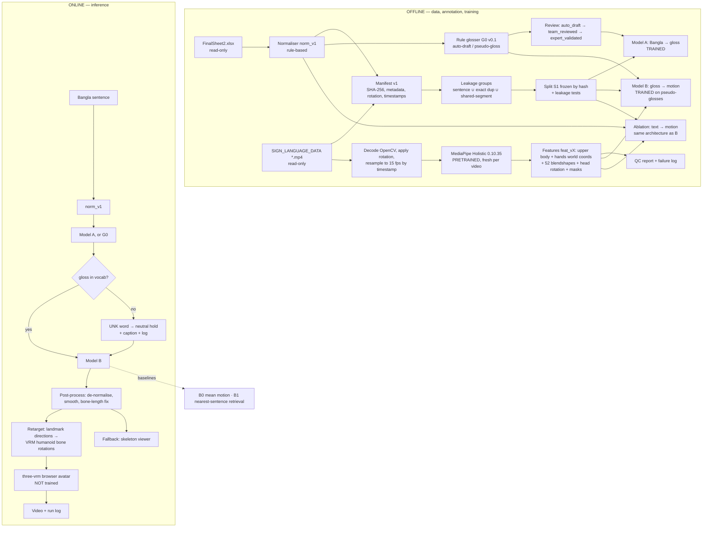

# Phase 1 — Research Design and Decision Review (2026-10-22)

> **Status: technical design APPROVED IN PRINCIPLE by the owner on 2026-10-22.** Written by the AI in
> Session 3. The binding record is `agent_docs/decisions.md` (ADR-0014–0021): each item there keeps
> its own status ("Accepted" = owner-confirmed; "Accepted in principle" = working choice that may be
> revised from evidence, only with the owner's OK). Anything below marked [P] that is not in an ADR is
> still a recommendation. Open items are in `agent_docs/open_questions.md` §G.
>
> **Labels:** **[V]** Verified (measured or inspected in this session, 2026-10-22) · **[R]** Previously
> reported (older logs, not re-measured) · **[O]** Owner-confirmed · **[P]** Proposed · **[U]** Unknown ·
> **[F]** Future work.
>
> Builds on `research/design_proposals/03_Stage1_Audit_and_Design_Plan_2026-10-21.md` (plan 03). Where this
> document differs from plan 03, it says so.

**What this session inspected (all read-only):**
- The docs: `CLAUDE.md`, all of `agent_docs/`, plan 03, both dataset READMEs and `DATASET_WORK_LOG.md`.
- Git: status, remote, `.gitignore`, the tracked files, and the GitHub visibility (unauthenticated API).
- `SIGN_LANGUAGE_DATA/`: a file listing and byte totals.
- `FinalSheet2.xlsx`: sentence and token statistics.
- The colour cluster: SHA-256 hashes and a frame-by-frame comparison of the six clips.
- The 50 sample clips: header metadata (rotation, size, fps).
- The earlier project `D:\CSE498R\Sign_Language\CSE498R_v2\`: file listing, model files, notes in its
  extraction code and old stats.
- Web: PyPI, npm, the MediaPipe docs, the Kalidokit README, VRoid CC0 models, the BanglaT5 Hub entry
  and Kaggle (secondary sources).

Temporary scripts and outputs stayed in the session scratchpad. No PDF in `research/papers/` was read.

---

## A. Verified current project state

| # | Finding | Label |
|---|---|---|
| A1 | Git: branch `main` = `origin/main` at `1809048`, working tree clean. 87 tracked files. | [V] |
| A2 | The GitHub repo `RRM006/sign_avatar_cse498r` is public: the unauthenticated GitHub API returns `"visibility": "public"`. `origin/main` contains the 50 committed sample videos (`dataset/initial_dataset/videos/`) and `FinalSheet2.xlsx`. **Owner, 2026-10-22: public on purpose; the owner has permission to make the dataset publicly available.** The repo has no LICENSE file, so the terms for reuse by others are not stated. | [V] / [O] |
| A3 | `.gitignore` has exactly one rule: `dataset/initial_dataset/SIGN_LANGUAGE_DATA/`. `git check-ignore` confirms it covers the full set. | [V] |
| A4 | `SIGN_LANGUAGE_DATA/` has 5,012 entries: 5,010 `.mp4` + `SESSION_LOG.md` + **a copy of `FinalSheet2.xlsx`**. The copy is byte-identical to `initial_dataset/FinalSheet2.xlsx` (SHA-256 prefix `15348b36e11ea8f0` on both). `initial_dataset/README.md` does not mention this copy. | [V] |
| A5 | Full set size: 71.2 GB including those two extra files. The `.mp4` total of 71,206,505,652 B is from the 2026-10-21 log. | [V] / [R] |
| A6 | `new_project_intake/` does not exist. `misc/pdf/` exists, is empty and is untracked. | [V] |
| A7 | No code, configs, notebooks, tests, features, gloss annotations, models or avatar assets exist in this repo. | [V] |
| A8 | Python: system Python 3.14.4 and a uv-managed CPython 3.14.3. **No Python 3.12 is installed.** `uv` is installed at `~/.local/bin/uv`. There is no ffmpeg/ffprobe and no torch. | [V] |
| A9 | System-Python packages: mediapipe 0.10.35, opencv-python **and** opencv-contrib-python 5.0.0.93 (two OpenCV packages in one environment can conflict), numpy 2.4.6, pandas 3.0.3, openpyxl 3.1.5, PyAV 17.1.0, PyYAML 6.0.3, scipy 1.17.1, ImageHash 4.3.2. | [V] |
| A10 | mediapipe 0.10.35 (released 2026-04-27) ships a `py3-none-win_amd64` wheel. Its classifiers list Python 3.9–3.12, so **Python 3.12 + mediapipe 0.10.35 looks viable on paper**. Not installed or tested on 3.12 yet. Latest is 1.1.1 (2026-10-14). | [V] (web) |
| A11 | MediaPipe Holistic Landmarker (official docs) outputs 33 pose landmarks (image + world coordinates), 21 landmarks per hand (image + world), 478 face landmarks and optionally 52 face blendshapes (`output_face_blendshapes`, default off). Python guide exists; modes are IMAGE, VIDEO and LIVE_STREAM. Model: `holistic_landmarker.task` (float16) from Google's model storage. | [V] (web) |
| A12 | The earlier project contains `holistic_landmarker.task` (13,683,609 B, two copies) plus hand, face and pose models. Its code notes say that **reusing one HolisticLandmarker across videos of different sizes crashed** (measured there 2026-09-04), so it built a fresh one per video. | [V] (files) / [R] (claim) |
| A13 | Earlier-project hand coverage on 49 videos / 9,792 frames: pose 100%, left hand 59.1%, right hand 35.5%, both hands 23.6%, any hand 71.0%. Extraction speed on 20 videos: 23.7 frames/s. | [R] |
| A14 | **Colour cluster (F7):** see §D-F7. It is 3 exact-duplicate pairs (3456=5096 "কালো", 3457=5100 "লাল", 3458=5102 "সাদা"). The three unique clips are **frame-identical or almost identical for the first ~70% and clearly different in the last ~25%.** | [V] |
| A15 | Sentence sheet, using this session's normaliser (`। . ? ! ,` → space, whitespace collapsed):<br>• 3,379 unique sentences. Plan 03 says 3,378 with a slightly different normaliser, so the normaliser must be fixed in code and versioned.<br>• 1,417 distinct tokens; 646 (46%) occur in only one sentence.<br>• 2,872 sentences (85%) contain only tokens that also occur in some other sentence.<br>• 2,588 sentences (77%) belong to "minimal-pair families" (same length, differ in exactly one word). There are 1,086 such families, the largest of size 31. | [V] |
| A16 | Sample clips: `0.mp4` has rotation flag 270°, `1.mp4` 180°, `2.mp4` 0°. Frame rates in the sample range from 23.1 to 30.2. | [V] |
| A17 | Dataset facts carried from 2026-10-21: 3,456 unique videos after exact dedup; 85.9% portrait; 5 of 80 clips have irregular timestamps; median duration 6.37 s, max 47.73 s; 9.89 h in total. | [R] (yesterday's measurement, not re-run) |
| A18 | three-vrm 3.5.5 (npm, 2026-07-09, MIT, peer `three >= 0.137`); three.js latest 0.186.1. | [V] (registry) |
| A19 | **Kalidokit: last npm release 1.1.5 on 2022-02-05; its README says it is "officially deprecated".** It is built around the legacy `@mediapipe/holistic` package. | [V] (web) |
| A20 | VRoid sample avatars released under CC0 exist (OpenGameArt mirror). They are **VRM 0.x**. Whether they have finger bones is not stated. | [V] (secondary) / [U] |
| A21 | `csebuetnlp/banglat5` exists on the Hugging Face Hub (T5, Bangla, arXiv:2205.11081). Licence not shown in the Hub summary. | [V] / [U] |
| A22 | Kaggle limits: official docs could not be read by the tool. Secondary sources say about 30 GPU-h/week, a 12 h session limit (one source says 9 h for GPU) and about 20 GB of disk. **Must be checked in your Kaggle account.** | [U] |
| A23 | torch 2.14.1 has cp312 wheels (PyPI). | [V] |

---

## B. Contradictions and blockers

| # | Issue | Evidence | Severity | Proposed handling |
|---|---|---|---|---|
| B-1 | CLAUDE.md rule 7 / constitution §2.8 ("videos stay inside the repo/team until origin, licence, consent are known") vs the owner's statement that the repo is public on purpose and the dataset may be made public. | A2 | Low (resolved by owner) | Re-word rule 7 via ADR-0017: public release is permitted; each *new* channel or use still needs the owner's OK. Formal reuse licence: open (G1). |
| B-2 | `current_task.md` says "go → Day 1 step 1". Your new instruction is first go = design review, implementation only after approval. | Docs vs owner | Low | Follow the owner's newer gating; update `current_task.md` (documentation change set, 2026-10-22). |
| B-3 | ADR-0004/0009 and CLAUDE.md say Colab is for training. You chose Kaggle primary, Colab fallback. | Docs vs owner | Medium | ADR-0016 amends. |
| B-4 | ADR-0009 and constitution §3 say "only the 50-clip sample is in this repo; full set on desktop/Drive". In fact the full set is inside the repo folder, gitignored. | A3, A4 | Low | ADR-0017 + the wording fixes in the documentation change set (2026-10-22) (F10). |
| B-5 | ADR-0005, CLAUDE.md:86, README.md:23 and session_protocol.md:56 still name `new_project_intake/` as the inbox. You say it is obsolete. | A6 | Low | ADR-0021 + wording fixes. |
| B-6 | ADR-0010 calls fingerspelling the recommended fallback, but **no fingerspelling assets exist**. | A7 | Medium | ADR-0014 refines C4 (UNK policy now; fingerspelling future). |
| B-7 | Python 3.12 is not installed; the system has 3.14. | A8 | Medium (Day 1) | Install 3.12 via `uv` into a project `.venv`, **only after you approve**. |
| B-8 | Kalidokit is deprecated and tied to the legacy MediaPipe API. | A19 | Medium (Day 5) | Do not depend on it; write our own small direction-based retargeter (§D-C1). |
| B-9 | Edited "shared-prefix" clips exist (colour cluster). Exact-hash dedup alone does not prevent leakage. | A14 | **High for evaluation** | Shared-segment detection before the split is frozen (§E). |
| B-10 | Hands are missing in many frames (right hand 35.5%). | A13 | **High for Model B** | Masks + hand-coverage QC + per-hand reporting. |
| B-11 | Kaggle quota and session numbers are unverified. | A22 | Medium | Record the real numbers from your account on first use. |
| B-12 | `initial_dataset/README.md` lists `SIGN_LANGUAGE_DATA/` as "SESSION_LOG.md plus 5,010 MP4". There is also a `FinalSheet2.xlsx` copy. | A4 | Low | One-line README fix (documentation change set, 2026-10-22). |
| B-13 | `initial_dataset/README.md` requires every inspection to be logged in `DATASET_WORK_LOG.md`. This session's read-only inspections are not logged yet, because you asked for no file changes. | — | Low | The entry is drafted in the documentation change set (2026-10-22). |
| B-14 | Unique-sentence count: 3,378 (plan 03) vs 3,379 (this session) because the normalisers differ. | A15 | Low | The manifest uses one versioned normaliser (`norm_v1`) and regenerates all counts. |

---

## C. Recommended end-to-end architecture [P]



The four layers are different, and the report must keep them apart:
1. **Extracting landmarks** = *measurement* of the real signer. MediaPipe can be wrong, especially for
   hands.
2. **Generating plausible motion** = *prediction* by Model B. It can be smooth and still wrong.
3. **Retargeting** = *geometry*: moving points onto an avatar's bones. It adds its own errors.
4. **Linguistically correct BdSL** = a *human judgement* by a BdSL-competent person. Low coordinate
   error does **not** establish it.

| Stage | Inputs | Outputs | Depends on | Acceptance |
|---|---|---|---|---|
| 0 Env + config | configs, sample clips | `work/reports/env_report.json` | — | All checks pass or failures documented |
| 1 Manifest | sheet, videos | `manifest_v1.parquet/csv` (5,010 rows) | 0 | 5,010 rows; ID set == sheet; sources unchanged (hash before/after on samples) |
| 2 Leakage groups + split | manifest | `groups_v1.csv`, `split_S1_v1.csv` + hash | 1 | Leakage tests pass (§E) |
| 3 Pilot select + copy | manifest, split | `dataset/pilot50_v1/` | 2 | 50/50 copies SHA-256 identical; selection reasons recorded |
| 4 Extraction + QC | videos, config | `features/<feat_ver>/<Index>.npz`, `qc.csv`, `failures.csv` | 0, 1 | Every clip extracted or logged; kill-and-resume test passes |
| 5 Gloss drafts + review | normalised text | `annotations/gloss_v01.csv` | 1 | Every row has a status; no row marked expert-validated without a real review record |
| 6 Model A | reviewed glosses, split | `runs/text2gloss/...` | 2, 5 | Overfit test passes; metrics saved; resume works |
| 7 Model B (+ ablation) | features, pseudo-glosses, split | `runs/gloss2motion/...` | 2, 4, 5 | Masked-loss unit test; overfit test; table vs B0/B1 |
| 8 Evaluate + export | runs | `eval/*.csv`, exported motion JSON | 6, 7 | Metrics regenerate from saved predictions |
| 9 Avatar | motion JSON, VRM model | rendered video + log | 8 | Round-trip error reported; fallback skeleton video always produced |

---

## D. Decision table, then detail per question

**Key:** "Answered" = you already decided; it only needs recording. "Approve" = AI recommendation
waiting for your yes. "Info" = more information is needed.

| ID | Topic | Your answer (this conversation) | Recommendation [P] | Needs |
|---|---|---|---|---|
| C1 | Motion representation + avatar | Browser VRM to investigate, Blender fallback | 3D world landmarks (upper body + hands) + 52 blendshapes + head rotation + masks at 15 fps; three-vrm + **own** retargeter (not Kalidokit); skeleton viewer always; Blender fallback | Approve |
| C2 | Bangla → gloss | Model A wanted; pseudo-glosses must be labelled | Normaliser → G0 rules → review layers; Model A = G0 baseline vs BiGRU-attention vs BanglaT5 (≥ 300 reviewed pairs) | Approve |
| C3 | Lexicon | Own dataset primary | Gloss vocabulary table from reviewed annotations; no per-sign clips claimed | Approve |
| C4 | Unknown words | Don't assume assets | `UNK(word)` hold + caption + log; FS/NUM tokens kept but rendered as UNK; fingerspelling = future | Approve |
| C5 | Evaluation | Separate metrics per stage; expert later | Metric set in §D-C5; pilot = pipeline tests only | Approve |
| B7 | Signer count | ~4–6 estimated, unverified, no identity work | Record "unknown, not pursued"; all claims signer-dependent | Answered (record) |
| B8 | Held-out split | Leakage-safe, no random video split | S1: group-disjoint (sentence ∪ exact dup ∪ shared segment), deterministic, test split by in-vocab vs OOV (§E) | Approve |
| E1 | Which machine has RX 570 | Desktop | — | Answered (record) |
| E2 | Inbox | Obsolete | Remove from CLAUDE.md, README, protocol; ADR-0005 note | Answered (approve wording) |
| E3 | Medical rows in 07 | Not needed | Delete the 2 table rows (lines 21, 80) | Answered (approve edit) |
| E4 | Video-sharing rule wording | Check rules before any upload | Keep the rule; add a derived-features clause | Approve |
| F1 | Direction | A + B, text→motion comparison, baselines | ADR-0014 | Answered (approve wording) |
| F2 | Gloss reviewer | BdSL-competent person later; provisional now | Three-status protocol; mock cases flagged; no fabricated reviews | Answered (record) |
| F3 | Copy / upload / visibility | (a) yes; (b) yes, features only, subject to checks; (c) public on purpose, dataset may be public | (a) yes; (b) yes, **without the raw 478-point face mesh**; (c) record it; per-use rule for new channels | Answered (b's minimisation: in principle); reuse licence open (G1) |
| F4 | Signer per Index range | Unknown; no gender/identity prediction | No signer split; claims "signer-dependent" | Answered (record) |
| F5 | Avatar route | three-vrm proposed, Blender fallback | Same, with own retargeter and CC0 VRM 0.x model | Approve |
| F6 | Kaggle | Primary; Colab fallback; local CPU extraction | ADR-0016 | Answered (approve wording) |
| F7 | Colour cluster | Recommend from evidence | Retain the 3 unique clips as an "edited minimal-pair" group, kept together in one split; drop the 3 exact copies; reviewer checks final signs | Approve |
| F8 | Earlier project | Use only what actually exists | Reference only: lessons learned, no code copied; download the official model fresh and compare hashes | Approve |
| F9 | Bangla-SGP | Not a required dependency | Close; at most a citation | Answered (record) |
| F10 | Data-location wording | Keep docs accurate | Smallest fix: ADR-0009 status note + constitution §3 line + init README line | Answered (approve wording) |
| F11 | `misc/pdf/` | Skip | Close, no action | Answered (record) |

### D-C1. Motion representation and avatar

- **Known:**
  - [O] MediaPipe Holistic is the interim extractor (ADR-0010).
  - [V] Its outputs are listed in A11.
  - [R] Hands are often missing (A13).
  - [V] three-vrm is current; Kalidokit is deprecated (A18, A19).
  - [V] CC0 VRM 0.x avatars exist (A20).
- **Unknown:**
  - [U] Whether the Python `HolisticLandmarkerResult` in 0.10.35 actually exposes *hand world landmarks*
    (the docs say yes). Checked on Day 1 by introspection.
  - [U] Whether left/right hand labels match the signer's real hands in these videos. Checked visually on
    Day 2.
  - [U] How good blendshapes are on the 350 low-res clips.
  - [U] Whether the CC0 avatar has finger bones.
- **Representation options:**

| Option | Pros | Cons |
|---|---|---|
| R1 2D image landmarks | Simple; most accurate in x, y | Depends on camera; no depth; landscape vs portrait mismatch |
| **R2 3D world landmarks, body-normalised [recommended]** | Camera-independent; avatar-ready; hand shape from hand world coordinates | MediaPipe depth is noisy (monocular) |
| R3 joint rotations (IK at extraction time) | Avatar-native | Solver errors baked into the training data; harder to debug |
| R4 SMPL-X body-model fitting | Best avatar fidelity | GPU-heavy, licence terms, too slow for one month |

- **Recommended feature vector per frame [P]** (exact sizes live in config; numbers are a starting point):
  - Upper body: pose world landmarks for nose, shoulders, elbows, wrists and hips (11 points × 3).
    Centred on the shoulder midpoint and scaled by shoulder width per clip.
  - Hands: 2 × 21 × 3 hand world landmarks (hand shape, wrist-relative). The global wrist position comes
    from the pose.
  - Face: 52 blendshapes plus head rotation (yaw, pitch, roll), computed from a few face landmarks at
    extraction time. **The raw 478-point face mesh is not stored in the training features**: privacy
    minimisation, and it is not needed for the avatar.
  - Masks: per-frame presence for pose, left hand, right hand and face; per-joint pose visibility; an
    "interpolated" flag.
  - Total ≈ 33 + 126 + 52 + 3 = 214 values + masks.
- **Avatar options:**

| Option | Effort | Risk | Note |
|---|---|---|---|
| Skeleton viewer (matplotlib/three.js lines) | Low | Low | Always produced; honest view of the model output |
| **three-vrm 3.5.5 + own direction-based retargeter + CC0 VRM [recommended]** | Medium | Medium | Python computes per-bone rotations from landmark directions and exports JSON; a small web page plays it |
| three-vrm + Kalidokit | Low–Medium | **High** | Deprecated (2022), legacy MediaPipe API. Use only as a maths reference |
| Blender (free) + MPFB2/Rigify rig + Python script [fallback] | Medium–High | Medium | Robust offline renders; steeper learning curve |
| HamNoSys → SiGML → JASigning | — | — | Rejected: our data cannot produce notation |

- **Validate by:**
  - The round-trip test: avatar forward kinematics vs the input bone directions, with mean angular
    error reported.
  - A visual checklist (hand flips, self-intersection, frozen hands).
  - FPS and latency.

### D-C2. Bangla → gloss

- **Known:**
  - [O] Sentence-level with BdSL order (ADR-0007).
  - [O] Normal sentences are **not** glosses.
  - [O] A BdSL-competent person is available later.
  - [V] 46% of tokens occur in only one sentence (A15).
- **Four layers, kept separate in every file:**
  1. `sentence_norm` — text normalisation (NFC, punctuation, spacing). Not linguistics.
  2. `gloss_auto` — G0 rule draft (provisional pseudo-gloss).
  3. `gloss_reviewed` with status `team_reviewed` — a team member checked it against the video.
  4. status `expert_validated` — only after a real BdSL-competent review, with a real review record.
- **Model options:**

| Model | Data need | Pros | Cons |
|---|---|---|---|
| **G0 rule glosser [baseline, required]** | 0 | Transparent, works on day 1 | Cannot learn reordering it was not told |
| **A-GRU: BiGRU + attention seq2seq from scratch [prototype]** | ≥ 300 reviewed pairs for a held-out estimate | Small, CPU-trainable, easy to explain | Weak on rare words |
| **A-T5: fine-tune BanglaT5 [Week 3, if ≥ 300 pairs]** | ≥ 300 pairs | Pretrained Bangla knowledge | Larger (Kaggle GPU); licence to check (A21) |
| Silver pre-training on G0 drafts of the full set, then fine-tune on reviewed pairs | — | Uses all sentences | Learns G0's habits; ablation only |

- **Why 50 is not enough:** 50 sentences cover only a small part of a 1,417-token vocabulary. A
  5-sentence test set gives a 95% confidence interval roughly ±40 points wide. With 50 items you can
  show that the code runs and the model can overfit, not that it generalises.
- **Honest expectation:** if reviewers mostly keep Bangla word order, Model A will barely beat G0.
  That is a valid finding, not a failure.
- **Validate by:** gloss WER on held-out reviewed pairs, compared with G0, over 3 seeds.

### D-C3. Lexicon

- **Recommendation [P]:**
  - `lexicon_v01.csv`: `gloss_id`, `bangla_lemmas`, `english_label` (optional), `pos` (optional), `n_sentences`,
    `example_indices`, `status` (`auto` / `team_reviewed` / `expert_validated`), `notes`.
  - Built only from glosses. It is **the vocabulary of Models A and B**, not a library of sign clips.
  - Nothing claims a video contains an isolated, separately labelled sign.
- **[F] Future:** minimal-pair families (77% of sentences) allow *candidate* sign-segment mining by
  aligning two clips that differ in one word. The colour cluster shows what that looks like. Any segment
  found is "candidate, unverified" until a BdSL-competent person checks it.

### D-C4. Unknown words

- **Options:**
  - (a) Drop silently. Hides errors. No.
  - (b) **`UNK(word)`: neutral hold of fixed length + on-screen caption + log [recommended].**
  - (c) Nearest known gloss. Risks showing a *wrong* sign.
  - (d) Fingerspelling. No assets exist; would need new recordings or a licensed source.
- **Recommendation [P]:**
  - Use (b) now.
  - Keep `FS(name)` / `NUM(n)` tokens in glosses so the information is not lost, but render them as UNK
    until real assets exist and are reviewed.
  - Report the OOV rate on every test set.
  - (d) is future work.

### D-C5. Evaluation (detail in §F-11)

| Stage | Meaningful on the 50-video pilot | Needs the full set or human raters |
|---|---|---|
| Model A | Per-item gloss table; overfit check; tag (neg/question) hits | Gloss WER, BLEU-4, chrF (sacreBLEU), exact match with bootstrap CIs on ≥ 100 reviewed test items; 3 seeds |
| Model B | Overfit 1 → 40; masked-loss unit test; per-item curves; hand-energy ratio per item | Masked MPJPE / DTW-MJE per body part; duration error; velocity/jerk; hand-energy ratio; output diversity (detects "mean collapse"); vs B0/B1 with CIs; 3 seeds |
| Avatar | Round-trip angular error; FPS; latency; visual checklist | Same, at scale |
| Human | Mock forms only (labelled MOCK) to test the procedure | Comprehension (forced choice inside a minimal-pair family), 1–4 naturalness, gloss correctness. Needs a BdSL-competent rater; ≥ 2 raters for agreement (Krippendorff's α) |

### D-B7 / F4. Signers

- **Known:**
  - [O] One signer per clip.
  - [O] Total estimated at ~4–6, unverified.
  - [O] The signer per Index range is unknown.
  - [O] No gender or identity prediction.
- **Consequence:**
  - The same people very likely appear in train and test.
  - Every result is **signer-dependent**: it shows performance on *these* signers' style, not on new
    signers.
  - The report must say so.
  - Index blocks (e.g. all 350 low-res clips in Index 3675–5415) are **recording batches, not signers**.
- **Strongest feasible alternative [P]:**
  - Report results per recording condition (orientation, resolution bucket, fps bucket); all are
    measured metadata.
  - Optionally add a single "index-block hold-out" stress test, labelled as a recording-batch proxy, if
    time allows ([F]).

### D-F3. Upload check (your request: "check before any upload")

- **What the rules say:**
  - CLAUDE.md rule 7 / constitution §2.8 restrict **videos**.
  - ADR-0008: team-owned, permissions in place.
  - ADR-0009 already allows the **full videos** to go to Google Drive → Colab.
  - **No rule forbids derived features on a private Kaggle dataset.**
- **Remaining sensitivity:**
  - Face landmarks are biometric-like data, so the proposal removes the raw face mesh (keeping only 52
    blendshapes and head rotation).
  - Hands and body pose are much less identifying but not zero.
- **Proposed upload controls:**
  - Private dataset; team collaborators only.
  - An upload manifest (file list + SHA-256).
  - An automatic pre-upload check: no `.mp4`/image files and no face-mesh arrays.
  - Never commit `kaggle.json`.
  - Delete the dataset when the project ends unless the team decides otherwise.
- **Public repo (owner, 2026-10-22):** public on purpose; the owner has permission to make the dataset
  public. This does not authorise every other use: a public Kaggle dataset, a paper supplement or
  another platform each need the owner's OK. Because the repo is public, **everything committed is
  published**, so features, checkpoints, `work/`, credentials and reviewers' personal data are never
  committed.

### D-F7. Colour-label cluster — evidence and rule

- **[V] Evidence:**
  - Exact groups: 3456 = 5096 (কালো), 3457 = 5100 (লাল), 3458 = 5102 (সাদা). Hashes match within each
    pair, and the labels agree within each pair.
  - All six are 1298×720, 30 fps, 181–183 frames.
  - Frame-difference profile (grey 64×112, 20 normalised time points; within-clip motion reference ≈ 7.1–7.4):

    | Pair | First 70% (positions 1–15) | Last 25% (positions 16–20) |
    |---|---|---|
    | 3456 vs 3458 | 0.0 at every point (identical) | 10.6–13.0 |
    | 3456 vs 3457 | 0.0–1.9 | 11.1–15.1 |
    | 3457 vs 3458 | 0.0–1.9 | 9.1–10.7 |

- **Interpretation [P]:**
  - These look like **one recording of "আমার পছন্দের রং …" edited onto three different endings**. That is
    an *edited minimal pair*, not three copies of the same video.
  - The differing ending is where the colour sign would be, so the three labels are **plausible**.
  - Whether each ending really is the sign for black/red/white can only be confirmed by a BdSL-competent
    person ([U]).
- **Rule for this and any similar cluster [P]:**
  1. Exact SHA-256 groups: keep one copy (lowest Index); the others are marked `exact_dup_of`.
  2. Near-duplicates with different labels: compute the aligned frame-difference profile.
     - If a differing segment exists → **"edited minimal pair"**: retain, put all members in one
       leakage group (same split), and flag `shared_segment=true`.
     - If no differing segment exists → **"label conflict"**: exclude from training and evaluation until
       resolved.
  3. Record the decision and evidence per Index in the manifest.
  4. The reviewer later confirms the differing segments.
- For this cluster: retain 3456, 3457, 3458 together; mark 5096, 5100, 5102 as exact duplicates. They can
  serve as a qualitative minimal-pair test of Model B, never split across train and test.

### D-F8. Earlier project

- **[O] (owner, 2026-10-22)** Treat it as a read-only reference only:
  - Re-use its *lessons*: fresh landmarker per video, presence masks, hand-confidence settings.
  - Do not copy its code.
  - Do not use its fixed-frame-count sampling (built for recognition, not generation).
- Download `holistic_landmarker.task` from Google's official URL, record its SHA-256, and compare it with
  the old copy. **This download needs your approval in Phase 2.**
- The 70 GB `Sign_Language.zip` stays unopened.

---

## E. Recommended dataset split (B8) [P]

**Why random video splitting leaks here:**
- **Exact copies:** 1,516 exact-duplicate groups exist [R]. A random split puts the same video file in
  train and test.
- **Same sentence:** two *different* recordings of one sentence in train and test let the model "remember"
  the answer.
- **Edited clips (new, A14):** clips that share recorded frames (shared prefix) leak *identical motion*
  even though their files and labels differ.

**Leakage group** = connected components of:
- same `sentence_norm` (norm_v1);
- same SHA-256;
- `shared_segment` link (frame-hash or aligned-difference detection, run on near-duplicate candidates
  found by perceptual hashing).

**Split S1 (the one fixed split):**
- Assignment: group-disjoint 80 / 10 / 10 (train / val / test) by groups. Each group goes to a bucket by
  `sha256(group_key + salt)`, so it is deterministic and adding data never reshuffles existing groups.
- Stratified checks afterwards: sentence length bucket, question/negation tag, orientation, resolution
  bucket. Re-salt only if a stratum is badly unbalanced, and log the salt.
- **Test reported in subsets, not separate splits:**
  - (i) *in-vocabulary*: every token seen in train. 85% of sentences qualify overall (A15).
  - (ii) *contains OOV*.
  - (iii) *has a minimal-pair sibling in train* vs not. This measures "unseen combinations of seen
    words" honestly.
- The test set is **locked**: used once for final numbers; all tuning on val.

**Minimal-pair families are NOT grouped as a whole.** Grouping them would remove most compositional test
cases. They are grouped only where `shared_segment` shows recorded frames are shared.

**Leakage tests (automated):**
- no group crosses splits;
- no SHA-256 crosses;
- no `sentence_norm` crosses;
- no `shared_segment` link crosses;
- the split file hash is recorded, and runs refuse to start on a mismatch.

**Pilot:**
- The pilot is drawn *from S1*: 40 from train, 5 from val, 5 from test. Pilot test items are therefore
  real S1 test items and can never leak when scaling up.
- Version note: S1 is `v0` until the full shared-segment scan runs (Week 2) and is then frozen as `v1`.
  Pilot numbers are pipeline tests either way.

**What this split cannot do:** prove signer independence (§D-B7).

---

## F. Complete research design and implementation plan

### F-1. Research question, hypotheses, claim limits [P]

- **RQ1 (main):** On a templated BdSL sentence-video dataset recorded by a small pool of signers, does a
  gloss-conditioned motion model (Model B) produce held-out sentence motion closer to the real
  recordings than mean (B0) and retrieval (B1) baselines, under duplicate-, sentence- and
  shared-segment-disjoint splits?
  - H1a: B beats B0 on masked pose error.
  - H1b: B vs B1 is an open empirical question. Retrieval can be strong on templated data; we report
    either outcome.
- **RQ2:** Does conditioning on rule pseudo-glosses differ from conditioning on normalised Bangla tokens?
  - Note: pseudo-glosses are a deterministic function of the text. This tests whether *G0's abstraction*
    (lemmas, tags) helps, **not** whether BdSL grammar was learned.
- **RQ3:** Can Model A reproduce team-reviewed glosses better than G0 on held-out reviewed sentences?
  - Depends on the volume of reviewed data.
- **RQ4 (engineering):** Can the motion be retargeted to a VRM avatar with bounded round-trip error at
  interactive speed?
- **We will not claim:**
  - correct BdSL grammar or natural signing (without BdSL-competent evaluation);
  - signer independence;
  - statistical significance from pilot items;
  - that pseudo-glosses are BdSL annotations.

### F-2. Manifest (Day 1 step 2, after approval)

- One row per Index. Columns:
  - `index`, `relpath`, `bytes`, `sha256`;
  - `codec`, `width`, `height`, `rotation`, `display_w`, `display_h`, `orientation`;
  - `fps_avg`, `n_frames`, `duration_s`, `ts_cv` (timestamp irregularity), `decode_ok`;
  - `sentence_raw`, `sentence_norm`, `norm_ver`, `exact_dup_of`, `group_id`, `flags`.
- Paths are relative to `data_root`. The script never opens a source file for writing; source mtimes and
  sizes are compared before and after.
- Full SHA-256 of 71 GB: about 10–20 min from NVMe (estimate; to be measured).

### F-3. Duplicates and near-duplicates

1. Exact: SHA-256 (full set).
2. Candidates: perceptual hash on K frames per clip (ImageHash is already available; the old pHash CSV is
   [R] and is regenerated).
3. Confirm: aligned frame-difference profile (as in F7) on candidate pairs only.
4. Classify each candidate pair as `identical` (different labels → label conflict), `shared_segment`, or
   `false_alarm`. The thresholds are set from the pilot and recorded, not invented now.

### F-4. Normalisation and provisional glossing

- `norm_v1` (Unicode NFC; `। . ? ! ,` and stray symbols removed; whitespace collapsed; digits kept as
  written, with the Bangla/Latin digit form recorded). The intentional spelling is **never** changed
  (ADR-0008).
- G0 v0.1 (rule-based): applies the gloss convention v0.1 below. It has a small hand-written suffix list
  and lemma table, built as the team reviews; it does not guess lemmas it does not know.

### F-5. Annotation schema, convention, status, review

- **`annotations/gloss_v01.csv` (UTF-8). Columns:**
  - Text and gloss: `index`, `sentence_raw`, `sentence_norm`, `norm_ver`, `g0_ver`, `gloss_auto`,
    `gloss_reviewed`.
  - Linguistic notes: `tags` (`neg`, `q-wh`, `q-yn`), `tense_note`.
  - Status: `status` (`auto_draft` | `team_reviewed` | `expert_validated` | `rejected`).
  - Review record: `annotator_id`, `reviewer_id`, `review_date`, `confidence` (low/med/high), `notes`,
    `is_mock`.
- **Rules:**
  - `expert_validated` can only be set from a review record that the owner supplies (reviewer ID = a code
    the owner assigns; no names stored in git).
  - Mock or simulated rows (to test the workflow) have `is_mock=true` and reviewer `MOCK`. Tests assert
    they never enter training or evaluation.
- **Gloss convention v0.1:** as in plan 03 §F (Bangla lemma tokens, case suffixes dropped,
  tense in a note rather than invented tokens, Bangla order kept until a reviewer confirms a reordering,
  `NOT`/`NOT.BE`/`NOT.HAVE` candidates + `[neg]`, wh-word + `[q-wh]`/`[q-yn]`, `FS()`/`NUM()`/`UNK()`, no
  timestamps). Its literature notes (FASAL 2026 summary, Bangla-SGP) remain *unverified pointers*.
- **Review protocol:**
  1. A team member watches the clip and corrects the draft → `team_reviewed`.
  2. A second team member spot-checks 20%.
  3. Disagreements are logged.
  4. The BdSL-competent person reviews a stratified sample when available → `expert_validated` for those
     rows only. Their agreement rate with team reviews is reported.
- **Implementation notes (Day 2 Step 2, 2026-10-22; ADR-0024):**
  - §F-4 G0 as built: rules R0–R6 (pronouns kept; negation candidates; question words; NUM()/FS()
    candidates; corpus-backed genitive stem marked `~`; otherwise `?`). On the pilot, 157 of 219
    tokens are left for the reviewer.
  - §F-5 as built: `annotations/pilot50_v1_gloss_v01.csv` adds the columns `split`, `g0_ver`,
    `tags_auto` and `tags_reviewed` (instead of one `tags` column). Reviewer codes are in
    `annotations/REVIEWERS.csv` (owner-maintained), and `bdsl.cli gloss-validate` enforces the rules.
    The CSVs are UTF-8 with BOM, for spreadsheet programs.

### F-6. Pilot selection (50) [P]

- **Pool:** S1 representatives (no exact copies, no label conflicts).
- **Composition:**
  - ~30 from 5–6 minimal-pair families (shows composition);
  - ~20 for diversity: questions 4, negation 4, numbers/time 3, long (≥ 7 words) 3, short (1–2 words) 2,
    other 4.
- **Quotas:**
  - ≥ 7 landscape, ≥ 3 low-res, ≥ 2 irregular-timestamp clips;
  - all duration quartiles;
  - roughly 20% deliberately hard clips.
- **Process:** deterministic seed; every pick has a written reason.
- **Copy:** copies go to `dataset/pilot50_v1/videos/` (gitignored), verified by SHA-256 (approved by you:
  F3a).
- **Change from plan 03:** the pilot is drawn from the S1 partitions (§E). The ~150-clip MediaPipe
  pre-pass is optional and dropped from the 5-day plan.
- **Naming, to avoid confusion:** `sample50` = the 50 clips already committed in
  `dataset/initial_dataset/videos/` (Index blocks 0–3, 328–332, 784–794, 3931–3950, 5451–5460; not
  leakage-aware). `pilot50_v1` = the 50 clips selected from S1 and copied to `dataset/pilot50_v1/videos/`.
  They are different sets. `sample50` is used only for the Day-1 environment checks.
- **Implementation notes (Day 1 Step 2, 2026-10-22; ADR-0022):**
  - §F-2 manifest columns as built: `stored_w`/`stored_h` (instead of `width`/`height`), plus
    `is_representative` and `label_conflict`. `ts_cv` moved to Day-2 extraction (it needs every frame
    decoded).
  - §F-4 `norm_v1` as built: NFC; `। . ? ! ,` → space; whitespace collapsed. Nothing else is removed or
    recorded; digits, Latin letters, hyphens and ZWNJ stay as written.
  - §F-6 as built: the ≥ 2 irregular-timestamp quota was dropped (not measured yet). Diversity train
    clips are picked before held-out clips. Each family's held-out split is chosen per family (half
    val, half test). Held-out clips prefer sentences made only of pilot-train words, with a same-split
    swap for core siblings (owner's option B, ADR-0022): 6/10 held-out clips use only seen words.
    The list, rules and hashes are in `dataset/pilot50_v1/SELECTION_PROTOCOL.md`.

### F-7. Splits and leakage checks — §E.

### F-8. MediaPipe extraction [P]

- **Decoding and resampling:**
  - OpenCV decode (auto-rotation verified [R]; re-tested on Day 1).
  - Per-frame timestamps from `CAP_PROP_POS_MSEC`.
  - Resample to a uniform 15 fps grid by nearest timestamp. This handles variable-frame-rate and
    irregular clips. The fps is configurable.
- **Landmarker setup:**
  - `HolisticLandmarker`, **fresh instance per video** (A12), VIDEO mode with grid timestamps (tracking).
    IMAGE mode is compared on the pilot, and the mode with better hand coverage is chosen.
  - `output_face_blendshapes=True`; the segmentation mask is off.
  - Confidence thresholds in config (defaults 0.5); the pilot may test lower hand thresholds.
- **Parallelism:** one process per video, a pool of 4–5 workers on 6 cores. No PyAV (it segfaulted [R]).
- **Output per clip:** `features/<feat_ver>/<Index>.npz` (arrays + masks + timestamps + meta).
  `feat_ver` = hash of the extraction config + mediapipe version + model-file SHA-256.
- **Run time [P]:** at 15 fps, ≈ 534k frames. At the reported 23.7 frames/s that is ≈ 6–7 h of CPU for the
  full set, plus decoding. To be measured by the Day-1 benchmark and the Day-2 pilot.

### F-9. Missing landmarks, masks, resampling, QC

- **Missing data:**
  - Gaps ≤ 5 frames (≈ 0.33 s): linear interpolation (SLERP for rotations), flagged `interpolated`.
  - Longer gaps: stay masked; never zero-filled into the loss.
- **QC per clip:**
  - coverage per part; longest hand gap; bone-length coefficient of variation; jitter (mean
    acceleration); timestamp irregularity;
  - flags `low_hand_coverage`, `left_right_swap_suspected`, `extraction_failed`.
- **Thresholds and logging:** thresholds are chosen after the pilot and recorded. Failures go to
  `failures.csv`; nothing is silently skipped.
- **Implementation notes (Day 2 Step 1, 2026-10-22; ADR-0023):**
  - §F-8 as built: OpenCV decodes each clip twice (timestamps first, then only the frames the 15 fps
    grid needs); nearest-timestamp resampling; a fresh HolisticLandmarker per clip; **VIDEO mode**
    (owner, ADR-0023).
  - Stored per frame (`feat_layout_v1`): all 33 pose points (world, image, visibility), both hands
    (world, image), 52 blendshapes, an approximate head rotation from 4 face points, presence masks.
    The upper-body subset and body normalisation are applied at training time, not at extraction.
    No face mesh or image data is stored (checked).
  - Measured on the pilot: about 35 grid frames/s with 5 processes (4,806 frames in 139 s). A
    full-set run (about 533k grid frames) is estimated at 4–4.5 h per mode, not measured.
  - §F-9 as built: QC values per clip in `qc.csv`, with no thresholds set (open_questions G9).
    Short-gap interpolation is a training-time step. Hand-side mapping: open_questions G8.

### F-10. Models, baselines, losses, training, checkpoints [P]

**Model A** (C2): G0; A-GRU (embedding 128, BiGRU 256, Bahdanau attention, GRU decoder, beam 4); A-T5
(BanglaT5) later.
- Loss: cross-entropy with label smoothing 0.1.
- Early stopping on val gloss WER.
- Training targets: reviewed pairs only.

**Model B** (primary, changed from plan 03):
- **Non-autoregressive Transformer:**
  - gloss and tag embeddings → 3-layer encoder (d = 192, 4 heads) → length head (predicts log frame
    count);
  - decoder: 3 layers of time queries (sinusoidal in normalised time) cross-attending to the encoder →
    linear to 214 features;
  - about 2–3 M parameters.
- **Why NAR first:**
  - no exposure bias and no "frozen pose" failure of autoregressive decoding;
  - stable training; fast; easier to debug.
- **Option:** the autoregressive GRU from plan 03 is kept as an optional comparison if time allows.
- **Loss:**
  - masked L1 on positions (hands up-weighted, weights in config);
  - λ_v · masked velocity L1;
  - λ_len · |log length error|;
  - optional bone-length term.
- **Length:** ground-truth length is used in training; predicted length at inference.

**Ablation T (text → motion):** the same Model B with normalised Bangla tokens as input.

**Baselines:**
- B0: mean motion, time-normalised to the predicted length.
- B1: the training sentence with the highest gloss-token overlap; return its real motion.

**Training procedure:**
- Config-driven; 3 seeds for reported numbers.
- Overfit-1 and overfit-40 tests first.

**Checkpoints (`last.pt` every N steps and at the wall-time limit):**
- model, optimizer, scheduler, AMP scaler;
- RNG states (python, numpy, torch, CUDA);
- epoch/step, resolved config + hash, vocab hash, split hash, `feat_ver`, git commit and dirty flag,
  package versions.
- `best.pt` is updated only after a successful save of a better validation score. Keep the last 3.
- Atomic writes (`.tmp` → rename). A `max_wall_time` setting stops cleanly before the Kaggle limit.

### F-11. Evaluation, ablations, error analysis, limitations

- **Metrics:** §D-C5.
- **Ablations:** gloss vs text conditioning; with/without blendshapes; masks vs naive zero-fill;
  NAR vs AR (optional).
- **Error analysis by:**
  - sentence length; question/negation; OOV; minimal-pair sibling in train;
  - recording condition; hand-coverage tertile.
- **Limitations written up:** §F-1 non-claims, MediaPipe errors, hand coverage, templated sentences,
  pseudo-glosses, one dataset, signer-dependent.

### F-12. Post-processing, retargeting, rendering, fallback

- **Post-processing:** de-normalise to the avatar's shoulder width; Savitzky–Golay or One-Euro smoothing
  (scipy is available); re-impose mean bone lengths; masked hands blend to a rest pose.
- **Retargeting (`bdsl.avatar.retarget`):**
  - For each VRM humanoid bone (spine/chest, upper arm, lower arm, hand, 15 finger bones per hand,
    neck/head), compute the rotation that turns the rest-pose bone direction into the target direction
    (swing), plus a wrist twist from the palm plane.
  - Map blendshapes to the VRM expression presets that exist.
  - Output: `motion_<run>.json` (per-frame quaternions + expression weights + fps).
- **Viewer:** `web/avatar_viewer/` (three.js + three-vrm, pinned versions). It loads the VRM and plays the
  JSON. Recording uses the browser's MediaRecorder.
- **Fallback chain:** skeleton viewer (always) → Blender script reading the same JSON.

### F-13. Code architecture (same code for pilot and full; differences only in config)

```
configs/  base.yaml · env/{local,kaggle,colab}.yaml · data/{pilot50,full}.yaml · model/*.yaml
src/bdsl/ config.py · paths.py · env.py · io.py (atomic writes, hashing)
          data/{manifest,dedup,split,video}.py · text/{normalize,gloss_rules,lexicon}.py
          features/{extract,qc,normalize}.py · models/{text2gloss,gloss2motion,baselines}.py
          train/{loop,checkpoint}.py · eval/{text_metrics,motion_metrics}.py · avatar/{retarget,export}.py
          cli.py (long jobs run from a terminal, not a notebook)
notebooks/ 00_env_check … 07_avatar_demo (thin: each calls package functions; each can run alone)
tests/     unit tests per module (pytest)
web/avatar_viewer/
pyproject.toml + uv.lock
work/ (gitignored) · dataset/pilot50_v1/ (videos/ gitignored)
```

- **Config resolution:** `base` ← `env` ← `data` ← `model` ← command-line overrides.
- **Environment choice:** chosen by `BDSL_ENV`, or auto-detected (Kaggle env var / `google.colab`).
- **Paths:**
  - The project root is found from `pyproject.toml`.
  - `data_root` and `work_dir` come from the env config, overridable by `BDSL_DATA_ROOT` /
    `BDSL_WORK_DIR`.
  - **No absolute paths in code.**
- **Config hash:** SHA-256 of the canonical resolved config, without machine-specific paths.

### F-14. Execution plans

- **Local (desktop):** `uv` venv with Python 3.12 in `.venv`; `uv sync`; notebooks in VS Code or Jupyter.
  Extraction and hashing run from a terminal (`uv run python -m bdsl.cli …`) so a notebook crash cannot
  kill them.
- **Kaggle (primary training):**
  - Features go up as a private dataset `bdsl-features-<feat_ver>`.
  - Code: the repo is public, so the notebook runs `git clone` and checks out a **pinned commit** (no
    token needed). Fallback: a private dataset `bdsl-code-<commit>`.
  - Notebook: attach the features, enable GPU, `pip install` the pinned requirements, run, **Save Version**.
- **Colab (fallback):** features zip on Drive → copy to `/content` → same code; checkpoints to Drive.

**Kaggle step-by-step (for when we reach Day 3; nothing is done now):**
1. Create or sign in to your Kaggle account. Verify your phone (needed for GPU and internet). Record the
   GPU quota and session limit shown in your settings.
2. **Datasets → New Dataset:**
   - upload the features zip (made by our export step, which also writes `UPLOAD_MANIFEST.csv`);
   - set it to **Private**; add only team members as collaborators.
3. (Only if `git clone` is unavailable) the same again for a code zip.
4. **Code → New Notebook:**
   - Add Input → the features dataset (and the code dataset if used);
   - Settings → Accelerator GPU (T4 or P100), Internet on (for `pip`);
   - set Persistence if offered.
5. Run the cells of `04_…`/`05_…`. Outputs go to `/kaggle/working/work/…`.
6. Click **Save Version → Save & Run All** for a full run, or **Quick Save** to keep the current outputs.
7. **Recovery:**
   - open the saved version → Output → add it as Input to a new run;
   - the notebook copies `last.pt` into `work/` and resumes;
   - the config, split and vocab hashes must match or it stops.
8. If you ever use the Kaggle CLI, your `kaggle.json` token stays in `%USERPROFILE%\.kaggle\`. Never put it
   in the repo.

### F-15. Privacy, consent, storage, upload controls — §D-F3, plus:
- The public repo and its committed sample are owner-authorised (ADR-0017). Any *new* channel for
  videos, frames or features (beyond the repo, the ADR-0009 Drive route and the private Kaggle
  features dataset) needs the owner's OK.
- Contact sheets and debug frames are written only under `work/` (gitignored), because a commit to
  the public repo is a publication.

### F-16. Tracking, reproducibility, recovery, versioning

- **Per run directory:**
  - `config.yaml` (resolved) and `config_hash`;
  - `env.json` (`pip freeze`, Python, OS, CPU/GPU);
  - git commit and dirty flag; `feat_ver`, split/vocab/annotation hashes;
  - `metrics.csv`, `stdout.log`, predictions.
- **Run index:** `work/registry.csv` is an append-only index of runs.
- **Optional:** TensorBoard (free, local files).
- **Not used:** online trackers (they would upload data).

### F-17. Schedules — §G. F-18. Report structure — §G.

### Day 1, Step 1 specification (Phase 2 only, after approval)

**Files to create:**
- `pyproject.toml`, `uv.lock`;
- `configs/base.yaml`, `configs/env/{local,kaggle,colab}.yaml`, `configs/data/{pilot50,full}.yaml`;
- `src/bdsl/{__init__,config,paths,env,io}.py`;
- `tests/{test_config,test_paths,test_io}.py`;
- `notebooks/00_env_check.ipynb`;
- `.gitignore` additions: `work/`, `dataset/pilot50_v1/videos/`, `.venv/`, `__pycache__/`,
  `.ipynb_checkpoints/`.

**Install (asks first):**
- `uv python install 3.12`;
- into `.venv`: mediapipe==0.10.35, opencv-python (one package only), numpy, pandas, openpyxl, pyyaml,
  torch (CPU), jupyter/ipykernel, nbclient, pytest. Exact pins come from the lock.
- **Download (asks first):** `holistic_landmarker.task` into `work/models/`, with its SHA-256 recorded.

**`env_report.json` checks:**
- Python and package versions;
- mediapipe import plus HolisticLandmarker creation from the model file, including a check of which
  result fields exist (hand world landmarks, blendshapes);
- OpenCV rotation test on `videos/0.mp4` (270° flag) and `videos/2.mp4` (0° flag, control): decoded frame
  shape vs expected display orientation;
- torch device list (CPU; CUDA absent locally; DirectML not installed);
- write-permission test in `work/`;
- CPU micro-benchmark: matrix multiply + one MediaPipe inference on a sample frame, timed.

**Acceptance:**
- The report exists with real values.
- `pytest` passes.
- Path resolution works with a different `BDSL_WORK_DIR`.
- Dataset files are unchanged (SHA-256 of the 2 test clips before and after).
- `git status` shows only the listed files.

---

## G. Schedules [P] — plans, not promises

**Five-day prototype** (D1 = the day you say go for implementation):

| Day | Deliverable | Acceptance | Risk → fallback |
|---|---|---|---|
| D1 | Step 1 env + config (stop for approval). Step 2: manifest (full SHA-256), exact groups, S1 v0, pilot selection + copies | env report; 5,010 rows; leakage tests; 50/50 hashes | Low |
| D2 | norm_v1 + G0 v0.1 drafts for 50; **team review (needs a team member's time)**; pilot extraction + QC; resume test | 50/50 have a status; 50/50 extracted or logged | **Medium:** review time → review 20, rest `auto_draft` |
| D3 | Model A: G0 vs A-GRU on pilot (pipeline/overfit test); checkpoint + resume test; Kaggle dry run with pilot features (if account ready) | Curves + per-item table saved; resume test passes | Kaggle setup delay → run locally on CPU |
| D4 | Model B NAR + ablation T + B0/B1; masked-loss unit test; overfit 1 → 40; metric code | Table vs B0/B1 (pilot, pipeline-test label) | Model does not fit → report it, keep B1 output for the demo |
| D5 | Retargeter + skeleton viewer + three-vrm page; end-to-end: sentence → video + log; limitations written | 1 sentence rendered end to end with a versioned log | **High:** avatar → skeleton video is the guaranteed deliverable |

**One month** (dates are proposals; the end date is (TBD — confirm with owner), `open_questions.md` G6.
Plan 03 assumed a buffer to 2026-11-20):
- **Week 2:**
  - full extraction (local, overnight runs);
  - near-duplicate / shared-segment scan → S1 v1 frozen;
  - full QC report;
  - 300–500 team-reviewed glosses;
  - contact the BdSL-competent person;
  - Kaggle full-feature upload.
- **Week 3:**
  - Model A: G0 vs A-GRU vs A-T5;
  - Model B: NAR (+ AR optional) vs B0/B1;
  - ablations (text, blendshapes, masks); 3 seeds;
  - avatar polish.
- **Week 4:**
  - one final run on the locked test set;
  - human evaluation if the BdSL-competent person is available;
  - report writing.
- **Buffer:** a few days before the deadline.

**Report structure:**
1. Abstract.
2. Introduction.
3. Related work (from the closed literature review).
4. Dataset: audit, dedup, shared-segment finding, split.
5. Method: normaliser, gloss convention, Models A/B, retargeting.
6. Experimental setup.
7. Results (measured only).
8. Error analysis.
9. Limitations and ethics: signer-dependent, pseudo-glosses, validation status, privacy and the public
   repo.
10. Conclusion.

**Reporting rules:**
- Every number comes with its run ID and config hash.
- Planned, measured and hypothetical items are labelled.
- Failures and exclusions are listed.
- No significance claims from the pilot.

---

## H. Decision records and open questions

The decisions from this review are recorded in `agent_docs/decisions.md` as ADR-0014–0021, each with
its own status. Remaining questions are in `agent_docs/open_questions.md` §G. Those two files are the
single source of truth; this document is the design rationale and does not repeat the ADR text, so
the two cannot drift apart.

---

## Sources (checked 2026-10-22)

- MediaPipe on PyPI (versions, wheels): <https://pypi.org/project/mediapipe/>, <https://pypi.org/project/mediapipe/0.10.35/>
- Holistic Landmarker overview and Python guide: <https://developers.google.com/edge/mediapipe/solutions/vision/holistic_landmarker>, <https://developers.google.com/edge/mediapipe/solutions/vision/holistic_landmarker/python>
- three-vrm: <https://github.com/pixiv/three-vrm> and npm registry (`@pixiv/three-vrm` 3.5.5)
- Kalidokit (deprecation note): <https://github.com/yeemachine/kalidokit>, npm registry (`kalidokit` 1.1.5)
- VRoid CC0 models (secondary mirror): <https://opengameart.org/content/vroid-studio-cc0-models>
- BanglaT5: <https://hf.co/csebuetnlp/banglat5> (arXiv:2205.11081)
- PyTorch wheels: <https://pypi.org/project/torch/>
- Kaggle limits (secondary, unverified): <https://gpuperhour.com/blog/free-cloud-gpus-and-credits>, <https://aimultiple.com/free-cloud-gpu>
- GitHub visibility: `https://api.github.com/repos/RRM006/sign_avatar_cse498r` (unauthenticated)
- Plan 03 sources (Bangla-SGP, FASAL 2026, mBART text-to-gloss) as listed there.
- Method citations to verify before the report: Saunders et al. 2020, Progressive Transformers for SLP
  (arXiv:2004.14874); non-autoregressive SLP work (e.g. Hwang et al. 2021). Not yet re-checked.
