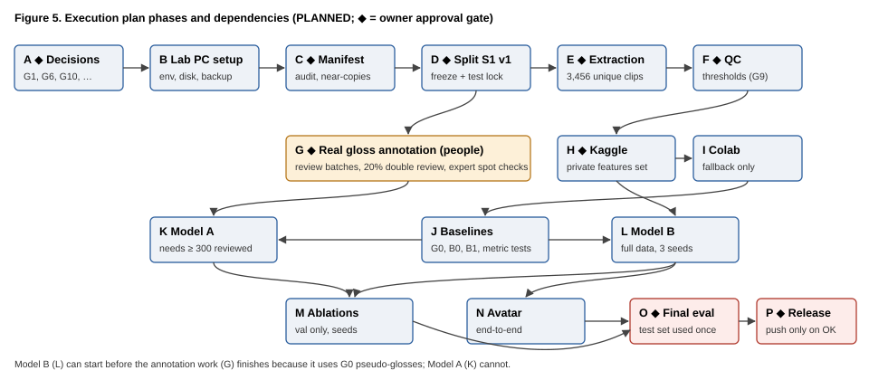
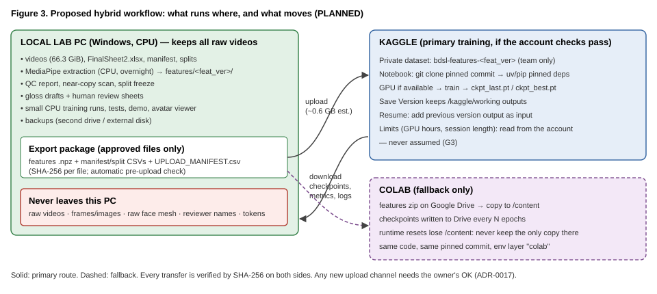
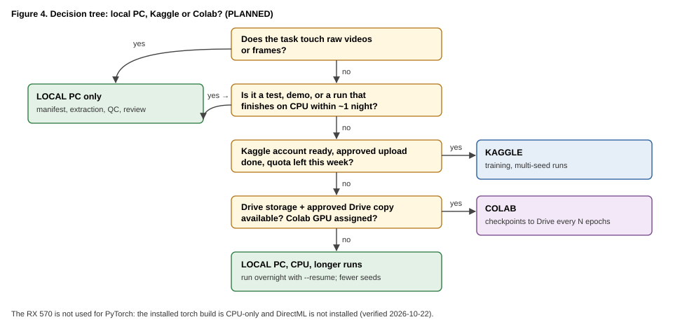

<div class="title-page">

# Bangla Text → BdSL Translation Using a 3D Avatar

## Full-Dataset Execution Plan (Proposal 05)

**Project:** CSE498R research project (`D:\sign_avatar_cse498r`)

**Status of this document:** PROPOSAL — not a decision. Every step that runs code, touches data, installs, downloads, uploads, commits or pushes needs the owner's explicit approval at its gate.

**Starting point:** the verified project state of 2026-10-22 (`research/reports/PILOT_TEST_VERSION_COMPLETE_REPORT.md`), branch `main` at `6ecc353`.

**Prepared:** 2026-10-22, by Claude (AI assistant), for the owner's review.

**Command labels:** **EXECUTABLE NOW** — works with the code at `6ecc353` · **PROPOSED — NOT EXECUTABLE YET** — needs code that a named step creates · **UI** — clicks in a web interface · **OWNER** — a decision or action only the owner can take.

**Value labels:** **[MEASURED]** from an actual run · **[VERIFIED]** checked in the audit · **[ESTIMATE]** calculated from stated assumptions · **[UNKNOWN]** must be checked on the real system.

</div>

## Table of contents

1. How to use this plan
2. Verified starting point
3. Compute, storage and execution strategy
4. Phase A — Preconditions and decisions
5. Phase B — Local lab PC setup
6. Phase C — Dataset audit and manifest
7. Phase D — Leakage-safe data splitting
8. Phase E — Full MediaPipe feature extraction
9. Phase F — Quality control
10. Phase G — Gloss convention and real annotation
11. Phase H — Kaggle setup and workflow
12. Phase I — Colab fallback workflow
13. Phase J — Baselines and experiment design
14. Phase K — Model A: Bangla text → gloss
15. Phase L — Model B: gloss → motion
16. Phase M — Controlled experiments and ablations
17. Phase N — Avatar and end-to-end integration
18. Phase O — Final evaluation and research reporting
19. Phase P — Final reproducibility, backup and release
20. Appendix A: Code to be written, by step
21. Appendix B: Common Windows errors and fixes
22. Appendix C: Owner decision register

---

## 1. How to use this plan

**Order.** Phases run roughly A → P, but some run in parallel (Figure 5). Model B (Phase L) can start before annotation (Phase G) is finished, because it uses automatic G0 glosses; Model A (Phase K) cannot.



**Every step has the same 17 parts:** number and title; purpose; prerequisites; inputs; actions; commands; files created or changed; expected output; verification; pass/fail criteria; common errors; data safety; what to record; recovery; time; dependencies and next step; stop/approval.

**Compact steps.** Steps in Phases A–E spell out all 17 parts. Shorter steps (mostly in Phases B and F–P) list only the parts that differ from these defaults, which then apply:

| Part | Default when not listed |
|---|---|
| Prerequisites / dependencies | the previous step in the same phase |
| Files | none created or changed |
| Data safety | no dataset file is opened; nothing leaves the lab PC |
| Common errors | see Appendix B |
| Record | the command, its result and the date in `agent_docs/test_log.md` |
| Recovery | re-run the step (all project commands are deterministic and skip finished work) |
| Time | under 15 minutes [ESTIMATE] |
| Next / stop | the next numbered step; any step that runs new code, touches data, installs, downloads, uploads, commits or pushes needs the owner's go |

**Where to type commands.** Unless stated otherwise: a **PowerShell** window (or the VS Code terminal) opened **in the project folder**:

```powershell
cd D:\sign_avatar_cse498r
```

Every project command starts with `uv run`, which runs inside the project environment `.venv`. You never need to "activate" anything.

**Golden rules (from CLAUDE.md and ADR-0017):**
- Never `git add` `work/`, `.venv/`, `dataset/initial_dataset/SIGN_LANGUAGE_DATA/` or pilot videos. The repository is public: a push is a publication.
- Raw videos and images never leave the lab PC. Only approved derived features go to a private Kaggle dataset.
- The final test split is used once, at the end (Phase O). No tuning on it.
- Automatic glosses are never labelled as human-reviewed.
- Each step ends at its stop condition; the next step starts only with the owner's go.

---

## 2. Verified starting point

| Item | State on 2026-10-22 | Label |
|---|---|---|
| Videos | 5,010 MP4, 66.3 GiB, 3,456 unique (SHA-256) | [VERIFIED] |
| Manifest / split | `manifest_v1` and `S1_v0` (provisional), hashes match, no leakage found | [VERIFIED] |
| Features | pilot only (50 clips, VIDEO mode `fa89892d4908`); `extract` refuses `--data full` | [VERIFIED] |
| Annotations | 50 pilot rows, all fake (`is_mock=true`); 0 real reviews | [VERIFIED] |
| Model A | code ready; TEST runs only | [VERIFIED] |
| Model B | code ready; pilot runs ≈ mean-motion baseline | [VERIFIED] |
| Avatar | demo and browser viewer work | [VERIFIED] |
| Training on GPU | **not possible yet**: the training code has no device support | [VERIFIED] |
| Kaggle / Colab | never used; account state unknown | [UNKNOWN] |
| Git | `main` 6 commits ahead of `origin/main`; line endings change CSV hashes (`core.autocrlf=true`, no `.gitattributes`); all runs `dirty=True` | [VERIFIED] |

---

## 3. Compute, storage and execution strategy

### 3.1 Resources

| Resource | Facts | Label |
|---|---|---|
| Lab PC (`DESKTOP-4NDR99B`) | Ryzen 5 3500X 6C/6T, 23.9 GB RAM, Windows 11 Pro | [VERIFIED] |
| Lab PC GPU | RX 570; not used by PyTorch (CPU build; DirectML not installed; DirectML wheels exist only as a 2024 pre-release) | [VERIFIED] / [REPORTED] |
| Disk | D: 83.4 GB free (videos live here); C: 121.7 GB free | [VERIFIED] |
| Kaggle | GPU type, weekly quota, session length, storage: **check on the account** (Step H1) | [UNKNOWN] |
| Colab | runtime type and limits: **check in the session** (Step I1) | [UNKNOWN] |

### 3.2 Storage plan

| Item | Size | Label and assumption |
|---|---|---|
| Raw videos | 66.3 GiB (71,206,505,652 B) | [VERIFIED] |
| Features, VIDEO mode, 3,456 unique clips | ≈ 0.6 GB | [ESTIMATE] pilot 7.4 MB / 4,806 frames ≈ 1.5 KB per frame × 379,301 frames |
| QC, logs, manifests, splits | < 0.1 GB | [ESTIMATE] |
| Model B checkpoints | ≈ 45 MB per seed (pilot: best 10.7 MB + last 32.1 MB) | [MEASURED pilot] / [ESTIMATE] full vocabulary |
| Model A checkpoints | ≈ 25–40 MB per seed | [ESTIMATE] (pilot TEST run: 79 MB folder for 3 seeds) |
| Experiment matrix (≈ 40 runs) | ≈ 2–3 GB | [ESTIMATE] |
| Kaggle upload | ≈ 0.6 GB features + a few MB metadata | [ESTIMATE] |
| Backups (everything except raw videos) | ≈ 3–5 GB | [ESTIMATE] |

D: has room for all derived data. A full second copy of the raw videos (66 GiB) does **not** fit on D:; see Step A4.

### 3.3 Time plan

| Task | Time | Label and assumption |
|---|---|---|
| Manifest re-run (cache reused) | ≤ 2 min 23 s | [MEASURED] first full run |
| Full extraction, 3,456 unique clips, VIDEO mode, 5 processes | ≈ 3.0 h (plan 3–5 h) | [ESTIMATE] pilot rate 34.6 grid frames/s × 379,301 frames; HEVC and 60 fps clips may be slower |
| Model B, one seed, full train split on the lab CPU | ≈ 2–4 h | [ESTIMATE, low confidence] pilot ≈ 2 s/epoch for 45 clips with 2 threads, scaled to ≈ 3,100 clips, ~100 epochs |
| Model A, 300–500 pairs, CPU | minutes | [ESTIMATE] pilot TEST run took 46 s for 3 seeds |
| Kaggle training | unknown until H1 and the device-support code exist | [UNKNOWN] |

### 3.4 What runs where



| Task | Lab PC | Kaggle | Colab |
|---|---|---|---|
| Manifest, split, extraction, QC, review sheets | **yes** (only here) | no | no |
| Unit tests, small and overnight CPU training, demo, avatar | **yes** | — | — |
| Multi-seed training, larger models (A-T5) | possible but slow | **primary** (after H1–H9) | fallback |
| Final evaluation on the locked test set | **yes** (or wherever the frozen checkpoint is, with logs copied back) | possible | possible |



---

## 4. Phase A — Preconditions and decisions

#### A1. Objective, experiments and success criteria

- **Purpose:** write down what the full-dataset work must show, before any run.
- **Prerequisites:** none.
- **Inputs:** ADR-0007, ADR-0014, ADR-0020, design doc 04 §D-C5 and research questions RQ1–RQ4.
- **Actions:**
  1. Owner confirms the research questions (design doc 04 §RQ): RQ1 Model B vs B0/B1; RQ2 gloss vs text input; RQ3 Model A vs G0 on reviewed glosses; RQ4 retargeting error bound.
  2. Owner confirms success criteria, proposed: Model B beats B0 on validation body DTW-MJE with non-overlapping 95% bootstrap intervals over 3 seeds; diversity ratio ≥ 0.5; Model A beats G0 on reviewed validation WER; real-avatar round-trip ≤ 5°.
  3. Record them in `agent_docs/decisions.md` (new ADR) only after the owner says yes.
- **Commands:** none (document step).
- **Files:** `agent_docs/decisions.md` (after approval).
- **Expected output:** an ADR with the questions and criteria.
- **Verify:** the ADR cites RQ1–RQ4 and gives numeric criteria.
- **Pass / fail:** pass if the owner approves the ADR text.
- **Common errors:** criteria that can only be met by peeking at the test set → reformulate on validation.
- **Data safety:** none.
- **Record:** ADR number, date.
- **Recovery:** criteria may be revised before Phase O only, with a new ADR.
- **Time:** 30 min owner discussion [ESTIMATE].
- **Depends on → next:** none → A2.
- **Stop:** OWNER approval of the ADR.

#### A2. Decision register

- **Purpose:** resolve the open questions that block later phases.
- **Prerequisites:** A1.
- **Inputs:** `agent_docs/open_questions.md` §G; Appendix C of this plan.
- **Actions:** the owner answers, or explicitly defers, each item: G6 deadline; G10 reviewers and their weekly hours; BdSL-competent person and when; G3 Kaggle account; G9 QC policy (decided after F1); G8 hand-side check plan; G1 reuse licence; push policy; `.gitattributes` fix; device-support code.
- **Commands:** none.
- **Files:** `open_questions.md`, `decisions.md` (only for confirmed answers).
- **Expected output:** each item marked answered (with ADR) or deferred with a date.
- **Verify:** no item is silently assumed.
- **Pass / fail:** pass when G6, G10 and G3 have answers; the rest may wait for their phase.
- **Common errors:** a recommendation recorded as a decision → only owner-confirmed items go into ADRs.
- **Data safety:** reviewer names never go into the repository; use codes.
- **Record:** answers with dates.
- **Recovery:** a deferred item blocks only its phase.
- **Time:** 1 h [ESTIMATE].
- **Depends on → next:** A1 → A3.
- **Stop:** OWNER.

#### A3. Permissions, privacy, consent and licensing check

- **Purpose:** make sure every planned data movement is allowed.
- **Prerequisites:** A2.
- **Inputs:** ADR-0017 (sharing), ADR-0018 (signers), README dataset section.
- **Actions:**
  1. Confirm consent covers training and publication of derived features and of avatar renderings of model output.
  2. Confirm what may go to Kaggle (proposal: features without raw face mesh, manifests, splits, annotations; never videos or frames).
  3. Decide the reuse licence for anything published (G1), or decide to publish nothing beyond the code until it is chosen.
  4. Confirm that faces in the committed 50-video sample may remain public (they are already in `origin/main`).
- **Commands:** none.
- **Files:** a new ADR if the owner confirms changes.
- **Expected output:** a written list: allowed / not allowed / undecided.
- **Verify:** each upload in Phases H and P is on the allowed list.
- **Pass / fail:** pass if the Kaggle upload set is explicitly allowed.
- **Common errors:** assuming "public repository" means "any upload is fine" → no; every new channel needs the owner's OK.
- **Data safety:** this step is the data-safety gate.
- **Record:** ADR.
- **Recovery:** if consent is unclear, keep everything local (Kaggle and Colab are skipped; training runs on the lab PC).
- **Time:** depends on the team [UNKNOWN].
- **Depends on → next:** A2 → A4.
- **Stop:** OWNER.

#### A4. Storage and backup plan

- **Purpose:** never lose the only copy of anything.
- **Prerequisites:** none.
- **Inputs:** §3.2; free space on each drive.
- **Actions:**
  1. Choose a backup target for derived data (proposal: another internal drive, e.g. F: with 69.5 GB free [VERIFIED], plus an external disk if available).
  2. Confirm where the master copy of the raw videos is kept besides D: (the plan cannot verify other copies) [UNKNOWN].
  3. Agree the backup rhythm: after each phase gate, and nightly during training.
- **Commands:** see Step B15.
- **Files:** none in the repository.
- **Expected output:** a named backup location for derived data.
- **Verify:** Step B15 restore test.
- **Pass / fail:** pass if a restore of one checkpoint and one manifest succeeds.
- **Common errors:** backing up to the same physical disk → use a different disk.
- **Data safety:** backups of raw videos stay on team-controlled disks only.
- **Record:** location and date of each backup.
- **Recovery:** restore from the newest backup; re-run deterministic steps instead of restoring when cheaper.
- **Time:** 30 min [ESTIMATE].
- **Depends on → next:** none → Phase B.
- **Stop:** OWNER chooses the backup location.

---

## 5. Phase B — Local lab PC setup

#### B1. Hardware and storage check

- **Purpose:** confirm the machine before long runs.
- **Prerequisites:** none.
- **Inputs:** none.
- **Actions:** run the commands; compare with §3.1.
- **Commands (EXECUTABLE NOW, PowerShell):**

```powershell
Get-CimInstance Win32_Processor | Select-Object Name, NumberOfCores, NumberOfLogicalProcessors
[math]::Round((Get-CimInstance Win32_ComputerSystem).TotalPhysicalMemory / 1GB, 1)
Get-CimInstance Win32_VideoController | Select-Object Name, DriverVersion
Get-PSDrive -PSProvider FileSystem | Select-Object Name, @{n='FreeGB';e={[math]::Round($_.Free/1GB,1)}}
```

- **Files:** none.
- **Expected output:** Ryzen 5 3500X, 6/6; about 23.9; Radeon RX 570; D: free ≥ 20 GB.
- **Verify:** the numbers match.
- **Pass / fail:** pass if D: has ≥ 20 GB free (features, runs and backups need ≈ 5 GB; the margin protects Windows).
- **Common errors:** WMI shows the RX 570 with 4 GB → a known WMI cap; irrelevant here.
- **Data safety:** read-only.
- **Record:** date and free space in `agent_docs/test_log.md`.
- **Recovery:** free space by moving old superseded runs to the backup disk (owner OK).
- **Time:** 2 min [ESTIMATE].
- **Depends on → next:** none → B2.
- **Stop:** none.

#### B2. Python and uv verification

- **Purpose:** confirm the tools that build the environment.
- **Prerequisites:** B1.
- **Commands (EXECUTABLE NOW):**

```powershell
uv --version
uv python list --only-installed
```

- **Expected output:** `uv 0.10.8 …` (or newer) and a `cpython-3.12.13` entry.
- **Verify / pass:** uv prints a version and Python 3.12 is listed.
- **Common errors:** `uv` not recognised → uv is not on PATH; reopen the terminal, or reinstall uv (installation needs owner approval).
- **Data safety / record / recovery:** none / versions / reinstall with approval.
- **Time:** 1 min. **Next:** B3. **Stop:** none.

#### B3. Project environment creation or update

- **Purpose:** build `.venv` exactly from `uv.lock`.
- **Prerequisites:** B2; internet for the first build only.
- **Commands (EXECUTABLE NOW):**

```powershell
uv sync --extra extract --extra train
uv run python -c "import mediapipe, cv2, torch, sacrebleu; print(mediapipe.__version__, cv2.__version__, torch.__version__, sacrebleu.__version__)"
uv run pytest -q
```

- **Files:** `.venv/` only (gitignored).
- **Expected output:** `0.10.35 5.0.0 2.14.1+cpu 2.6.0`; `140 passed`.
- **Verify:** both outputs exactly as above.
- **Pass / fail:** fail on any version difference or test failure.
- **Common errors:** see Appendix B (long paths, antivirus locking `.venv`, proxy).
- **Data safety:** no data touched.
- **Record:** `uv.lock` hash: `Get-FileHash uv.lock`.
- **Recovery:** delete `.venv` (owner OK) and run `uv sync` again.
- **Time:** 2–10 min [ESTIMATE].
- **Next:** B4. **Stop:** none. Changing a pin needs owner approval.

#### B4. Line endings and clean commits (repository hygiene)

- **Purpose:** make file hashes identical on every checkout and make every run reproducible from a commit.
- **Prerequisites:** owner approval (A2).
- **Actions:**
  1. Add `.gitattributes` with `* text=auto eol=lf` and `*.csv text eol=lf` (proposal).
  2. Renormalise once: `git add --renormalize .` and commit after review.
  3. Training commands refuse to record a result run when the working tree is dirty (code change; see Appendix A).
- **Commands:** PROPOSED — NOT EXECUTABLE YET (needs the owner's go; the refusal needs code from this step).
- **Files:** `.gitattributes`; `src/bdsl/models/train_*.py`.
- **Expected output:** `git status` clean after renormalising; `annotations/pilot50_v1_gloss_v01.csv` hashes to the committed blob value.
- **Verify:** `Get-FileHash annotations\pilot50_v1_gloss_v01.csv` equals `git show HEAD:annotations/pilot50_v1_gloss_v01.csv` hashed.
- **Pass / fail:** pass if equal.
- **Common errors:** renormalising changes many files → review the diff; content stays the same except line endings.
- **Data safety:** tracked files only.
- **Record:** commit hash.
- **Recovery:** `git revert` the commit.
- **Time:** 20 min [ESTIMATE].
- **Next:** B5. **Stop:** OWNER approves the commit.

#### B5. Folder structure, configuration and portable paths

- **Purpose:** know where everything lives and how to move outputs.
- **Facts [VERIFIED]:** configs are layered: `configs/base.yaml` ← `configs/env/{local,kaggle,colab}.yaml` ← `configs/data/{pilot50,full}.yaml` ← environment variables. Outputs go to `work/` (gitignored).
- **Environment variables:** `BDSL_ENV` (local/kaggle/colab), `BDSL_WORK_DIR` (move all outputs), `BDSL_DATA_ROOT` (move the dataset root), `BDSL_PROJECT_ROOT`.
- **Commands (EXECUTABLE NOW):**

```powershell
uv run python -c "from bdsl.config import load_config; c=load_config(data='full'); print(c['_meta']['env'], c['paths']['work_dir'], c['data']['video_root'], c['_meta']['config_hash'][:12])"
$env:BDSL_WORK_DIR = "F:\bdsl_work_test"; uv run python -c "from bdsl.config import load_config; print(load_config()['paths']['work_dir'])"; Remove-Item Env:BDSL_WORK_DIR
```

- **Expected output:** `local D:/sign_avatar_cse498r/work D:/sign_avatar_cse498r/dataset/initial_dataset/SIGN_LANGUAGE_DATA <hash>`; then `F:\bdsl_work_test`.
- **Verify / pass:** paths resolve; the config hash is unchanged by `BDSL_WORK_DIR`.
- **Common errors:** setting the variable in one window and running in another → variables are per window.
- **Data safety:** read-only.
- **Record:** config hash.
- **Time:** 5 min. **Next:** B6. **Stop:** none.

#### B6. Environment diagnostic notebook

- **Purpose:** re-run the 8 environment checks (packages, MediaPipe, OpenCV rotation, torch devices, write test, benchmark).
- **Commands (EXECUTABLE NOW):** in VS Code open `notebooks/00_env_check.ipynb`, choose the `.venv` kernel (top right, *Select Kernel*), click *Run All*. Headless alternative:

```powershell
uv run python -c "import nbformat; from nbclient import NotebookClient; nb=nbformat.read('notebooks/00_env_check.ipynb',4); NotebookClient(nb, timeout=900).execute(); nbformat.write(nb,'work/reports/00_env_check.executed.ipynb')"
uv run python -c "import json; r=json.load(open('work/reports/env_report.json')); print(r['overall'], {k: v.get('status') for k, v in r['checks'].items()})"
```

- **Files:** `work/reports/env_report.json`, `work/reports/00_env_check.executed.ipynb`.
- **Expected output:** `pass` and 8 checks `pass`.
- **Pass / fail:** fail if any check fails; read its `detail` field.
- **Common errors:** wrong kernel (system Python 3.14) → select `.venv`; Windows zmq warnings are harmless [REPORTED].
- **Data safety:** reads `videos/0.mp4` and `videos/2.mp4` only (log in `DATASET_WORK_LOG.md`).
- **Record:** report timestamp and config hash.
- **Time:** 2–5 min [MEASURED Day 1 order of magnitude]. **Next:** B7. **Stop:** none.

#### B7. MediaPipe model requirement

- **Purpose:** confirm the exact model file (already downloaded on Day 1).
- **Commands (EXECUTABLE NOW):** `Get-FileHash work\models\holistic_landmarker.task -Algorithm SHA256`
- **Expected output:** `E2DAB61191E2DCD0A15F943D8E3ED1DCE13C82DFA597B9DD39F562975A50C3F8` (pinned in `configs/base.yaml`).
- **Pass / fail:** fail on any other hash; the environment check also fails.
- **Recovery:** a new download needs owner approval; the URL is in `configs/base.yaml` ("latest" — a new download may differ and change `feat_ver`).
- **Time:** 1 min. **Next:** B8. **Stop:** download only with OWNER approval.

#### B8. Sample-video decoding and rotation test

- **Purpose:** confirm OpenCV applies rotation flags (portrait clips).
- **Commands:** part of B6 (`opencv_rotation` check) — EXECUTABLE NOW.
- **Expected output:** `0.mp4` flag 270° → 1920×1080 (h×w) portrait; `2.mp4` flag 0° unchanged.
- **Pass / fail:** fail if a portrait clip decodes landscape → stop; extraction would be wrong.
- **Time:** included in B6. **Next:** B9.

#### B9. CPU versus GPU expectations

- **Purpose:** know what will run on the GPU (currently nothing).
- **Facts:** torch is the CPU build; the training code has no device support [VERIFIED]. The RX 570 could only be tried through torch-directml (pre-release, Python ≤ 3.12) [REPORTED, 2026-10-21 web check].
- **Commands (EXECUTABLE NOW):** `uv run python -c "import torch; print(torch.__version__, torch.cuda.is_available())"` → `2.14.1+cpu False`.
- **Optional experiment:** PROPOSED — installing torch-directml in a separate test environment, needs OWNER approval; treat any speed-up as unverified until measured.
- **Pass / fail:** none; this step sets expectations.
- **Next:** B10.

#### B10. Disk-space plan

- **Purpose:** avoid a full disk during extraction or training.
- **Actions:** compare §3.2 with B1; keep ≥ 20 GB free on D:; put large experiment matrices under `BDSL_WORK_DIR` on another drive if needed.
- **Commands (EXECUTABLE NOW):** `Get-ChildItem work -Recurse | Measure-Object Length -Sum` (bytes used by `work/`).
- **Pass / fail:** pass if the projected use (≈ 5 GB) fits with the margin.
- **Next:** B11.

#### B11. CPU extraction benchmark

- **Purpose:** replace the [ESTIMATE] extraction time with a measurement on a representative sample.
- **Prerequisites:** C1; E3 code (the `bench` subset).
- **Actions:** extract a stratified 100-clip sample (portrait/landscape, low-res, h264/hevc/VP9, 30/60 fps) into a scratch output folder; record seconds per grid frame.
- **Commands:** PROPOSED — NOT EXECUTABLE YET (created in E2): `uv run python -m bdsl.cli extract --data bench100 --mode video --out-root work/features_bench`.
- **Today (EXECUTABLE NOW, pilot only):** `uv run python -m bdsl.cli extract --data pilot50 --mode video --out-root work/features_recheck` (re-measures the pilot rate; should reproduce `fa89892d4908` arrays).
- **Expected output:** `extract_run.json` with `seconds`; rate ≈ 35 grid frames/s on the pilot [MEASURED Day 2].
- **Record:** frames/s per stratum; update §3.3.
- **Time:** 5–10 min [ESTIMATE]. **Next:** B12.

#### B12. Running scripts and notebooks from the correct folder

- **Rule:** always start in `D:\sign_avatar_cse498r`; use `uv run python -m bdsl.cli <command>`; never `python file.py` with system Python.
- **Check:** `Get-Location` shows the project folder; `uv run python -c "import bdsl, sys; print(sys.executable)"` prints a path inside `.venv`.
- **Notebooks:** thin wrappers of the same CLI (`01_manifest` … `06_avatar_demo`); they have never been executed [VERIFIED] — prefer the CLI; if a notebook is used, select the `.venv` kernel.

#### B13. Verifying outputs and reading error logs

| Output | Where | How to read |
|---|---|---|
| Manifest | `work/manifests/manifest_v1.{csv,meta.json,run.log}` | `Get-Content work\manifests\manifest_v1.run.log -Tail 20` |
| Extraction | `work/features/<feat_ver>/{qc.csv,failures.csv,extract_run.json}` | `failures.csv` must have only its header |
| Training | `work/runs/<run>/{run.json,train.log,metrics.json,per_item.csv}` | `Get-Content work\runs\<run>\train.log -Wait` (live) |
| Demo | `work/demo/demo_<time>/demo_log.json` | open in VS Code |

Every command exits with code 0 on success; `$LASTEXITCODE` shows it in PowerShell.

#### B14. Resuming after a crash, shutdown or interruption

| Stage | What survives | How to resume (EXECUTABLE NOW unless marked) |
|---|---|---|
| Manifest | per-file cache `manifest_v1.partial.jsonl` | run the same command again; cached files are reused if size and mtime match [VERIFIED in code] |
| Extraction | every finished clip (atomic writes); a clip with the current `feat_ver` is skipped | run the same command again [VERIFIED Day 2 kill test] |
| Model A / Model B training | `seed<N>/ckpt_last.pt` after every epoch | `uv run python -m bdsl.cli train-gloss2motion --input gloss --resume work\runs\<run folder>`; changed inputs are refused [VERIFIED Day 3/4 kill tests] |
| Demo | nothing to resume | re-run (seconds) |

After a power cut: run `uv run pytest -q`, then resume; check `git status` for half-saved edits.

#### B15. Backup and recovery

- **Commands (EXECUTABLE NOW; target from A4, here F:):**

```powershell
robocopy D:\sign_avatar_cse498r\work F:\bdsl_backup\work /E /XD _superseded /R:1 /W:1 /NP /LOG:F:\bdsl_backup\robocopy_work.log
robocopy D:\sign_avatar_cse498r\annotations F:\bdsl_backup\annotations /E /R:1 /W:1
```

- **Verify:** `robocopy` exit code < 8; compare one checkpoint: `Get-FileHash` on both copies.
- **Restore test:** copy one `ckpt_best.pt` back into a test folder and load it: `uv run python -c "import torch; print(list(torch.load(r'F:\bdsl_backup\work\runs\<run>\seed42\ckpt_best.pt', weights_only=True)))"`.
- **Data safety:** backups stay on team-controlled disks.
- **Time:** minutes [ESTIMATE].

#### B16. Windows-specific errors

See Appendix B.

---

## 6. Phase C — Dataset audit and manifest

#### C1. Inventory and filename/sheet reconciliation

- **Purpose:** confirm that every video has exactly one sheet row and vice versa, and that nothing changed since manifest v1.
- **Prerequisites:** Phase B passed.
- **Inputs:** `dataset/initial_dataset/FinalSheet2.xlsx`, `SIGN_LANGUAGE_DATA/*.mp4`.
- **Actions:** re-run the manifest (cache reused); compare the new CSV hash with `2ff133cf…`.
- **Commands (EXECUTABLE NOW):**

```powershell
uv run python -m bdsl.cli manifest --data full
Get-FileHash work\manifests\manifest_v1.csv
```

- **Files:** `work/manifests/manifest_v1.*` (rewritten identically if nothing changed).
- **Expected output:** 5,010 rows, 0 missing, 0 extra, 0 decode failures; `csv_sha256` unchanged.
- **Verify:** the printed JSON counts; hash equality.
- **Pass / fail:** fail on any missing/extra file or hash change → stop and ask the owner (data changed).
- **Common errors:** a file opened in another program (locked) → close it, re-run.
- **Data safety:** read-only; size + mtime + sheet hash checked before and after by the command. Log the run in `DATASET_WORK_LOG.md`.
- **Record:** manifest hash, run log.
- **Recovery:** re-run; the cache makes it fast.
- **Time:** ≤ 2.5 min [MEASURED].
- **Depends on → next:** B → C2.
- **Stop:** none if the hash is unchanged; OWNER if anything changed.

#### C2. Readability and metadata validation

- **Purpose:** catch videos that open but fail later (truncated streams).
- **Actions:** the manifest decodes the first frame of every file [VERIFIED code]; Phase E decodes every frame and logs failures in `failures.csv`.
- **Commands:** included in C1 (EXECUTABLE NOW) and E3.
- **Pass / fail:** pass if `decode_ok` is true for all 5,010 and E3 has 0 unexplained failures.
- **Next:** C3.

#### C3. SHA-256, exact duplicates and label conflicts

- **Facts [VERIFIED]:** 3,456 unique SHA-256; 3,376 leakage groups; 0 label conflicts (with `norm_v1`).
- **Commands:** included in C1. To list the largest duplicate groups (EXECUTABLE NOW):

```powershell
uv run python -c "import pandas as pd; m=pd.read_csv('work/manifests/manifest_v1.csv'); print(m.groupby('sha256').size().value_counts().sort_index())"
```

- **Expected output:** how many SHA-256 values occur 1, 2, 3, … times.
- **Pass / fail:** pass if `label_conflict` is false everywhere; otherwise list the rows for the owner.
- **Next:** C4.

#### C4. Near-duplicates and edited / shared segments (G2)

- **Purpose:** find clips that share recorded footage although their sentences differ (like the colour cluster), so they can be put in one leakage group.
- **Prerequisites:** E3 finished (uses the extracted landmarks; no second video pass).
- **Actions (proposal):**
  1. For every pair of clips whose sentences share all but the last 1–2 words, or whose Index numbers are within ±50, compare the first and last 3 s of their body+hand landmark sequences (normalised).
  2. Flag pairs whose aligned landmark distance is below a threshold calibrated on the known positive (3456/3457/3458) and on random negative pairs.
  3. For flagged pairs only, confirm with a frame-difference check on the videos (read-only, as on 2026-10-22).
  4. The owner reviews the flagged list.
- **Commands:** PROPOSED — NOT EXECUTABLE YET (new `scan-segments` command, Appendix A): `uv run python -m bdsl.cli scan-segments --feat-ver fa89892d4908`.
- **Files:** `work/splits/shared_segments_v1.csv` (candidates, distances, decision column).
- **Expected output:** the colour cluster is found (recall check); a short candidate list.
- **Verify:** known positive found; false-positive rate measured on 100 random pairs.
- **Pass / fail:** fail if the colour cluster is not found → recalibrate.
- **Common errors:** many candidates from templated sentences (same signer, same opening) → confirm with the frame check.
- **Data safety:** frame checks write only to `work/` (contact sheets never committed).
- **Record:** threshold, recall on known positives, number of confirmed links.
- **Recovery:** deterministic; re-run.
- **Time:** 1–3 h compute + owner review [ESTIMATE].
- **Depends on → next:** E3 → C5, D1.
- **Stop:** OWNER confirms the links.

#### C5. Normaliser versioning, exclusions and corrections

- **Purpose:** record every decision that changes which data is used, without editing the source files.
- **Rules:** the sheet is never edited (spelling is intentional). `norm_v1` stays; any change becomes `norm_v2` with a new version string and a re-run of C1 and D1. Exclusions (from F3) and confirmed links (C4) go into versioned CSV files with a reason column.
- **Commands:** PROPOSED — NOT EXECUTABLE YET (exclusion support in `manifest`, Appendix A).
- **Files:** `work/manifests/exclusions_v1.csv` (Index, reason, decided_by, date) — or tracked under `dataset/` if the owner wants them public.
- **Pass / fail:** every excluded clip has a reason and an owner decision.
- **Next:** C6.

#### C6. Versioned manifest (v2) and integrity tests

- **Purpose:** freeze the dataset definition used for full training.
- **Actions:** write `manifest_v2` = v1 + exclusion flags + shared-segment links; the meta file records the hashes of v1, the exclusions and the links.
- **Commands:** PROPOSED — NOT EXECUTABLE YET: `uv run python -m bdsl.cli manifest --data full --version v2`.
- **Verify (automated, proposed tests):** row count 5,010; every excluded row has a reason; every link refers to existing rows; hash of v1 unchanged.
- **Pass / fail:** all tests pass.
- **Time:** minutes [ESTIMATE].
- **Next:** D1. **Stop:** OWNER approves `manifest_v2`.

---

## 7. Phase D — Leakage-safe data splitting

#### D1. Grouping for S1 v1

- **Purpose:** groups that join identical normalised sentences, identical files and confirmed shared segments.
- **Why S1 v0 may change:** S1 v0 knows only the colour cluster. Clips that share footage but have different sentences could sit in train and test, letting the model "recognise" test footage. Different sentence strings do **not** prove independence.
- **Actions:** add the confirmed links from C4 to `split.known_shared_segment_links` in `configs/base.yaml`; set `split.version: v1`. Proposal: keep the salt `S1-v0` so that unaffected groups keep their split (owner decision).
- **Commands (EXECUTABLE NOW once the config is edited):** `uv run python -m bdsl.cli split`
- **Files:** `work/splits/S1_v1.csv`, `S1_v1.meta.json`.
- **Expected output:** `leakage_problems: []`; balance report printed.
- **Pass / fail:** fail on any leakage problem.
- **Data safety:** read-only on data.
- **Record:** split CSV hash, number of groups that moved compared with v0.
- **Recovery:** deterministic; re-run.
- **Time:** < 1 min [MEASURED order of magnitude].
- **Next:** D2. **Stop:** OWNER approves the config change.

#### D2. Automated leakage tests

- **Commands (EXECUTABLE NOW):** included in `split` (group, SHA-256, sentence and known-link checks) and in `uv run pytest -q tests/test_groups_split.py`.
- **Extra check (EXECUTABLE NOW):**

```powershell
uv run python -c "import pandas as pd; m=pd.read_csv('work/manifests/manifest_v1.csv'); s=pd.read_csv('work/splits/S1_v1.csv'); x=m.merge(s,on='index'); print([int(x.groupby(c)['split'].nunique().gt(1).sum()) for c in ('sha256','sentence_norm','group_id_y')])"
```

- **Expected output:** `[0, 0, 0]`.
- **Pass / fail:** any non-zero value fails.

#### D3. Distribution inspection

- **Purpose:** make sure train/val/test are comparable (length, question/negation words, orientation, resolution).
- **Commands:** the balance report is printed by `split` and saved in `S1_v1.meta.json` (EXECUTABLE NOW).
- **Pass / fail:** no stratum with zero val or test clips where train has ≥ 50 [proposal]; otherwise report it as a limitation (never re-split by hand to "improve" numbers).

#### D4. Freeze and checksum

- **Actions:** record the S1 v1 hash in `agent_docs/decisions.md` (ADR, owner); training runs record the split hash in `run.json` and refuse a different split.
- **Commands:** PROPOSED — NOT EXECUTABLE YET (split-hash check in training, Appendix A).
- **Pass / fail:** two machines produce the same split hash.

#### D5. Protecting the test set

- **Purpose:** the test split is used once (Phase O).
- **Actions (proposal):** training and tuning commands evaluate only train and val; a separate `evaluate --final` command reads the test split, requires a frozen evaluation config (O1), and writes a lock file; a second final run on the same frozen config is refused unless the owner overrides it in writing.
- **Commands:** PROPOSED — NOT EXECUTABLE YET (Appendix A). Note: the pilot code reports test metrics for every run; that is acceptable for pipeline tests but not for the full study.
- **Pass / fail:** a unit test shows the training commands never read test rows.
- **Stop:** OWNER approves the protocol (ADR).

---

## 8. Phase E — Full MediaPipe feature extraction

**Gate before Phase E:** B3 (environment), B6 (8/8 checks), C1 (manifest unchanged), the split policy agreed (A2), storage (B10) and backup (B15) all passed. Extraction does not need the final split: features do not depend on it.

**Feature schema (actual, `feat_layout_v1`) [VERIFIED].** Per clip `<Index>.npz` on a uniform 15 fps grid of T frames: `pose_world`/`pose_img` (T,33,3), `pose_vis` (T,33), `lhand_world`/`rhand_world`/`lhand_img`/`rhand_img` (T,21,3), `blendshapes` (T,52) plus names, `head_rot` (T,3), `mask` (T,4) uint8 (pose, left hand, right hand, face), time arrays and a JSON `meta`. NaN where a part is missing, exactly where the mask is 0. No raw face mesh, no images. Hand "world" points share the pose frame (their wrist equals the pose wrist); they are **not** hand-centred.

**API and mode.** `mediapipe.tasks.vision.HolisticLandmarker`, one fresh instance per clip (a reused instance crashed in the earlier project [REPORTED]). Modes: IMAGE (each frame alone), VIDEO (tracking across frames with timestamps; chosen in ADR-0023 because hand coverage was equal and wrist jitter lower), LIVE_STREAM (asynchronous callbacks for a live camera; not suitable for offline files, not used). Sampling: decode with OpenCV (rotation applied), take the source frame nearest to each 1/15 s grid point.

#### E1. Compatibility test

- **Purpose:** prove that extraction today reproduces the pilot features exactly.
- **Prerequisites:** the gate above.
- **Commands (EXECUTABLE NOW):**

```powershell
uv run python -m bdsl.cli extract --data pilot50 --mode video --out-root work\features_recheck
uv run python -c "import numpy as np, pathlib; a=sorted(pathlib.Path('work/features/fa89892d4908').glob('*.npz')); print(all(np.array_equal(np.load(f)['pose_world'], np.load(pathlib.Path('work/features_recheck/fa89892d4908')/f.name)['pose_world'], equal_nan=True) for f in a))"
```

- **Files:** `work/features_recheck/fa89892d4908/` (scratch; delete later only with the owner's OK).
- **Expected output:** `feat_ver fa89892d4908`, 50 clips, 0 failures; then `True`.
- **Verify / pass:** both as expected. **Fail:** a different `feat_ver` or different arrays → stop (the environment drifted).
- **Common errors:** see Appendix B.
- **Data safety:** reads the pilot copies only; the command prints `pilot copies unchanged: True`.
- **Record:** result and date in the test log.
- **Recovery:** re-run (finished clips are skipped).
- **Time:** ≈ 2.5 min [MEASURED Day 2: 138.8 s].
- **Next:** E2. **Stop:** none.

#### E2. Full-set extraction support (code step)

- **Purpose:** let `extract` run on the full set safely.
- **Prerequisites:** E1; owner go for the code.
- **Actions (code, Appendix A):**
  1. Allow `--data full` and a stratified `--data bench100`.
  2. Extract **one clip per unique SHA-256** (the representative) and record the duplicate mapping (no repeated work; identical features by construction).
  3. Write a progress log (clips done / total, rate, estimated time left).
  4. Add a disk-space guard (stop cleanly below 5 GB free).
  5. Keep atomic writes, skip-if-done, `failures.csv`, the privacy check and `feat_ver`.
- **Commands:** PROPOSED — NOT EXECUTABLE YET until this step is implemented and tested.
- **Files:** `src/bdsl/cli.py`, `src/bdsl/features/extract.py`, `configs/data/bench100.yaml`, tests.
- **Expected output / verify:** new unit tests for the duplicate mapping, the disk guard (simulated) and resume; E1 still passes.
- **Pass / fail:** all tests pass.
- **Data safety:** code only.
- **Record:** commit hash.
- **Recovery:** `git revert`.
- **Time:** half a day [ESTIMATE].
- **Next:** B11, then E3. **Stop:** OWNER go for the code, then OWNER go for E3.

#### E3. Full extraction run

- **Purpose:** features for all 3,456 unique clips.
- **Prerequisites:** E2; B11 benchmark done.
- **Inputs:** `manifest_v1` (or v2), `SIGN_LANGUAGE_DATA/`.
- **Commands:** PROPOSED — NOT EXECUTABLE YET (created in E2):

```powershell
powercfg /change standby-timeout-ac 0
uv run python -m bdsl.cli extract --data full --mode video --workers 5
```

- **Files:** `work/features/fa89892d4908/<Index>.npz` per representative, `qc.csv`, `failures.csv`, `extract_run.json`, progress log.
- **Expected output:** `clips_with_features` = 3,456 minus logged failures; `privacy_problems: 0`; `feat_ver fa89892d4908`.
- **Verify:** E5.
- **Pass / fail:** fail if any failure is unexplained, `feat_ver` changes, or a privacy problem appears.
- **Common errors:** sleep/standby interrupts the run → the `powercfg` line above (restore your setting afterwards).
- **Data safety:** videos opened read-only; source size and modification time are checked; nothing leaves the PC. Add an entry to `DATASET_WORK_LOG.md`.
- **Record:** start/end time, rate, failures, `feat_ver`, git commit (clean tree).
- **Recovery:**
  - **A video fails:** it is listed in `failures.csv` with its error and the run continues. Re-run the same command to retry only the failed clips (finished clips are skipped). If it fails again, decode it alone with OpenCV to see whether the file is damaged and report it to the owner. Never "repair" a source file.
  - **MediaPipe crashes or a worker dies:** the clip is logged as failed; re-run the command.
  - **The PC shuts down:** after the reboot, re-run the same command; finished clips are skipped and leftover temporary files are replaced [VERIFIED Day 2 kill test].
  - **The disk becomes nearly full:** the guard stops the run; free space, or copy the finished features to another drive and set `BDSL_WORK_DIR` there, then re-run.
- **Time:** ≈ 3 h; plan 3–5 h [ESTIMATE]; run overnight.
- **Next:** E4–E6. **Stop:** OWNER go before starting.

#### E4. Progress monitoring

- **Commands (EXECUTABLE NOW, in a second PowerShell window while E3 runs):**

```powershell
(Get-ChildItem work\features\fa89892d4908\*.npz).Count
Get-Content work\features\fa89892d4908\failures.csv
Get-Process python | Select-Object Id, CPU, WorkingSet
```

- **Expected output:** the count rises steadily (≈ 1 clip per second overall [ESTIMATE]); `failures.csv` stays at its header; 5–6 Python processes.

#### E5. Output validation

- **Purpose:** check every feature file before anything trains on it.
- **Checks (proposed `validate-features` command, Appendix A):** keys and shapes match `feat_layout_v1`; the mask equals the non-NaN pattern; finite values where the mask is 1; grid time strictly increasing in 1/15 s steps; T ≈ duration × 15 (± 1); `feat_ver` in `meta`; the privacy check; a per-file SHA-256 list for the upload manifest.
- **Commands:** PROPOSED — NOT EXECUTABLE YET: `uv run python -m bdsl.cli validate-features --feat-ver fa89892d4908`.
- **Pass / fail:** 0 problems, or every problem listed with an owner decision.
- **Record:** report path and the hash of the checksum list.

#### E6. Provenance

- Record in `agent_docs/test_log.md`: `feat_ver`, MediaPipe version, model SHA-256, thresholds, mode, fps, git commit, run time, counts, failures, validation result, hash of the checksum list.
- Any change to these inputs produces a new `feat_ver` folder; existing folders are never overwritten.

---

## 9. Phase F — Quality control

#### F1. Full QC report

- **Purpose:** measure data quality across all clips.
- **Measures (already computed per clip in `qc.csv` [VERIFIED in code]):** coverage per part (pose, left, right, both, any hand, face); longest hand gap; bone-length coefficient of variation; wrist jitter; timestamp irregularity (ts_cv); hand-side agreement with the body wrists; head yaw.
- **Additional (proposed):** implausible-movement flags (wrist speed above the 99.9th percentile of all frames; sudden left/right label swaps); frame count vs duration.
- **Commands:** `qc.csv` comes from E3; the aggregated report is PROPOSED — NOT EXECUTABLE YET: `uv run python -m bdsl.cli qc-report --feat-ver fa89892d4908` → `work/reports/qc_full_fa89892d4908.html` (histograms; the 30 worst clips per measure).
- **Pass / fail:** the report covers 100% of extracted clips.
- **Data safety:** any contact sheets or frames stay in `work/` (never committed).

#### F2. Visual review of the worst clips

- **Actions:** a team member watches the 30 worst clips per measure on the lab PC and notes the cause (lighting, occlusion, framing, signer outside the frame, mirroring).
- **Output:** `work/reports/qc_review_notes.csv` (Index, measure, cause, reviewer code).
- **G8 (hand sides):** for each recording type, note whether the video looks mirrored (visible text, a watch or ring on a known hand). This answers G8 per recording batch.

#### F3. Thresholds from observed data (G9)

- **Method:** for each measure, inspect the distribution (F1) and the causes found in F2; place thresholds at natural breaks or at the percentile where reviewed clips become unusable — not at arbitrary round numbers. Starting proposal: the 5th percentile of any-hand coverage and the 99th percentile of jitter, then adjust.
- **Rules (proposal):** **retain** above all thresholds; **mask** short bad segments (the loss already ignores masked values); **reprocess** clips with a fixable cause (owner decision); **exclude** clips without usable hands for most of the sentence, listed in `exclusions_v1.csv` with the reason.
- **Stop:** OWNER chooses thresholds (ADR).

#### F4. Apply and version

- Apply the rules through `exclusions_v1.csv` → `manifest_v2` (C6). Report the number excluded per split and per stratum; if exclusions are uneven, report it as a limitation (never move clips between splits).

---

## 10. Phase G — Gloss convention and real annotation

**Three different things (convention §1).** *Bangla text* is the input sentence. *Gloss notation* is a sequence of labels for signs (one token per sign, in signing order). *BdSL grammar* is how meaning is actually signed: word order, use of space, facial expressions, head movements, simultaneous signs. Glosses capture only part of the grammar; a G0 pseudo-gloss captures none of it beyond word lists.

**Statuses (unchanged):** `auto_draft` (G0; nobody checked it), `team_reviewed` (a registered team member compared it with the clip and corrected it), `expert_validated` (a registered BdSL-competent person checked it), `rejected` (the clip cannot be glossed as given; a note says why). Automatic output is never labelled as reviewed.

#### G1. Convention review

- **Actions:** the team reads `annotations/GLOSS_CONVENTION_v0.1.md` and glosses 10 clips together. Changes (for example how to write pointing, classifiers or fingerspelling) go into v0.2 with the owner's OK. The BdSL-competent person comments when available.
- **Output:** `GLOSS_CONVENTION_v0.2.md` only if something changes; ADR.

#### G2. Pilot: real review first

- **Purpose:** replace the fake pilot rows with real ones.
- **Actions:**
  1. Start a new file version (proposal: `pilot50_v1_gloss_v02.csv`, regenerated from the G0 drafts; `gloss-draft` refuses to overwrite reviewed rows by design).
  2. T1 reviews each row **while watching the clip**; honest notes; per-row confidence; `is_mock=false`.
  3. Validate.
- **Commands:** regenerating drafts into a new file is PROPOSED — NOT EXECUTABLE YET (an `--out` option, Appendix A). Validation is EXECUTABLE NOW: `uv run python -m bdsl.cli gloss-validate` — it must report 0 problems **without** any test option.
- **Pass / fail:** 0 problems; no note says "not video-verified".
- **Stop:** OWNER confirms the review is real before Model A uses it.

#### G3. Review batches for the full set

- **Selection (proposal):** 300–500 **train** sentences stratified by length, question/negation words and recording type; all **val** sentences (for validation scores); **test** sentences only after the model is frozen (O2), by a reviewer who has not seen model outputs.
- **Batch tool:** PROPOSED — NOT EXECUTABLE YET: `uv run python -m bdsl.cli review-batch export --size 50` writes `annotations/batches/batch_<n>.csv` (rows, local video paths, G0 drafts); `review-batch import` validates and merges a returned batch.
- **Workload:** about 1–2 minutes per clip → 50 clips ≈ 1–2 h per reviewer [ESTIMATE; measure it on the pilot review].

#### G4. Instructions and onboarding

- Use `annotations/REVIEW_GUIDE.md` (exists). Reviewers get a code from the owner (`REVIEWERS.csv`, role `team` or `expert`), never their names. In Excel, save as "CSV UTF-8".

#### G5. Double review and disagreement resolution

- A second team member independently reviews 20% of each batch. Disagreements are recorded (token-level edit distance; tag differences); the two reviewers agree, or the owner decides; the resolution is written in `notes`.
- **Metric:** inter-annotator gloss WER and tag agreement on the double-reviewed rows (PROPOSED code).

#### G6. Expert spot checks

- The BdSL-competent person reviews a stratified sample (proposal: 50 rows) → `expert_validated` for those rows only; agreement with the team reviews is reported. Without an expert, every gloss stays `team_reviewed` and every grammar claim is provisional.

#### G7. Annotation quality and protection

- **Mock exclusion:** rows with `is_mock=true` or "not video-verified" notes are refused by default [VERIFIED, implemented].
- **Validation/test protection:** val and test rows live in separate files; test rows are reviewed only after the model freeze.
- **Versioning:** every change gives the file a new version (`…_v02`, `…_v03`) and a test-log entry with its hash; training runs record the annotation hash [VERIFIED, implemented].
- **Public repository:** a commit publishes annotations; the owner approves each commit.

---

## 11. Phase H — Kaggle setup and workflow

**Before you start.** (1) The training code cannot use a GPU yet (device support, Appendix A). (2) A Kaggle notebook cannot see local commits: the code must be pushed (owner decision) or uploaded as a private code dataset. (3) `configs/env/kaggle.yaml` still has a placeholder dataset slug (TBD).

#### H1. Account, quotas and accelerators

- **Purpose:** learn the real limits of the account; never assume them.
- **UI:**
  1. Sign in at kaggle.com → your profile picture → **Settings**.
  2. Verify your phone number if it is not verified (Kaggle requires it for GPU and internet in notebooks).
  3. **Create → New Notebook**. In the right-hand panel open **Session options**: note which accelerators are offered, the **GPU quota remaining** this week, and whether **Internet** can be switched on.
  4. Run one cell:

```python
!nvidia-smi
!python --version
!df -h /kaggle/working
import torch; print(torch.__version__, torch.cuda.is_available())
```

- **Expected output:** the real GPU name, the Python version, free space in `/kaggle/working`, the torch version and `True` when a GPU accelerator is selected.
- **Record:** every value and the date in the test log (answers G3).
- **Pass / fail:** pass if a GPU is available and the Python version can run the project (the project pins 3.12; otherwise use H7's fallback).
- **Stop:** OWNER.

#### H2. Decide the upload set

- **Allowed (proposal, ADR-0017 and A3):** `work/features/<feat_ver>/*.npz` (no face mesh, no images), `qc.csv`, `manifest_v2.csv` (sentences and hashes; no faces), the split CSV, annotation CSVs (codes only), `UPLOAD_MANIFEST.csv`.
- **Never:** videos, frames, contact sheets, `.venv`, credentials, reviewer names, files of the earlier project.
- **Stop:** OWNER approves the exact list.

#### H3. Export package and upload manifest

- **Commands:** PROPOSED — NOT EXECUTABLE YET: `uv run python -m bdsl.cli export-kaggle --feat-ver fa89892d4908 --out work\export\bdsl-features-fa89892d4908.zip`
- **What it does:** copies only allow-listed files; writes `UPLOAD_MANIFEST.csv` (path, bytes, SHA-256); runs the pre-upload check (privacy check of every `.npz`, nothing outside the allow list); prints the total size.
- **Expected output:** one zip of ≈ 0.6 GB [ESTIMATE] plus the manifest.
- **Pass / fail:** the pre-upload check reports 0 problems.

#### H4. Create the private dataset

- **UI:** **Datasets → New Dataset** → drag the zip in → title `bdsl-features-fa89892d4908` → visibility **Private** → **Create**. Then open the dataset's **Settings → Sharing** and add team members only.
- **Verify:** the dataset page says *Private*; the file list matches `UPLOAD_MANIFEST.csv`.
- **Stop:** the OWNER uploads, or approves the upload explicitly.

#### H5. Verify the upload

- In a notebook with the dataset attached (H6), recompute SHA-256 for every file and compare with `UPLOAD_MANIFEST.csv`. Expected: 0 mismatches.

#### H6. Create the training notebook

- **UI:** **Create → New Notebook** → **Add Input** → *Your Datasets* → `bdsl-features-fa89892d4908` → **Add**. **Session options:** the GPU accelerator from H1; **Internet** On (for `git clone` and `pip`); file persistence if offered.
- **Paths:** the dataset is read-only under `/kaggle/input/<slug>/`; all outputs go to `/kaggle/working/`.

#### H7. Code and dependencies

- **Code:** if the owner has pushed: `!git clone https://github.com/RRM006/sign_avatar_cse498r.git` then `!git -C sign_avatar_cse498r checkout <pinned commit>`. Otherwise attach a private code dataset made from `git archive` of the pinned commit (owner OK).
- **Dependencies:** check `python --version`. If 3.12: `!pip install -e ./sign_avatar_cse498r[train]`. If not: install only the training pins (`!pip install numpy==2.4.6 pyyaml==6.0.3 pandas==3.0.3 sacrebleu==2.6.0`), keep Kaggle's torch, and add `sign_avatar_cse498r/src` to `PYTHONPATH`. MediaPipe and OpenCV are not needed on Kaggle (features exist).
- **Config:** `BDSL_ENV=kaggle`, with the features folder pointing at the input dataset (PROPOSED — NOT EXECUTABLE YET: a `paths.features_dir` override in `configs/env/kaggle.yaml`).
- **Verify:** `!python -m bdsl.cli --env kaggle gloss-validate` runs; `!python -m pytest -q` passes, with video-dependent tests skipped (PROPOSED marker).

#### H8. Environment check on Kaggle

- Run the `00_env_check` logic with `BDSL_ENV=kaggle`; MediaPipe/OpenCV video checks are expected to be skipped there (record which). Record the GPU, CUDA and torch versions.

#### H9. One-batch dry run, then one epoch

- **Commands:** PROPOSED — NOT EXECUTABLE YET (needs device support, `--data full` and a `--max-steps` option, Appendix A):

```bash
python -m bdsl.cli --env kaggle train-gloss2motion --data full --input gloss --seeds 42 --max-steps 1
python -m bdsl.cli --env kaggle train-gloss2motion --data full --input gloss --seeds 42 --stop-after-epochs 1
```

- **Expected output:** a run folder under `/kaggle/working/work/runs/` whose `run.json` says the device is `cuda`; one epoch in `curves.csv`; `ckpt_last.pt`.
- **Pass / fail:** finite loss; GPU memory in use (`nvidia-smi`); the measured time per epoch replaces the [ESTIMATE] in §3.3.

#### H10. Save outputs and bring them home

- **UI:** **Save Version** → *Save & Run All (Commit)* for a full run, or *Quick Save* to keep the current outputs. Open the version → **Output** → download the run folder (checkpoints, metrics, logs).
- **Verify on the lab PC:** `Get-FileHash` of each checkpoint equals the hash printed in the notebook; the checkpoint loads with `torch.load(..., weights_only=True)`.
- **Export only:** run folders (never copies of the data).

#### H11. Resume an interrupted run

- **UI:** new notebook version → **Add Input** → *Notebook Output Files* → the interrupted version; copy its run folder into `/kaggle/working/work/runs/`; then run the same command with `--resume /kaggle/working/work/runs/<run>`.
- **Guaranteed by the code [VERIFIED]:** changed inputs (data, split, config, vocabulary) are refused; random-number state is restored exactly.

#### H12. Quota exhausted, timeouts, resets, no GPU

- **Quota exhausted:** wait for the weekly reset, or download the run folder and continue on the lab PC with `--resume`.
- **Timeout / reset:** only files saved in a version survive. Training writes `ckpt_last.pt` every epoch; save a version regularly.
- **No GPU available:** Kaggle CPU is not faster than the lab PC; use the lab PC.

#### H13. Credentials

- Never type tokens into notebook cells that get saved. If the Kaggle command-line tool is used on the lab PC, `kaggle.json` stays in `%USERPROFILE%\.kaggle\`, never in the repository; `git status` must never list it.

#### H14. Reproducibility from a clean session

- Start a new notebook, repeat H6–H9 exactly, and compare the first-epoch loss with the earlier run (same seed, same commit). Expected: equal, or within GPU non-determinism; record the difference.

---

## 12. Phase I — Colab fallback workflow

#### I1. Runtime check

- **UI:** colab.research.google.com → **New notebook** → **Runtime → Change runtime type** → a GPU if offered. Then run the same cell as H1 with `/content` instead of `/kaggle/working`. Record the results; never assume a GPU type or session length.

#### I2. Data access

- **Approved route (ADR-0009; owner OK per transfer):** the same export zip as H3 on the team's Google Drive. In Colab: `from google.colab import drive; drive.mount('/content/drive')`, copy the zip to `/content/data` and unzip (local disk is faster than Drive). Verify SHA-256 against `UPLOAD_MANIFEST.csv`.

#### I3. Code, paths, dependencies

- As H7, with `BDSL_ENV=colab` (`configs/env/colab.yaml`: data `/content/data`, work `/content/work`).

#### I4. Checkpoint persistence

- `/content` is erased at every runtime reset. Either set `BDSL_WORK_DIR=/content/drive/MyDrive/bdsl_work`, or copy `work/runs/<run>` to Drive after each epoch (a proposed `--sync-dir` option, Appendix A). Never keep the only copy of a checkpoint in `/content`.

#### I5. Interrupted-run recovery

- Re-mount Drive, re-copy the data, then `--resume` from the run folder on Drive.

#### I6. Export and differences from Kaggle

- Download run folders from Drive and verify hashes. Differences that can change results: GPU type, torch/CUDA version, Python version, time limits, idle disconnects. Record them in `run.json` and in the test log.

---

## 13. Phase J — Baselines and experiment design

**Protocol (proposal, ADR-0020).**

| Split | Used for | Never used for |
|---|---|---|
| train | fitting models; standardiser statistics; vocabularies; B0/B1 sources | — |
| val | early stopping, hyperparameter choice, ablation decisions, error analysis | — |
| test | one final evaluation of frozen configurations (Phase O) | any decision before Phase O |

#### J1. Metric checks on known examples

- **Purpose:** prove the metric code is right before trusting any number.
- **Commands (EXECUTABLE NOW):** `uv run pytest -q tests/test_text2gloss.py tests/test_gloss2motion.py tests/test_avatar.py` — includes WER on hand-computed cases, sacreBLEU = 100 on identical text, MPJPE = 0 on identical motion, DTW on a zero cost matrix, B0/B1 on toy data, the masked-loss zero-gradient test.
- **Pass / fail:** all pass. Add a test for every new metric (e.g. bootstrap intervals) before using it.

#### J2. Model A rule baseline (G0)

- G0 is computed in every Model A run (`g0` block of `metrics.json`) [VERIFIED code]. On real data: score G0 against **reviewed val** glosses only.

#### J3. Model B baselines (B0 mean motion, B1 retrieval)

- Computed in every Model B run [VERIFIED code]. For the full data: B1 must retrieve among **representative** training clips and must not return an exact copy (same SHA-256) or a shared-segment partner of the query (code change, Appendix A).

#### J4. Direct text → motion comparison (ablation T)

- Implemented: `train-gloss2motion --input text` [VERIFIED]. Run it with the same seeds and data as the gloss model; compare on val.

#### J5. Decisions allowed before the final evaluation

- On train/val: architecture size, learning rate, epochs, loss weights, ablation choices, QC thresholds' effect.
- Only in Phase O: the reported test numbers; nothing is changed after seeing them.

---

## 14. Phase K — Model A: Bangla text → gloss

#### K1. Data

- **Inputs:** `norm_v1` Bangla tokens (whitespace) → target: reviewed tag tokens (`<neg>`, `<q-wh>`, `<q-yn>`) + reviewed gloss tokens [VERIFIED code].
- **Vocabulary:** built from train only; unseen words → `<unk>` (input) — and the model cannot produce gloss tokens never seen in train (a known limit; report the OOV rate on val).
- **Prerequisite:** ≥ 300 real reviewed train pairs + reviewed val (Phase G); no mock rows (refused by default).
- **Commands:** `train-text2gloss` accepts only `--data pilot50` today; full data is PROPOSED — NOT EXECUTABLE YET (Appendix A).

#### K2. Architecture, loss, optimiser (implemented)

- A-GRU: embedding 128, BiGRU 256, Bahdanau attention 256, GRU decoder 256, dropout 0.2, beam 4; cross-entropy with label smoothing 0.1; Adam 1e-3; batch 8; early stopping on val WER (patience 30). Config: `configs/base.yaml` → `text2gloss`.

#### K3. Training, checkpointing and recovery

- **Commands (after K1 code):** `uv run python -m bdsl.cli train-text2gloss --data full` (3 seeds by default); resume with `--resume <run>` [VERIFIED mechanism].
- **Overfit checks first:** `--overfit 1` and `--overfit 40` must reach 100% / ≥ 95% exact match (as in the pilot).
- **Time:** minutes on CPU [ESTIMATE].

#### K4. Tuning (val only)

- Small grid (proposal): hidden 128/256; dropout 0.2/0.4; label smoothing 0/0.1. Choose by mean val WER over 3 seeds. Record every run in the registry (Appendix A).

#### K5. A-T5 (BanglaT5), optional

- Needs a model download (owner approval; licence check) and a GPU (Phase H). Only if ≥ 300 reviewed pairs exist.

#### K6. Metrics and error analysis

- Gloss WER, exact match, chrF, BLEU-4 (often 0 for glosses shorter than 4 tokens — report but do not rely on it), tag accuracy; targeted checks: negation placement, wh-word position, number/fingerspelling tokens, OOV words. Compare with G0 on the same rows.
- **Limit:** with a few hundred team-reviewed pairs, Model A can show only whether it beats G0; it cannot validate BdSL grammar.

---

## 15. Phase L — Model B: gloss → motion

#### L1. Full-data loader

- **Representation (implemented, ADR-0026):** 208 values per frame (9 body points in shoulder widths; wrist-relative hands; 52 blendshapes; head rotation), part masks, gaps ≤ 5 frames interpolated, standardised on train.
- **Code change (PROPOSED, Appendix A):** `train-gloss2motion --data full` reading `manifest_v2` + `S1_v1` + representatives only + exclusions; inputs from G0 drafts of every sentence (and later from reviewed glosses where they exist); memory ≈ 379,301 frames × 208 × 4 B ≈ 0.32 GB [ESTIMATE] — fits in RAM.

#### L2. Overfit tests

- `--overfit 1` (loss < 10% of its start) and `--overfit 40` (beats B0 on train), as in the pilot.

#### L3. Training (3 seeds)

- **Config:** `configs/base.yaml` → `gloss2motion` (d 192, 3+3 layers, AdamW 5e-4, patience 60; loss hands × 2, λ_v 0.5, λ_len 0.1).
- **Where:** Kaggle GPU after H9, or the lab PC overnight (≈ 2–4 h per seed [ESTIMATE]).
- **Recovery:** `--resume` [VERIFIED mechanism].

#### L4. Evaluation and visual inspection

- **Quantitative (val):** MPJPE per part, DTW-MJE, duration error, velocity/jerk ratio, hand-energy ratio, diversity ratio; vs B0 and B1; mean ± sd over seeds.
- **Collapse check:** diversity ratio near 0 or velocity ratio far below 1 means the model outputs average motion (the pilot showed this).
- **Missing hands:** report errors separately for clips with low hand coverage (F1).
- **Visual:** render 20 val sentences with `demo` (skeleton video) and inspect side by side with B1 and the real recording.

#### L5. Pseudo-gloss vs reviewed-gloss conditioning

- Train on G0 pseudo-glosses for the full set; when reviewed glosses exist for a subset, train/evaluate a variant on that subset and report both, clearly labelled.

#### L6. Why low coordinate error is not correct BdSL

- B0 (the same motion for every sentence) already reaches errors close to Model B in the pilot. Coordinate error ignores handshape meaning, timing of sign boundaries, facial grammar and comprehensibility. Only BdSL-competent human evaluation (O4) can test linguistic correctness.

---

## 16. Phase M — Controlled experiments and ablations

| Run ID (proposal) | Variable | Values | Seeds | Data | Decide on |
|---|---|---|---|---|---|
| M-B-base | Model B, gloss input | — | 42/43/44 | S1 v1 train/val | baseline for all |
| M-T | input | gloss vs text | 3 | same | val DTW-MJE |
| M-FS | feature subset | with / without blendshapes | 3 | same | val body + hands |
| M-MASK | missing landmarks | masks vs zero-fill | 3 | same | val hands |
| M-QC | data filter | all clips vs QC-filtered | 3 | same | val |
| M-SPLIT | split policy | S1 v0 vs S1 v1 | 1 | — | shows leakage effect (report only) |
| M-UNSEEN | robustness | val items with vs without unseen word combinations | 3 | same | report only |

- **Decision rule (proposal):** a variant replaces the baseline only if its mean val metric is better and the 95% bootstrap interval of the difference excludes 0; otherwise keep the simpler variant.
- **Never** use test metrics in this table.
- **Commands:** each run is `train-gloss2motion` with a config override (PROPOSED: `--set key=value` option and run registry, Appendix A).

---

## 17. Phase N — Avatar and end-to-end integration

| Step | What | Status |
|---|---|---|
| N1 Skeleton viewer | side-by-side skeleton MP4, always produced (`demo`) | EXECUTABLE NOW |
| N2 Coordinates | MediaPipe (x = labelled left, y down, z away) → VRM 1.0 (+X model's left, +Y up, +Z front) via S = diag(1, −1, −1) | implemented [VERIFIED] |
| N3 Joint mapping and rotations | spine frame, arms (swing), hands (palm frame), 15 finger bones per hand, head from yaw/pitch/roll | implemented [VERIFIED] |
| N4 Bone lengths | rotations only, so the avatar keeps its own bone lengths; the skeleton video uses mean shoulder width | implemented |
| N5 Smoothing | One-Euro (min cutoff 1.0, β 0.3); hands blend to rest over 3 frames when missing | implemented |
| N6 Browser VRM viewer | `web/avatar_viewer/` (three 0.186.1, three-vrm 3.5.5 via jsDelivr), mirror toggle, `.webm` recording | implemented |
| N7 Blender fallback | read the same motion JSON (`local_quat_canonical_rest`) in a Blender script | PROPOSED — NOT EXECUTABLE YET |
| N8 Unknown tokens | `<unk>` input is reported in `demo_log.json` (`unknown_tokens`); proposal: show it on screen and fall back to fingerspelling `FS(…)` only if the team defines it | partly implemented |
| N9 Performance | render FPS and end-to-end latency | NOT MEASURED → add timing to the viewer and the demo log |
| N10 Separate rendering from model defects | always show three views of a sentence: the real recording's skeleton (if the sentence exists), B1, Model B; a defect visible in all three views is in rendering/retargeting; a defect only in Model B is a model defect | PROPOSED |
| N11 G8 hand sides | apply the F2 mirroring findings per recording batch before rendering | OWNER decision |

- **Commands (EXECUTABLE NOW):** `uv run python -m bdsl.cli demo --sentence "<Bangla sentence>"`, then `uv run python -m http.server 8765 --bind 127.0.0.1` and open `http://127.0.0.1:8765/web/avatar_viewer/?demo=/work/demo/<folder>/`.
- **Success as an engineering demo:** every stage runs, the log has all versions and hashes, round-trip ≤ 5° on the real avatar, video recorded. **Evidence of sign-language correctness:** only O4.

---

## 18. Phase O — Final evaluation and research reporting

#### O1. Freeze the evaluation configuration

- Owner approves (ADR): the model configurations, checkpoints (by SHA-256), split hash (S1 v1), feature version, annotation versions, metric code commit, number of seeds and the bootstrap settings (proposal: 1,000 resamples of test items, 95% intervals).

#### O2. Locked test-set run (once)

- **Commands:** PROPOSED — NOT EXECUTABLE YET: `uv run python -m bdsl.cli evaluate --final --config <frozen>` (writes a lock file; refuses a second run without the owner's written override).
- Test glosses for Model A are reviewed only now (G3), by a reviewer who has not seen model outputs.

#### O3. Results with uncertainty

- Model A vs G0 (reviewed test); Model B vs B0/B1 and text ablation (test); per-seed and mean ± sd; bootstrap intervals; per-stratum tables (length, question/negation, OOV, minimal-pair sibling in train, recording type, hand coverage tertile).

#### O4. Human evaluation (when a BdSL-competent person is available)

- Minimal-pair comprehension (can a signer tell which of two similar sentences is shown), naturalness 1–4, gloss correctness; Model B vs B1 vs real recording, blind and randomised. Without an expert: state that no linguistic correctness is claimed.

#### O5. Figures, tables, report sections

- Methods (normaliser, gloss convention, Models A/B, retargeting), results (measured only), error analysis, limitations and ethics (signer-dependent, pseudo-glosses, validation status, privacy, public repository) — report structure in design doc 04 §G.

#### O6. Model card and artifact inventory

- For each released model: intended use, data, splits, metrics, limitations, licence (G1); inventory of every artifact with path and SHA-256.

#### O7. Final claim audit

- Every number in the report is traced to a file and a run ID; every claim is labelled measured / estimated; nothing from TEST runs or the test set is used for decisions. A second person checks 10 random numbers against the files.

---

## 19. Phase P — Final reproducibility, backup and release

| Step | Check | Pass when |
|---|---|---|
| P1 Fresh environment | clone the repository into a new folder; `uv sync --extra extract --extra train`; `uv run pytest -q` | all tests pass |
| P2 Configuration and hashes | config hash, manifest/split/feature/annotation hashes match the frozen values | all equal |
| P3 Checkpoint loading and inference | load every released checkpoint; run `demo` on 3 sentences | outputs identical to the recorded ones |
| P4 Training recovery | kill-and-resume test on one seed | weights identical |
| P5 Provenance | every artifact in the inventory has a hash and a run ID | 100% |
| P6 Permissions | publication list checked against A3 (licence, consent, no faces beyond what is allowed, no reviewer names) | owner signs off |
| P7 Git review | `git status` clean; `git log` reviewed; no secrets (`git grep -i token`, `kaggle.json` absent); `.gitignore` covers `work/`, videos | clean |
| P8 Publication | push / release | **only with the owner's explicit approval**; no history rewriting without it |

---

## 20. Appendix A: Code to be written, by step

| Step | Code (PROPOSED — NOT EXECUTABLE YET) |
|---|---|
| B4 | `.gitattributes`; refuse result runs on a dirty tree |
| C4 | `scan-segments` (landmark-based shared-segment candidates + frame check) |
| C5–C6 | exclusions file support; `manifest --version v2` |
| D4–D5 | split-hash check in training; `evaluate --final` with test lock |
| E2 | `extract --data full` and `--data bench100`, with duplicate reuse, progress log, disk guard |
| E5 | `validate-features` |
| F1 | `qc-report` |
| G2–G3 | `gloss-draft --out`; `review-batch export/import`; agreement metric |
| H3 | `export-kaggle` with `UPLOAD_MANIFEST.csv` and pre-upload check |
| H7 | `paths.features_dir` override for Kaggle/Colab; pytest markers for video-dependent tests |
| H9 / L3 | **device support (cuda)** in both training loops; `--max-steps`; `--data full` for both trainers |
| I4 | `--sync-dir` for Colab |
| J3 | B1 excludes exact copies and shared-segment partners |
| M | `--set key=value` overrides; `work/registry.csv`; per-run `env.json` |
| N7 | Blender import script |
| N9 | render FPS and latency logging |
| O2–O3 | bootstrap confidence intervals; final evaluation report |

Each item needs its own owner go, tests, and a commit made **before** any result run.

---

## 21. Appendix B: Common Windows errors and fixes

| Symptom | Likely cause | Fix |
|---|---|---|
| `uv` is not recognised | not on PATH in this window | reopen the terminal; check `where.exe uv` |
| `ModuleNotFoundError: bdsl` | ran system Python, not `uv run` | prefix the command with `uv run` |
| Bangla text shows as `?` or crashes with `UnicodeEncodeError: 'charmap'` | console code page | `$env:PYTHONIOENCODING="utf-8"` or `[Console]::OutputEncoding=[Text.Encoding]::UTF8` |
| Multi-line git commit message breaks in PowerShell 5.1 | quoting | write the message to a file; `git commit -F <file>` |
| `PermissionError` on `.venv` or a `.npz` | antivirus or an open file | close VS Code previews; add a scanning exclusion for `work/` (owner/IT) |
| Long-path errors | Windows 260-character limit | keep the project at `D:\sign_avatar_cse498r` (short) |
| Multiprocessing freezes or re-runs code | Windows spawns new processes | always run through `bdsl.cli` (worker code is guarded) |
| Extraction stops overnight | sleep / Windows Update restart | `powercfg /change standby-timeout-ac 0`; pause updates for the night |
| Jupyter zmq "Proactor event loop" warning | Windows asyncio | harmless [REPORTED] |
| Excel damages Bangla in CSV | saved as ANSI CSV | save as "CSV UTF-8" |
| File hash differs after `git checkout` | line-ending conversion (`core.autocrlf=true`) | Step B4 |

---

## 22. Appendix C: Owner decision register

| # | Decision | Needed before | Recommendation (proposal only) |
|---|---|---|---|
| 1 | Research questions and success criteria (A1) | Phase C | as in A1 |
| 2 | Deadline (G6) | scheduling | — |
| 3 | Reviewers, hours per week (G10); BdSL expert | Phase G | name at least one reviewer before Phase E ends |
| 4 | Kaggle account readiness (G3) | Phase H | do H1 early (10 minutes) |
| 5 | Upload allow-list (A3, H2) | Phase H | features + metadata only |
| 6 | Push policy (history contains labelled fake rows) | H7, P8 | decide before Kaggle (code access) |
| 7 | `.gitattributes` and clean-commit rule (B4) | first full run | adopt |
| 8 | Device-support code (Appendix A) | Kaggle training | adopt |
| 9 | Shared-segment links (C4) and S1 v1 salt (D1) | Phase K/L | keep salt `S1-v0` |
| 10 | QC thresholds and exclusions (G9, F3) | full training | from F1–F2 evidence |
| 11 | Hand sides / mirroring (G8, F2) | Phase N | per recording batch |
| 12 | Test-set protocol and final config (D5, O1) | Phase O | lock file + single run |
| 13 | Reuse licence (G1) | any publication | — |
| 14 | A-T5 model download | K5 | only with ≥ 300 reviewed pairs |
