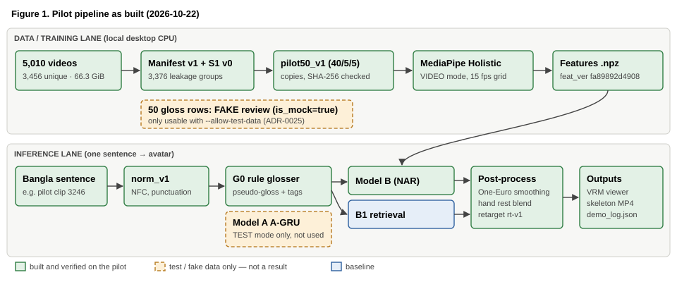
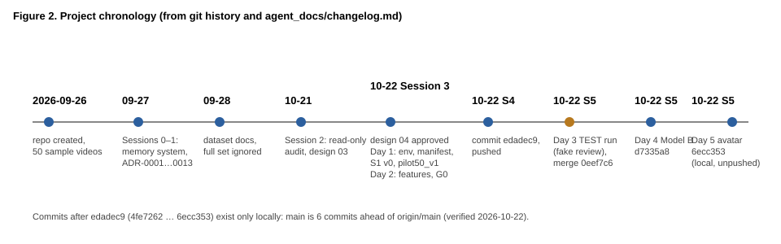
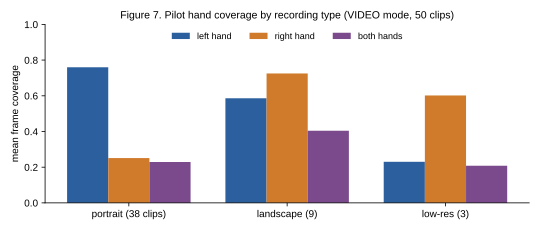
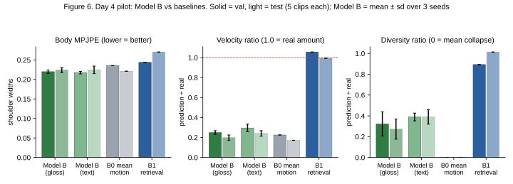

# Bangla Text → BdSL Translation Using a 3D Avatar

## Pilot / Test Version — Complete Evidence-Based Report

**Project:** CSE498R research project (`D:\sign_avatar_cse498r`)

**Scope of this report:** everything actually done from the repository's creation (2026-09-26) to the end of the 5-day prototype (2026-10-22)

**Audit date:** 2026-10-22 (read-only audit, Stage 1; report written in Stage 2 after the owner's approval)

**Repository state audited:** branch `main` at commit `6ecc353` (6 commits ahead of `origin/main` = `edadec9`; not pushed)

**Prepared by:** Claude (AI assistant), from files and measurements in the repository; owner review pending

**Status labels used throughout:** **[VERIFIED]** directly inspected or tested · **[REPORTED]** stated in an earlier log but not re-checked in this audit · **[PLANNED]** intended, not implemented · **[MISSING]** expected but not found · **[UNVERIFIABLE]** cannot be checked with the available evidence · **NOT MEASURED** never measured.

**Important:** every result in this report is a **pilot "pipeline test"** on 50 videos (40 train / 5 validation / 5 test). No result shows generalisation, and nothing has been checked by a BdSL-competent person. The Model A (text → gloss) numbers come from **deliberately fake review data** and appear only in Appendix A.

## Table of contents

1. Executive summary
2. Research objective and complete pipeline
3. Verified project-state inventory
4. Dataset provenance and statistics
5. Chronological implementation history
6. Local environment and hardware
7. Python environment and dependency versions
8. Data inspection, normalization, deduplication and splitting
9. Pilot selection and data handling
10. MediaPipe extraction and actual output schema
11. Feature quality, hand coverage, missing landmarks and failures
12. Gloss conventions, pseudo-glosses and annotation status
13. Model A: Bangla text → gloss
14. Model B: gloss → motion
15. Baselines and comparisons
16. Training configurations, loss curves, checkpoints and seeds
17. Evaluation methods and all available results
18. Avatar integration and end-to-end tests
19. Errors encountered and how they were resolved
20. Reproducibility and checkpoint recovery
21. What worked and what failed
22. Lessons learned
23. Limitations and remaining blockers
24. Changes required before scaling up
25. Evidence index
26. Appendix A: Day 3 Model A TEST run (fake review data)
27. Appendix B: How this report was produced

---

## 1. Executive summary

**What the project is.** A research project that turns a Bangla text sentence into Bangla Sign Language (BdSL) performed by a 3D avatar: Bangla sentence → gloss (Model A) → motion (Model B, on MediaPipe-derived features) → retargeted VRM avatar (design approved in principle on 2026-10-22, ADR-0014–0021).

**What was done in the pilot (all on 2026-10-22, on the owner's step-by-step approval).** **[VERIFIED]**

| Day | Deliverable | Outcome |
|---|---|---|
| Day 1 | Environment, configuration, dataset manifest, leakage-safe split S1 v0, 50-video pilot | done; 8/8 environment checks; 5,010-row manifest; no leakage |
| Day 2 | MediaPipe Holistic features for the pilot; gloss convention v0.1 and 50 automatic gloss drafts | done; 50/50 clips extracted, 0 failures; 50 `auto_draft` rows |
| Day 3 | Model A (text → gloss) code and training | code done; **run only in TEST mode on fake review data** (ADR-0025) |
| Day 4 | Model B (gloss → motion), text ablation, baselines B0/B1 | done; Model B ≈ mean-motion baseline on held-out clips |
| Day 5 | Retargeting, browser VRM avatar viewer, end-to-end demo | done; one sentence → side-by-side Model B and B1 video |

**Headline findings.**

- The pipeline runs end to end, and its engineering safeguards work: checksums, leakage tests, deterministic splits, kill-and-resume tests for extraction and both models (weights bit-identical after resume), a training guard that refuses fake data by default, and 140 passing unit tests. **[VERIFIED]**
- **Model B does not yet learn sign motion.** On 5 validation and 5 test clips its body error equals the mean-motion baseline (test 0.224 vs 0.221 shoulder widths) and it moves at only 20–30% of real speed. With 40 training clips this is expected. **[VERIFIED]**
- **Model A has no real result.** The only review data is fake on purpose (glosses derived from the text, no video watched). **[VERIFIED]**
- Hands are the weak point of the data: MediaPipe finds the left hand in 69.7% and the right hand in 35.7% of pilot frames. **[REPORTED, test_log]**
- The avatar retargeting is accurate as an engineering step (≤ 3.4° bone-direction error on the real avatar), which says nothing about BdSL correctness. **[VERIFIED]**

**Problems found by this audit (must be fixed before scaling up):** a Git line-ending setting changes the checksum of tracked CSV files; every training run was made with uncommitted code (`dirty=True`); notebooks 01–06 were never executed; `README.md` is out of date; Kaggle and Colab were never used. Details in §19–§24.

---

## 2. Research objective and complete pipeline

**Objective (owner-confirmed, ADR-0007).** Input: a Bangla text sentence. Output: BdSL shown by a 3D avatar. Translation is sentence-level and must handle BdSL grammar and word order, not word-by-word lookup. Out of scope: speech input, sign → text. Deliverables: report, literature review, trained model and results, aimed at a publishable paper. Not a medical project; no dialect focus (ADR-0003).

**Pipeline (design doc 04, approved in principle 2026-10-22).**

| Stage | Built in the pilot? | Where |
|---|---|---|
| Text normaliser `norm_v1` | yes [VERIFIED] | `src/bdsl/text/normalize.py` |
| Rule glosser G0 v0.1 (pseudo-glosses) | yes [VERIFIED] | `src/bdsl/text/gloss_rules.py` |
| Model A, BiGRU + attention (A-GRU) | code yes; TEST runs only [VERIFIED] | `src/bdsl/models/text2gloss.py`, `train_text2gloss.py` |
| Model A, BanglaT5 (A-T5) | no [PLANNED] | design doc 04 §D-C2 |
| MediaPipe Holistic extraction | yes, pilot only [VERIFIED] | `src/bdsl/features/extract.py` |
| Model B, non-autoregressive Transformer | yes [VERIFIED] | `src/bdsl/models/gloss2motion.py` |
| Ablation T (Bangla words → motion) | yes [VERIFIED] | `train-gloss2motion --input text` |
| Baselines B0 (mean motion), B1 (retrieval) | yes [VERIFIED] | `src/bdsl/models/baselines.py` |
| Retargeting to VRM bones + browser viewer | yes [VERIFIED] | `src/bdsl/avatar/`, `web/avatar_viewer/` |
| Blender fallback | no [PLANNED] | design doc 04 §F-12 |
| Human / expert evaluation | no [MISSING] | ADR-0020 |

**Three things are kept separate throughout** (gloss convention §1): Bangla word order (the input text), gloss notation (labels for signs), and BdSL grammar (space, face, head, simultaneity — mostly lost in glosses). A G0 output is a *pseudo-gloss*: a function of the Bangla text, never a BdSL annotation.

---

## 3. Verified project-state inventory

All rows were checked in the read-only audit of 2026-10-22 unless labelled otherwise.

| Area | Status | Evidence |
|---|---|---|
| Raw videos | [VERIFIED] 5,010 MP4 + `SESSION_LOG.md` + sheet copy (5,012 entries); 71,206,505,652 B (66.3 GiB) | `dataset/initial_dataset/SIGN_LANGUAGE_DATA/` (gitignored); manifest `bytes` column |
| Sample videos | [VERIFIED] 50 MP4 (767 MB), committed and pushed | `dataset/initial_dataset/videos/` |
| Current sheet | [REPORTED] `FinalSheet2.xlsx`, 5,010 rows, Index 0–5460 unique | dataset README, work log |
| Manifest v1 | [VERIFIED] 5,010 rows, 3,456 unique SHA-256, all decodable; CSV SHA-256 `2ff133cf…` matches its meta | `work/manifests/manifest_v1.csv`, `.meta.json` |
| Split S1 v0 | [VERIFIED] SHA-256 `40481a5f…` matches; 0 SHA-256 / sentence / group crossing splits (re-checked) | `work/splits/S1_v0.csv`, `.meta.json` |
| Pilot selection | [VERIFIED] SHA-256 `8affc876…` matches | `work/pilot/pilot50_v1_selection.*` |
| Pilot copies | [VERIFIED] 50/50 SHA-256 match `pilot50_manifest.csv`; 40/5/5 | `dataset/pilot50_v1/` |
| Environment report | [VERIFIED] overall pass, 2026-10-22T06:50:41Z | `work/reports/env_report.json` |
| MediaPipe model | [VERIFIED] 13,683,609 B, SHA-256 `e2dab611…` | `work/models/holistic_landmarker.task` |
| Pilot features | [VERIFIED] VIDEO `fa89892d4908` and IMAGE `395e878f9861`, 50 clips each, empty `failures.csv` | `work/features/` |
| Annotations | [VERIFIED] 50 rows `team_reviewed` but `is_mock=true`, notes "TEST DATA … not video-verified" (fake on purpose) | `annotations/pilot50_v1_gloss_v01.csv` |
| Reviewer register | [VERIFIED] one code `T1`, role `team`, assigned by owner | `annotations/REVIEWERS.csv` |
| Training runs | [VERIFIED] 12 current + 6 superseded run folders; all 60 checkpoint files load; every run has run/metrics files | `work/runs/` |
| Demo | [VERIFIED] skeleton MP4 (91 frames), two motion JSON files, log, limitations | `work/demo/demo_20261022T141520Z/` |
| Avatar model | [VERIFIED] `Base_Female.vrm` 16,323,872 B, SHA-256 `1995f174…`, CC0 in its metadata | `work/models/vrm/` |
| Unit tests | [VERIFIED] 140 passed | `uv run pytest` |
| Notebooks | [VERIFIED] 7 notebooks, all saved without outputs; only 00 was ever executed (copy in `work/reports/`) | `notebooks/` |
| Kaggle / Colab work | [MISSING] no runs, no uploads, no environment check there; account state [UNVERIFIABLE] | — |
| Real gloss reviews, expert validation, human evaluation | [MISSING] | — |
| Shared-segment scan (G2), QC thresholds (G9), full extraction | [PLANNED] | open_questions G2, G9 |
| Run registry `work/registry.csv`, per-run `env.json` | [MISSING] (planned in design doc 04 §F-16) | — |

---

## 4. Dataset provenance and statistics

**Provenance (ADR-0008, ADR-0017).** Team-owned dataset; permissions secured; the owner has permission to make it public; the repository is public by the owner's choice. A formal reuse licence is not stated (G1). One visible signer per clip; the number of distinct signers is an unverified owner estimate (about 4–6); which signer recorded which clip is unknown and is not inferred (ADR-0018).

| Quantity | Value | Status / evidence |
|---|---|---|
| Videos | 5,010 MP4 | [VERIFIED] manifest |
| Total size | 71,206,505,652 B (66.3 GiB) | [VERIFIED] manifest |
| Unique files (SHA-256) | 3,456 | [VERIFIED] manifest |
| Exact-duplicate groups | 1,516 groups / 3,070 files; 1,424 of the second copies at Index ≥ 4000 | [REPORTED] test_log 2026-10-21 |
| Unique sentences (`norm_v1`) | 3,378 | [REPORTED] test_log Day 1 Step 2 |
| Leakage groups | 3,376; 0 label conflicts | [REPORTED] test_log Day 1 Step 2 |
| Declared duration, all rows | 35,527 s (9.87 h) | [REPORTED] test_log |
| Duration, unique clips | 25,286.8 s ≈ 379,301 frames at 15 fps | [VERIFIED] computed from manifest |
| Duration per clip | min 1.30 s, median 6.37 s, mean 7.10 s, max 47.73 s | [REPORTED] test_log 2026-10-21 |
| Orientation (displayed) | portrait 4,302 (85.9%), landscape 708 | [REPORTED] |
| Rotation flags | 0° 3,142 · 270° 1,838 · 90° 18 · 180° 12 | [REPORTED] |
| Codecs | h264 2,819 · hevc 2,181 · VP9 10 | [REPORTED] |
| Frame rate | ≈30 fps for 4,686 files; ≈29: 262; ≈23–24: 32; ≈59–60: 16 | [REPORTED] |
| Low-resolution clips (short side < 500 px) | 350, all in Index 3675–5415 | [REPORTED] |
| Timestamp irregularity | 5 of 80 sampled clips irregular (≥ 10% CV) | [REPORTED] |
| Words per sentence | 1–13, mean 4.19; vocabulary 1,398–1,417 tokens (normaliser-dependent) | [REPORTED] |
| Colour cluster | 3456/3457/3458 share ~70% identical frames; 5096/5100/5102 are exact copies | [REPORTED] test_log 2026-10-22 |

**Sentence text.** The spelling in the sheet is intentional and is never corrected (CLAUDE.md conventions).

---

## 5. Chronological implementation history

| Date | Session / step | What happened | Evidence |
|---|---|---|---|
| 2026-09-26 | — | Repository created; 50 sample videos committed (`15c9496`) | git log [VERIFIED] |
| 2026-09-27 | Sessions 0–1 | Project memory (`CLAUDE.md`, `agent_docs/`), folder reorganisation, ADR-0001…0013, scope confirmed | changelog [REPORTED] |
| 2026-09-28 | — | Dataset README and work log; full set gitignored (`c2d541d`) | git log, work log |
| 2026-10-21 | Session 2 | Read-only re-audit; design proposal 03 (`1809048`) | changelog |
| 2026-10-22 | Session 3 | Design review 04 approved in principle (ADR-0014–0021); Day 1 (env, manifest, S1 v0, pilot) and Day 2 (features, gloss drafts); ADR-0022–0024 | changelog, test_log |
| 2026-10-22 | Session 4 | 93 tests passed; Day 1–2 work committed and pushed (`edadec9`) | changelog, `origin/main` |
| 2026-10-22 | Session 5 | Pilot review checked twice and found invalid; owner-requested practice run on branch `test-run-fake-review` (`4fe7262`, `de6db35`); merged into `main` (`0eef7c6`, ADR-0025) | git log, ADR-0025 |
| 2026-10-22 | Session 5 | Day 4 Model B (`d7335a8`, ADR-0026); Day 5 avatar demo (`6ecc353`, ADR-0027) | git log |
| 2026-10-22 | This audit | Read-only audit; this report | — |

All commits after `edadec9` are local only (`main` is 6 commits ahead of `origin/main`) **[VERIFIED]**.

---

## 6. Local environment and hardware

| Item | Value | Status |
|---|---|---|
| Computer | `DESKTOP-4NDR99B`, Windows 11 Pro 10.0.26200 | [VERIFIED] |
| CPU | AMD Ryzen 5 3500X, 6 cores / 6 threads | [VERIFIED] |
| RAM | 23.9 GB | [VERIFIED] |
| GPU | AMD Radeon RX 570 (driver 31.0.12027.9001); 8 GB per the 2026-10-21 check (Windows WMI reports a capped 4 GB) | [VERIFIED] name/driver; memory [REPORTED] |
| GPU use by PyTorch | none: torch is the CPU build; CUDA no; DirectML not installed | [VERIFIED] env report |
| Free disk | D: 83.4 GB (dataset drive), C: 121.7 GB | [VERIFIED] 2026-10-22 |
| CPU benchmark | numpy 512×512 matmul ≈ 288–329 GFLOPS; MediaPipe IMAGE mode 33.4–36.6 ms per 1920×1080 frame, single process | [REPORTED] env report |
| Laptop | used for code and small samples (ADR-0016); not inspected | [UNVERIFIABLE] |

---

## 7. Python environment and dependency versions

**Environment.** uv-managed project environment `.venv`, CPython 3.12.13, uv 0.10.8 **[VERIFIED]**. System Python 3.14.4 is separate and is not used by the project (only for this report's Markdown conversion, Appendix B).

| Package | Version | Extra / group | Added |
|---|---|---|---|
| numpy | 2.4.6 | core | Day 1 |
| PyYAML | 6.0.3 | core | Day 1 |
| mediapipe | 0.10.35 | extract | Day 1 |
| opencv-contrib-python | 5.0.0.93 (opencv-python absent) | extract | Day 1 |
| pandas / openpyxl | 3.0.3 / 3.1.5 | extract | Day 1 Step 2 |
| torch | 2.14.1+cpu | train | Day 1 |
| sacrebleu | 2.6.0 (+ lxml 6.1.3, portalocker 4.4.1, regex 2026.9.29, tabulate 0.10.0) | train | Day 3 |
| matplotlib | 3.11.2 (dependency of mediapipe) | — | Day 1 |
| pytest / ipykernel / nbclient / nbformat | 9.1.1 / 7.4.0 / 0.11.0 / 5.11.1 | dev | Day 1 |
| three (browser, jsDelivr) | 0.186.1 | viewer | Day 5 |
| @pixiv/three-vrm (browser, jsDelivr) | 3.5.5 | viewer | Day 5 |

Pins are in `pyproject.toml`; exact resolution in `uv.lock` (96 packages) **[VERIFIED]**. Rebuild: `uv sync --extra extract --extra train`.

---

## 8. Data inspection, normalization, deduplication and splitting

**Manifest v1 (Day 1 Step 2).** Command: `uv run python -m bdsl.cli manifest --data full`. 2 min 23 s with 6 processes. Every video is hashed (SHA-256), probed with OpenCV (size, rotation, frame rate, codec, first frame decoded) and joined to its sheet row. Sources were read-only: size, modification time and the sheet hash were identical before and after **[REPORTED]**. CSV SHA-256 `2ff133cf6bb2…` **[VERIFIED]**.

**Normaliser `norm_v1`.** Unicode NFC, then `। . ? ! ,` → space, then whitespace collapsed. Spelling is never changed. 990 of 5,010 rows change under NFC alone **[REPORTED]**.

**Leakage groups.** A group joins clips with the same normalised sentence, the same SHA-256, or a known shared recorded segment (only the colour cluster so far). 3,376 groups; sizes 1:1,915 · 2:1,380 · 3:35 · 4:30 · 5:3 · 6:7 · 7:2 · 8:1 · 9:1 · 11:2 **[REPORTED]**.

**Split S1 v0 (ADR-0018).** Deterministic 80/10/10 by `sha256(salt | group_id)`, salt `S1-v0`. Groups 2,700 / 357 / 319; representative clips 2,759 / 368 / 329; rows 4,009 / 524 / 477 **[VERIFIED]**. Automatic checks: no group, SHA-256, sentence or known link crosses splits; re-confirmed in this audit (0 / 0 / 0) **[VERIFIED]**. Re-runs are byte-identical **[REPORTED]**.

**Why S1 v0 is provisional.** Different sentences can still share recorded footage: the colour cluster shows one recording edited onto three endings (~70% identical frames). Such clips are invisible to sentence and hash checks. A full shared-segment scan (G2) must run before S1 is frozen as v1. **[PLANNED]**

---

## 9. Pilot selection and data handling

**pilot50_v1** (ADR-0022, owner option B). Drawn from S1 v0: 40 train / 5 val / 5 test.

- **Core:** 6 minimal-pair families × 4 train clips (same length, one word different), plus 16 diversity clips (question, negation, number/time, long, short, other).
- **Held-out clips** were chosen after the train clips, preferring sentences made only of pilot-train words: 6 of 10 held-out clips use only seen words; 4 contain unseen words (listed per clip).
- **Quotas met:** 9 landscape, 3 low-resolution, all duration quartiles.
- **Copies:** 50 clips copied to `dataset/pilot50_v1/videos/` (723 MB, gitignored); originals never modified. 50/50 SHA-256 match **[VERIFIED in this audit]**.
- `sample50` (the committed `videos/`) is a different set from `pilot50_v1`.

---

## 10. MediaPipe extraction and actual output schema

**Process (Day 2 Step 1).** `uv run python -m bdsl.cli extract --data pilot50 --mode both`. OpenCV decode with rotation applied; resampled to a uniform 15 fps grid by nearest source timestamp; a fresh `HolisticLandmarker` per clip; face blendshapes on; documented default thresholds (0.5 / 0.3); 5 worker processes **[REPORTED]**.

| Mode | feat_ver | Clips | Failures | Wall time |
|---|---|---|---|---|
| VIDEO (chosen, ADR-0023) | `fa89892d4908` | 50 | 0 | 138.8 s [VERIFIED extract_run.json] |
| IMAGE (comparison only) | `395e878f9861` | 50 | 0 | 129.2 s [VERIFIED] |

4,806 grid frames from 9,613 source frames per mode; about 7.4 MB per mode **[REPORTED]**. Measured pilot rate: ≈ 34.6 grid frames/s with 5 processes.

**Stored per clip (`feat_layout_v1`, `.npz`)** **[VERIFIED in code and files]**:

| Array | Shape | Meaning |
|---|---|---|
| `t_ms`, `src_t_ms`, `src_frame` | (T,) | grid time, source time, source frame index |
| `pose_world`, `pose_img` | (T, 33, 3) | body landmarks (metres / image coordinates) |
| `pose_vis` | (T, 33) | visibility |
| `lhand_world`, `rhand_world`, `lhand_img`, `rhand_img` | (T, 21, 3) | hands; NaN where missing |
| `blendshapes`, `blendshape_names` | (T, 52), (52,) | face blendshapes |
| `head_rot` | (T, 3) | approximate yaw/pitch/roll (degrees) from 4 face points |
| `mask` | (T, 4) uint8 | present: pose, left hand, right hand, face |
| `meta` | JSON | Index, feat_ver, mode, timing, ts_cv, … |

The raw 478-point face mesh and image data are **never stored** (privacy check on all 150 files) **[REPORTED]**.

**Facts measured during Days 4–5 [VERIFIED]:**
- Missing values are NaN exactly where the mask is 0 (all 50 VIDEO files).
- MediaPipe "left shoulder" has larger x than "right shoulder" in 50/50 clips; y points down.
- **The hand "world" landmarks are not hand-centred.** Their wrist coincides with the pose wrist (distance 0.000 m); the wrist is about 0.55 m from the origin (median). The Day 2 layout note saying "hand-centred" was wrong and was corrected on Day 4.

---

## 11. Feature quality, hand coverage, missing landmarks and failures

**QC values, VIDEO mode, mean over 50 clips** **[REPORTED, test_log Day 2]**:

| Measure | Value |
|---|---|
| Coverage: pose / face | 99.95% / 99.4% |
| Coverage: left hand / right hand / both / any | 69.7% / 35.7% / 25.9% / 79.5% |
| Longest hand gap | left median 0.67 s (max 4.9 s); right median 1.7 s (max 11.9 s, clip 792) |
| Forearm-length coefficient of variation | ≈ 0.15 |
| Wrist jitter | left 15.8 m/s², right 19.0 m/s² (IMAGE mode: 19.6 / 24.8) |
| Timestamp irregularity (ts_cv) | max 0.064, median 0 |
| Hand label agrees with body wrists | median 0.90, minimum 0.49 |
| Extraction failures | 0 of 50 per mode |

**Interpretation (cautious).** Left > right in 40 of 50 clips, and portrait clips show the strongest imbalance. Whether some recordings are mirrored (so MediaPipe's "left" is the signer's right) is unknown (G8). No quality thresholds have been set (G9); no clip was excluded. After interpolating gaps ≤ 5 frames (Day 4), train-split coverage is left 74.1% / right 42.3% **[VERIFIED, Day 4 run.json]**.

---

## 12. Gloss conventions, pseudo-glosses and annotation status

**Convention v0.1** (`annotations/GLOSS_CONVENTION_v0.1.md`, provisional, ADR-0015): one token per sign in signing order; citation forms; tense in `tense_note`; special tokens `NOT`, `NOT.BE`, `NOT.HAVE`, `FS(…)`, `NUM(…)`, `UNK(…)`; tags `neg`, `q-wh`, `q-yn`. Not checked by a BdSL-competent person.

**G0 v0.1 rule glosser** (ADR-0024): never reorders words and never guesses a lemma. Over the 219 pilot tokens: R0 pronoun 46, R1 negation 4, R2 wh-word 1, R2b কি/কী 4, R3 number 1, R4 Latin 1, R5 genitive stem 5, R6 no rule 157 **[REPORTED]**. Drafts are deterministic (re-run byte-identical).

**Statuses:** `auto_draft` → `team_reviewed` → `expert_validated`, or `rejected`. Only a registered reviewer sets a reviewed status; the AI never does.

**What happened to the pilot review (Session 5)** **[VERIFIED from the session record and files]:**

| Version | Content | Check result |
|---|---|---|
| 1 | 50 rows `team_reviewed` by T1, role `reviewer`, notes "drafted from sentence text; video not checked" | failed: role not allowed; rows did not meet the definition of `team_reviewed` |
| 2 | role fixed to `team`; all rows `is_mock=true`, notes "TEST DATA: glosses derived from sentence text, not video-verified" | normal check fails (100 problems); accepted only with `--allow-test-data` |

**Current state:** 50 rows, all fake on purpose (owner decision, ADR-0025). **Real annotations: 0. Mock / test annotations: 50.** Normal `gloss-validate` exits 1; test mode exits 0 **[VERIFIED]**.

---

## 13. Model A: Bangla text → gloss

**Implementation [VERIFIED in code].** A-GRU: embedding 128, BiGRU 256 per direction, Bahdanau attention 256, GRU decoder 256, dropout 0.2, beam 4; label smoothing 0.1; Adam 1e-3, batch 8, ≤ 300 epochs, early stopping on validation gloss WER (patience 30); tag tokens (`<neg>`, `<q-wh>`, `<q-yn>`) prefixed to the target. 1,713,752 parameters on the pilot vocabulary (source 98, target 88). Command: `train-text2gloss` (refuses unless `gloss-validate` is clean).

**Results: NONE that count.** The only available references are fake. The TEST-mode numbers (which include G0 vs A-GRU, overfit and resume checks) are in **Appendix A**, labelled as such, and must never be cited as Model A performance.

**What is needed for a real result:** a real video review of the pilot rows, then at least 300 reviewed pairs for a meaningful held-out estimate (design doc 04 §D-C2).

---

## 14. Model B: gloss → motion

**Inputs.** G0 pseudo-glosses (`gloss_auto` with markers removed, plus G0 tag tokens), not reviewed glosses (ADR-0014). Ablation T uses the normalised Bangla words instead.

**Motion representation (ADR-0026) [VERIFIED in code].** 208 values per frame at 15 fps:

| Part | Values | Normalisation |
|---|---|---|
| Body | 27 = 9 points × 3 (nose, shoulders, elbows, wrists, hips) | centred on the shoulder midpoint, divided by the clip's mean shoulder width |
| Left hand / right hand | 63 + 63 = 21 points × 3 each | minus the hand's own wrist (hand shape, metres); MediaPipe labels as given (G8) |
| Face | 55 = 52 blendshapes + yaw/pitch/roll | raw |

Hand gaps ≤ 5 frames are interpolated and flagged; longer gaps stay masked. Values are standardised with means/SDs from the training clips' present values only.

**Model [VERIFIED in code].** Non-autoregressive Transformer: token embedding (d = 192) → 3-layer encoder (4 heads, feed-forward 512, dropout 0.1) → length head (log frame count); decoder: one query per output frame from a sinusoidal code of normalised time (1–128 cycles), 3 layers → linear to 208 values. 2,663,441 parameters (gloss vocabulary 100). Training uses the true length; inference the predicted length.

**Loss (owner OK, ADR-0026).** Masked L1 on positions (hands × 2) + 0.5 × masked L1 on frame-to-frame velocity + 0.1 × |log length error|. Missing values and padding contribute nothing (unit-tested: zero gradient).

**Training.** AdamW 5e-4, weight decay 0.01, batch 8, ≤ 600 epochs, early stopping on validation masked position L1 (patience 60), gradient clip 1.0, seeds 42/43/44, CPU with 2 threads per run.

**Results:** §17. In short, Model B ≈ B0 on held-out clips and moves far less than real signing.

---

## 15. Baselines and comparisons

| Baseline | Definition | Status |
|---|---|---|
| G0 (for Model A) | the rule draft with markers removed | implemented [VERIFIED]; only compared on fake references |
| B0 mean motion | all training clips time-normalised to 64 steps, averaged over present values, stretched to the median training length | implemented [VERIFIED] |
| B1 retrieval | the real recorded motion of the training sentence with the highest gloss-token Jaccard overlap (ties → lowest Index; never the item itself) | implemented [VERIFIED] |
| Ablation T | Model B with Bangla words as input instead of glosses | implemented [VERIFIED] |
| A-T5 (BanglaT5) | fine-tuned pretrained model | [PLANNED]; needs ≥ 300 reviewed pairs and a model download (approval) |

---

## 16. Training configurations, loss curves, checkpoints and seeds

| Run ID (`work/runs/…`) | Purpose | Data | Seeds | Epochs (best) | Checkpoints | Status |
|---|---|---|---|---|---|---|
| `gloss2motion_gloss_overfit1_pilot50_20261022T133821Z` | overfit 1 clip | 1 train clip | 42 | 400 (fixed) | last + best | current |
| `gloss2motion_gloss_overfit40_pilot50_20261022T134024Z` | overfit 40 clips | 40 train | 42 | 400 (fixed) | last + best | current |
| `gloss2motion_gloss_pilot50_20261022T133822Z` | Model B, gloss input | 40/5/5 | 42, 43, 44 | 97 (37), 86 (26), 98 (38) | 6 files | current |
| `gloss2motion_text_pilot50_20261022T133822Z` | ablation T, text input | 40/5/5 | 42, 43, 44 | 108 (48), 105 (45), 96 (36) | 6 files | current |
| `gloss2motion_gloss_pilot50_20261022T134800Z` | kill-and-resume test | 40/5/5 | 42 | killed at 50, resumed | 2 files | current |
| `_superseded_day4_hand_offset/…` (6 folders) | before the hand-coordinate fix | — | — | — | — | superseded |
| `TEST_text2gloss_…` (7 folders) | Model A TEST runs | fake references | — | — | — | TEST only (Appendix A) |

**Checkpoint content [VERIFIED]:** model weights, optimiser state, training state (epoch, best score, history), torch RNG and batch-order RNG states, and a meta block (input and config hashes, vocabulary hash, standardiser hash, label, seed). Resume refuses if any hash differs. Sizes for one Model B seed: `ckpt_best.pt` 10.7 MB, `ckpt_last.pt` 32.1 MB; all 60 checkpoint files total 1.1 GB. All load **[VERIFIED]**.

**Loss curves:** per seed in `seed<N>/curves.csv` (training total/position/velocity/length losses and the monitored validation L1 per epoch) **[VERIFIED present]**. Overfit 1 clip: monitored L1 0.808 → 0.041 (5.1%); overfit 40 clips: 0.707 → 0.136 (19.2%) **[REPORTED, test_log Day 4]**.

---

## 17. Evaluation methods and all available results

**Metrics implemented [VERIFIED in code, unit-tested].**
- Model A: gloss WER (corpus-level), exact match, tag accuracy, BLEU-4 and chrF via sacreBLEU 2.6.0.
- Model B: MPJPE per body part after time-normalising the prediction to the true length; DTW-MJE (val/test only); duration error; velocity and jerk ratios; hand-energy ratio (wrist speed²); diversity ratio (pairwise distance between predictions ÷ the same for real motion; 0 = every sentence gets the same motion).
- Units: body in shoulder widths, hands in millimetres (wrist-relative shape), face = mean absolute blendshape error.

**Model B results — pilot pipeline test, 5 clips per held-out split, signer-dependent [VERIFIED from metrics.json].** Model B = mean over seeds 42/43/44 (SD ≤ 0.01 body, ≤ 6 mm hands).

| Split | Method | Body MPJPE | Hands L / R (mm) | DTW body | Duration error (s) | Velocity ratio | Hand-energy ratio | Diversity ratio |
|---|---|---|---|---|---|---|---|---|
| val | Model B (gloss) | 0.220 | 63.7 / 57.2 | 0.199 | 3.18 | 0.25 | 0.07 | 0.32 |
| val | Model B (text) | 0.217 | 60.0 / 61.1 | 0.199 | 2.99 | 0.30 | 0.09 | 0.39 |
| val | B0 | 0.235 | 63.2 / 57.1 | 0.215 | 3.20 | 0.23 | 0.05 | 0.00 |
| val | B1 | 0.244 | 73.4 / 69.0 | 0.210 | 3.76 | 1.06 | 1.30 | 0.89 |
| test | Model B (gloss) | 0.224 | 55.9 / 65.3 | 0.209 | 1.91 | 0.20 | 0.05 | 0.27 |
| test | Model B (text) | 0.224 | 58.4 / 65.1 | 0.207 | 2.28 | 0.24 | 0.07 | 0.39 |
| test | B0 | 0.221 | 58.2 / 59.7 | 0.208 | 2.08 | 0.17 | 0.04 | 0.00 |
| test | B1 | 0.270 | 63.2 / 75.2 | 0.233 | 2.03 | 0.99 | 1.64 | 1.01 |

**Training-split check (overfit 40):** Model B body 0.107 vs B0 0.216; hands 23.8 / 24.8 mm vs B0 51.8 / 59.6 mm — the model can fit what it has seen **[REPORTED, test_log]**.

**What these numbers do and do not mean.**
- They show the code runs, the loss is masked correctly, and the model can memorise.
- They do **not** show generalisation: 5 items per split, no confidence intervals (NOT MEASURED), signer-dependent.
- Low coordinate error does **not** mean correct BdSL: B0 has competitive error while being the same motion for every sentence. Linguistic correctness needs BdSL-competent human judgement (NOT MEASURED).

**Model A results:** none valid (Appendix A for TEST numbers). **Human evaluation, expert validation, inter-annotator agreement:** NOT MEASURED.

---

## 18. Avatar integration and end-to-end tests

**Demo command (Day 5).** `uv run python -m bdsl.cli demo --sentence "<sentence of clip 3246>"` → `work/demo/demo_20261022T141520Z/` **[VERIFIED]**.

| Step | Detail | Result |
|---|---|---|
| Text → gloss | G0 (Model A not used) | "আমি স্কুল? যাই?" — no unknown tokens |
| Model B | gloss run `…T133822Z`, seed 42, best checkpoint SHA-256 `b7639820…` | 91 predicted frames |
| B1 | most similar training sentence | clip 3225 "আমি সোমবার স্কুল এ যাই", 79 frames, hand coverage L 0.81 / R 0.51 |
| Input checks | run inputs, vocabulary and standardiser hashes vs the training run | all pass |
| Post-processing | One-Euro filter (min cutoff 1.0, β 0.3) on body + hands; hands blend to rest over 3 frames where missing | — |
| Retargeting `rt-v1` | MediaPipe → VRM 1.0 model space via S = diag(1, −1, −1); parent-first swing/frame/head solving | — |
| Outputs | `motion_modelB.json`, `motion_B1.json`, `skeleton_side_by_side.mp4`, `demo_log.json`, `LIMITATIONS.md` | present |

**Round-trip checks.**
- Python, canonical T-pose skeleton, all 50 pilot recordings (4,806 frames): max error ≤ 2.5 × 10⁻⁶ degrees — exact by construction; it checks the quaternion maths only **[VERIFIED, demo_log.json]**.
- Real avatar in the browser (three-vrm, after normalised → raw bone transfer): Model B body mean 0.50° (max 3.42°), hands and fingers ≈ 0°; B1 body 0.35° (max 2.79°) **[REPORTED, test_log Day 5; viewer-computed, not stored in a file]**. The body error is not broken down per bone (likely the torso measurement from the hips).

**Viewer** (`web/avatar_viewer/`, served locally by `http.server` on 127.0.0.1): two avatars side by side, labels, Bangla sentence, mirror toggle, `.webm` recording (1.1 MB test recording produced as a save link, not downloaded); plays at 15 fps; no console errors **[REPORTED, test_log Day 5]**. Render FPS and latency: NOT MEASURED.

**Engineering demo vs sign-language evidence.** The demo proves that a sentence flows through every stage and is rendered faithfully. It proves nothing about whether the signing is correct or understandable; no signer has seen it.

---

## 19. Errors encountered and how they were resolved

| When | Problem | Resolution | Status |
|---|---|---|---|
| Session 2 | PyAV 17.1 segfaulted in a long demux loop; PyAV does not report rotation | OpenCV used instead | resolved |
| Day 1 Step 1 | Environment check failed `torch_devices` (wrong constant in the check) | compare with numpy | fixed |
| Day 1 Step 2 | pandas `index` column clash; synthetic tests used Latin digits; stale protocol text | fixed before the real run | fixed |
| Day 1 Step 2 | First pilot rule (option A) gave 1/10 held-out clips with seen words | owner chose option B (ADR-0022) | superseded |
| Day 2 Step 2 | a test passed expected outputs through `norm_v1` (strips `?`) | fixed | fixed |
| Day 3 | Pilot review invalid twice (wrong role; "video not checked"; then `is_mock=true`) | owner chose a labelled practice run (ADR-0025) | open: real review needed |
| Day 3 | Overfit stop judged by greedy decoding while scoring used beam search | overfit judged with beam search | fixed |
| Day 3 | Resume ignored the run's original seeds | resume keeps them; mismatch refused | fixed |
| Day 4 | Decoder time code too coarse to tell neighbouring frames apart | 1–128 cycles per clip | fixed |
| Day 4 | Hand world points assumed hand-centred (wrong) | wrist-relative hands; 6 runs superseded | fixed |
| Day 4 | A test compared NaN values as unequal | compare via JSON text | fixed |
| Day 5 | A zero-length hand vector crashed the solver | degenerate frames handled | fixed |
| Day 5 | Negative first time-step crashed the viewer | clamped at 0 | fixed |
| Day 5 | Viewer measured fingertip bones with the previous bone (mean 19° error) | measure via the bone's own rotation | fixed |
| Day 5 | VRM path under `avatar:` changed the config hash when the work folder moved | moved under `paths:` | fixed |
| This audit | Git `core.autocrlf=true`, no `.gitattributes`: the working-copy annotation CSV hashes `9cd37d3d…` but the committed blob (and the Day 3 runs' record) is `a0be4e91…` | not fixed (needs owner OK) | open |
| This audit | every `run.json` says `dirty=True` (uncommitted code at run time) | not fixed | open |
| This audit | `README.md` status out of date; `configs/data/pilot50.yaml` says the pilot folder "does not exist yet" | not fixed | open |

---

## 20. Reproducibility and checkpoint recovery

**What is in place [VERIFIED].**
- Layered configuration with a machine-independent config hash; outputs move with `BDSL_WORK_DIR` without changing the hash.
- Deterministic manifest, split and pilot selection (re-runs byte-identical [REPORTED]).
- Every training run writes `run.json` (inputs, hashes, versions, git commit and dirty flag, vocabulary sizes, parameter count) and refuses to resume when inputs change.
- Kill-and-resume tests, each with a real process kill:
  - extraction (killed with 10 clips done; resume array-identical) [REPORTED];
  - Model A TEST run (killed after epoch 20; weights identical) [REPORTED];
  - Model B (killed at epoch 50; last and best checkpoints weight-identical; metrics identical) [REPORTED].
- Atomic writes for every output (temporary file + rename).

**Gaps [VERIFIED].**
- Runs were made with uncommitted code (`dirty=True`): Day 3 at `4fe7262` + changes, Day 4 at `4d8abbc` + changes, the demo at `d7335a8` + changes. The committed code is believed equivalent, but this is **[REPORTED]**, not verified.
- File hashes of tracked CSVs depend on the checkout's line endings (§19).
- No per-run `env.json` (full package list), no run registry.
- Notebooks 01–06 never executed; only the CLI paths are tested in practice.
- Superseded run folders remain in `work/` (clearly labelled).

---

## 21. What worked and what failed

**Worked.**
- Step-by-step, owner-approved implementation with acceptance tests at each step.
- Data hygiene: hashing, deduplication, leakage groups, deterministic split, privacy-minimised features.
- Guard rails: fake or mock annotation data is refused by default; TEST outputs are unmistakably labelled.
- Recovery: real kill-and-resume tests pass for extraction and both models.
- End-to-end engineering: sentence → motion → VRM avatar and skeleton video with a versioned log.

**Failed or not achieved.**
- No real human gloss review → no real Model A result.
- Model B does not beat the mean-motion baseline on held-out clips (40 training clips).
- Hand detection is weak (right hand 35.7% of frames), and hand sides may be mirrored (G8 unknown).
- Kaggle/Colab training never started; no GPU training was done, and the training code cannot yet use a GPU (§24, item 11).
- No BdSL-competent evaluation of anything.

---

## 22. Lessons learned

1. **Measure before assuming:** two assumptions written in the docs were wrong (hand world points are not hand-centred; Holistic hand points share the pose frame). Small measurements caught both.
2. **Overfit tests catch real bugs:** the coarse time code and the greedy-vs-beam mismatch were found only because a 1-clip overfit failed to reach its target.
3. **Human annotation is the critical path.** It cannot be automated, and invalid "reviews" were caught only because the validator and the notes were checked.
4. **Byte hashes need fixed line endings:** Git's line-ending conversion silently changed a tracked file's checksum.
5. **Commit before training:** a run should record a clean commit, or it cannot be reproduced exactly.
6. **Baselines are essential:** without B0, Model B's error numbers would have looked like progress.

---

## 23. Limitations and remaining blockers

**Limitations of all results.** Pilot size (5 val / 5 test clips); signer-dependent (signers unknown); pseudo-glosses only; MediaPipe noise (monocular depth, missing hands); possibly mirrored recordings; templated sentences (minimal-pair families); no human evaluation.

**Blockers (owner input).**

| ID | Blocker | Blocks |
|---|---|---|
| G10 | Real team review of gloss rows (who, how many per day) | Model A, any grammar claim |
| G6 | Deadline of the one-month deliverable | the whole schedule |
| G3 | Kaggle account readiness and limits | GPU training |
| G9 | QC thresholds for weak clips | full-set training data definition |
| G8 | Hand sides / mirroring | avatar correctness, dominant-hand claims |
| G2 | Shared-segment scan | freezing split S1 v1 |
| G1 | Reuse licence for the public dataset | publication of data/features |
| — | BdSL-competent reviewer availability (F2: "later") | expert validation, human evaluation |
| — | Push decision (history contains labelled fake rows) | publishing the code |

---

## 24. Changes required before scaling up

| # | Change | Why | Approval |
|---|---|---|---|
| 1 | Add `.gitattributes` (e.g. CSV/MD/PY with fixed `eol=lf`) or hash parsed content | stable checksums across checkouts | owner |
| 2 | Commit before every training run; refuse `dirty=True` runs for reported results | exact reproducibility | owner |
| 3 | Extend `extract` to the full set, extracting each unique SHA-256 once | CLI currently refuses anything except `pilot50` | owner go |
| 4 | Shared-segment scan and S1 v1 freeze; a test-set lock | leakage safety | owner go |
| 5 | Full QC report and owner-chosen thresholds | data definition | owner (G9) |
| 6 | Review-batch tooling and a real review of the pilot rows, then 300–500 train rows | Model A | owner (G10) |
| 7 | Model B data loader on representatives only; B1 must exclude exact copies of the query | avoid duplicate leakage in B1 | owner go |
| 8 | Run registry, per-run `env.json`, bootstrap confidence intervals | reporting | owner go |
| 9 | Kaggle export with `UPLOAD_MANIFEST.csv` and pre-upload check | approved upload only | owner (ADR-0017) |
| 10 | Update `README.md` and the stale config comment | accuracy | owner |
| 11 | Add device support (`cuda` when available) to both training loops | the code never moves models or tensors to a GPU (verified: no `.to(device)` in `src/bdsl/models/`); `configs/env/kaggle.yaml` sets `device: cuda`, but training does not use it, so Kaggle runs would be CPU-only today | owner go |

The full step-by-step plan is in `research/design_proposals/05_FULL_DATASET_EXECUTION_PLAN.md`.

---

## 25. Evidence index

| Evidence | Path | Identifier |
|---|---|---|
| Project rules and memory | `CLAUDE.md`, `agent_docs/*.md` | — |
| Decisions | `agent_docs/decisions.md` | ADR-0001 … ADR-0027 |
| Test log | `agent_docs/test_log.md` | entries 2026-09-27 … 2026-10-22 |
| Dataset log | `dataset/initial_dataset/DATASET_WORK_LOG.md` | entries 2026-09-28 … 2026-10-22 |
| Design proposals | `research/design_proposals/03_…`, `04_…` | 04 approved in principle |
| Manifest v1 | `work/manifests/manifest_v1.csv` (+ `.meta.json`) | SHA-256 `2ff133cf6bb2ec33…` |
| Split S1 v0 | `work/splits/S1_v0.csv` (+ meta) | SHA-256 `40481a5faedc962a…` |
| Pilot selection | `work/pilot/pilot50_v1_selection.csv` | SHA-256 `8affc876aacecf78…` |
| Pilot manifest | `dataset/pilot50_v1/pilot50_manifest.csv`, `SELECTION_PROTOCOL.md` | SHA-256 `e6d7265a214e2b64…` |
| Environment report | `work/reports/env_report.json`, `00_env_check.executed.ipynb` | 2026-10-22T06:50:41Z |
| Features | `work/features/fa89892d4908/` (`qc.csv`, `failures.csv`, `extract_run.json`) | feat_ver `fa89892d4908` |
| Mode comparison | `work/features/compare_pilot50.json` | — |
| Annotations | `annotations/` | committed blob `a0be4e91…` (fake rows) |
| Model A TEST runs | `work/runs/TEST_text2gloss_*` | code commit `de6db35` |
| Model B runs | `work/runs/gloss2motion_*` | code commit `d7335a8` |
| Demo | `work/demo/demo_20261022T141520Z/` | code commit `6ecc353` |
| Avatar model | `work/models/vrm/Base_Female.vrm` | SHA-256 `1995f174f6c8f221…` |
| MediaPipe model | `work/models/holistic_landmarker.task` | SHA-256 `e2dab61191e2dcd0…` |
| Code | `src/bdsl/`, `web/avatar_viewer/`, `tests/` (140 tests) | `main` @ `6ecc353` |
| Git | local `main` 6 ahead of `origin/main` (`edadec9`) | branch `test-run-fake-review` also present |

Everything under `work/` and the full video set are gitignored and exist only on the desktop.

---

## 26. Appendix A: Day 3 Model A TEST run (fake review data)

> **TEST RUN — NOT A RESULT.** The references were derived from the sentence text; no video was watched (`is_mock=true`, ADR-0025). G0 is favoured because the references were made by editing its drafts. These numbers must never be cited as Model A performance.

**Setup.** Branch `test-run-fake-review`, code `de6db35`; `train-text2gloss --allow-test-data`; every output named `TEST_…` with `TEST_RUN: true`. Run `TEST_text2gloss_pilot50_20261022T125820Z`, 46 s on CPU, seeds 42/43/44 (best epochs 9/20/11).

| Split | G0 WER | G0 exact | A-GRU WER (mean ± sd) | A-GRU exact | A-GRU tags | A-GRU BLEU-4 | A-GRU chrF |
|---|---|---|---|---|---|---|---|
| train (40) | 34.5 | 15% | 1.4 ± 1.5 | 94% | 99% | 97.2 | 98.8 |
| val (5) | 33.3 | 20% | 68.3 ± 7.3 | 0% | 87% | 8.4 | 33.8 |
| test (5) | 33.3 | 0% | 69.8 ± 13.7 | 0% | 87% | 9.7 | 38.6 |

**Engineering checks that are valid regardless of the fake data:** the guard refuses fake data without the option (exit 2); overfit 1 sentence → 100% exact at epoch 4; overfit 40 → 100% at epoch 12; a process killed after epoch 20 resumed to weight-identical checkpoints; every output file carries the `TEST_` prefix (0 exceptions) **[REPORTED, test_log]**.

---

## 27. Appendix B: How this report was produced

- **Sources:** the files listed in §25, read in a read-only audit on 2026-10-22; PDFs in `research/papers/` were not read (ADR-0006).
- **Checks run during the audit:** SHA-256 of manifest, split, pilot selection, annotation files, models and the 50 pilot copies; leakage re-check on S1 v0; loading of all 60 checkpoints; `uv run pytest` (140 passed); `gloss-validate` with and without the test option; hardware and disk queries; Git history.
- **Figures:** Figures 1–5 are hand-drawn SVG; Figures 6–7 were generated with matplotlib 3.11.2 from `metrics.json` and the logged QC values.
- **PDF:** converted from this Markdown with `markdown-it-py` 4.2.0 (system Python 3.14.4, already installed) and printed with headless Google Chrome; see `research/reports/build_reports.py`.
